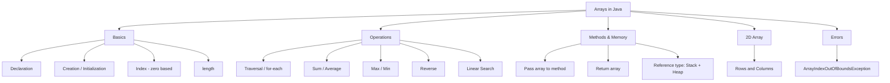
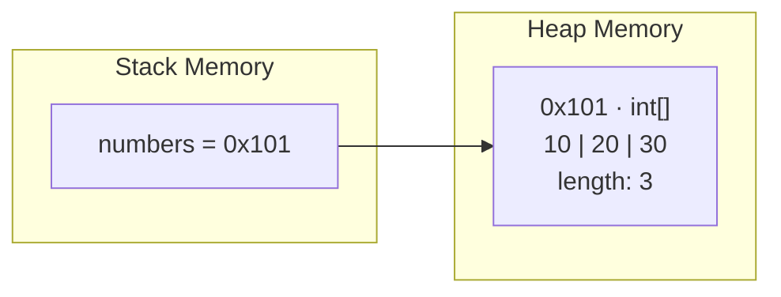
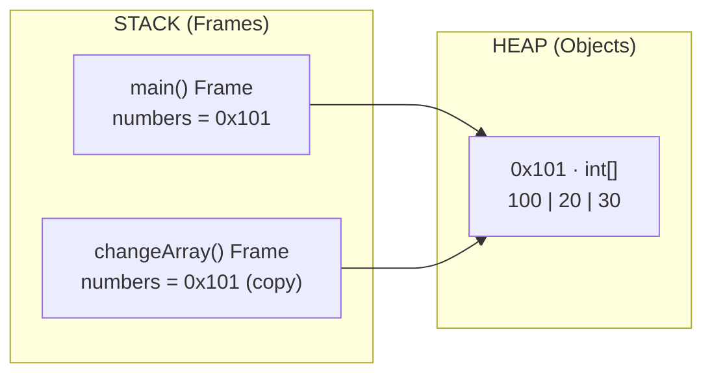

# 📚 Arrays in Java

আজকের topic: **Arrays**

**Array** ব্যবহার করা হয় একই data type-এর **একাধিক value** একটি single variable structure-এর মধ্যে store করতে।

> Array Java foundation এবং **Data Structure**-এর core topic-এর একটি অংশ।

## 🗺️ Arrays Overview



## 📚 আজকে শিখবে

1. What is an Array
2. Array Declaration
3. Array Initialization
4. Index
5. Access & Update
6. Traversing an Array
7. Array Length
8. Taking Input in Array
9. Sum / Average
10. Maximum / Minimum
11. Reverse Array
12. Linear Search
13. Enhanced for-loop
14. Passing Array to Method
15. Returning Array from Method
16. 2D Array Basics
17. Common Errors
18. Interview Questions

## 📑 Table of Contents

1. [What is an Array?](#1-what-is-an-array)
2. [Important Characteristics of Array](#2-important-characteristics-of-array)
3. [Array Index](#3-array-index)
4. [Array Declaration](#4-array-declaration)
5. [Array Creation](#5-array-creation)
6. [Array Initialization](#6-array-initialization)
7. [Access Array Element](#7-access-array-element)
8. [Update Array Element](#8-update-array-element)
9. [Default Values in Array](#9-default-values-in-array)
10. [Array Length](#10-array-length)
11. [Traversing an Array](#11-traversing-an-array)
12. [কেন i < array.length?](#12-কেন-i--arraylength)
13. [Enhanced For Loop / For-Each Loop](#13-enhanced-for-loop--for-each-loop)
14. [Normal for vs For-Each](#14-normal-for-vs-for-each)
15. [Sum of Array Elements](#15-sum-of-array-elements)
16. [Average of Array](#16-average-of-array)
17. [Find Maximum Value](#17-find-maximum-value)
18. [Maximum Logic](#18-maximum-logic)
19. [Find Minimum Value](#19-find-minimum-value)
20. [Count Even Numbers](#20-count-even-numbers)
21. [Print Even Elements](#21-print-even-elements)
22. [Reverse Traversal](#22-reverse-traversal)
23. [Reverse an Array Properly](#23-reverse-an-array-properly)
24. [Linear Search](#24-linear-search)
25. [Find Index of Target](#25-find-index-of-target)
26. [Linear Search Method](#26-linear-search-method)
27. [Taking Array Input with Scanner](#27-taking-array-input-with-scanner)
28. [Dynamic Size from User](#28-dynamic-size-from-user)
29. [Array Passed to Method](#29-array-passed-to-method)
30. [Sum Method](#30-sum-method)
31. [Returning an Array from Method](#31-returning-an-array-from-method)
32. [Arrays Are Reference Types](#32-arrays-are-reference-types)
33. [Important Example — Array and Methods](#33-important-example--array-and-methods)
34. [Java is Still Pass by Value](#34-java-is-still-pass-by-value)
35. [Array Copy Problem](#35-array-copy-problem)
36. [Copy an Array](#36-copy-an-array)
37. [Arrays.toString()](#37-arraystostring)
38. [Direct Array Print করলে কী হয়?](#38-direct-array-print-করলে-কী-হয়)
39. [Array Sorting](#39-array-sorting)
40. [2D Array](#40-2d-array)
41. [Access 2D Array](#41-access-2d-array)
42. [Traverse 2D Array](#42-traverse-2d-array)
43. [For-Each with 2D Array](#43-for-each-with-2d-array)
44. [Common Error — ArrayIndexOutOfBoundsException](#44-common-error--arrayindexoutofboundsexception)
45. [Common Mistake](#45-common-mistake)
46. [Common Mistake — Hardcoded Length](#46-common-mistake--hardcoded-length)
47. [Common Mistake — Empty Array Max](#47-common-mistake--empty-array-max)
48. [Array vs Normal Variable](#48-array-vs-normal-variable)
49. [Array vs ArrayList — Basic Idea](#49-array-vs-arraylist--basic-idea)
50. [Day 7 Quick Summary](#-day-7-quick-summary)
51. [Day 7 Most Important Concepts](#-day-7-most-important-concepts)
52. [Day 7 Practice Problems](#-day-7-practice-problems)
53. [Important Practice — Second Largest](#-important-practice--second-largest)
54. [Mini Project — Student Marks Analyzer](#-mini-project--student-marks-analyzer)
55. [Day 7 Interview Questions](#-day-7-interview-questions)
56. [Day 7 Coding File](#-day-7-coding-file)

---

## 1. What is an Array?

ধরো ৫ জন student-এর marks রাখতে হবে।

### Array ছাড়া

```java
int mark1 = 80;
int mark2 = 75;
int mark3 = 90;
int mark4 = 67;
int mark5 = 88;
```

এভাবে অনেক variable লাগবে।

### Array ব্যবহার করলে

```java
int[] marks = {80, 75, 90, 67, 88};
```

এখন একটা variable `marks`-এর মধ্যে multiple integer value রাখা হয়েছে।

> **Array = same data type-এর multiple values-এর collection**

---

## 2. Important Characteristics of Array

Java array সম্পর্কে কয়েকটা গুরুত্বপূর্ণ বিষয়:

- **Fixed size**
- **Same data type**
- **Index-based**
- **Zero-based indexing**
- Can store **primitive or object references**

```java
int[] numbers = {10, 20, 30, 40};
```

এখানে array size = `4`

| Index | Value |
| ----- | ----- |
| 0     | 10    |
| 1     | 20    |
| 2     | 30    |
| 3     | 40    |

---

## 3. Array Index

Array index শুরু হয় **`0`** থেকে। `1` থেকে না।

```java
int[] numbers = {10, 20, 30, 40};
```

### Visualization

```
Value:   10   20   30   40
Index:    0    1    2    3
```

তাই:

```java
System.out.println(numbers[0]);
```

**Output:**

```
10
```

আর:

```java
System.out.println(numbers[2]);
```

**Output:**

```
30
```

---

## 4. Array Declaration

### Syntax

```java
dataType[] arrayName;
```

### Example

```java
int[] numbers;
```

আরেকটা valid syntax:

```java
int numbers[];
```

কিন্তু **recommended:** `int[] numbers;` — কারণ এটা বেশি readable।

---

## 5. Array Creation

শুধু declare:

```java
int[] numbers;
```

এখনো **actual array তৈরি হয়নি**।

Array create করতে:

```java
numbers = new int[5];
```

Full:

```java
int[] numbers = new int[5];
```

এখানে array-এর size `5`, Indexes: `0`, `1`, `2`, `3`, `4`

---

## 6. Array Initialization

### Method 1

```java
int[] numbers = new int[5];

numbers[0] = 10;
numbers[1] = 20;
numbers[2] = 30;
numbers[3] = 40;
numbers[4] = 50;
```

### Method 2

```java
int[] numbers = {10, 20, 30, 40, 50};
```

দ্বিতীয়টা **short এবং convenient**।

---

## 7. Access Array Element

```java
int[] numbers = {10, 20, 30};

System.out.println(numbers[0]);
```

**Output:**

```
10
```

```java
System.out.println(numbers[1]);
```

**Output:**

```
20
```

---

## 8. Update Array Element

```java
int[] numbers = {10, 20, 30};

numbers[1] = 100;

System.out.println(numbers[1]);
```

**Output:**

```
100
```

Array এখন: `10 100 30`

---

## 9. Default Values in Array

যখন `int[] numbers = new int[5];` লেখা হয়, Java automatically **default values** দেয়।

For `int`: `0`

```java
int[] numbers = new int[3];

System.out.println(numbers[0]);
```

**Output:**

```
0
```

### Common defaults

| Type             | Default value  |
| ---------------- | -------------- |
| `int`            | `0`            |
| `double`         | `0.0`          |
| `boolean`        | `false`        |
| `char`           | `'\u0000'`     |
| object reference | `null`         |

---

## 10. Array Length

Array-এর size জানতে: `array.length`

```java
int[] numbers = {10, 20, 30, 40};

System.out.println(numbers.length);
```

**Output:**

```
4
```

### ⚠️ Important

| Type   | Length                |
| ------ | --------------------- |
| Array  | `length` (parentheses নেই) |
| String | `length()`            |

---

## 11. Traversing an Array

Array-এর সব element একে একে access করাকে **traversal** বলা হয়।

```java
int[] numbers = {10, 20, 30, 40};

for (int i = 0; i < numbers.length; i++) {
    System.out.println(numbers[i]);
}
```

**Output:**

```
10
20
30
40
```

---

## 12. কেন `i < array.length`?

```java
int[] numbers = {10, 20, 30, 40};
```

Length: `4`, কিন্তু **last index: `3`**।

তাই `i < numbers.length` মানে `i < 4`, valid index হবে: `0, 1, 2, 3`

---

## 13. Enhanced For Loop / For-Each Loop

Array traverse করার **সহজ উপায়**:

```java
int[] numbers = {10, 20, 30, 40};

for (int number : numbers) {
    System.out.println(number);
}
```

**Output:**

```
10
20
30
40
```

এটাকে বলে **Enhanced for loop** or **For-each loop**।

---

## 14. Normal for vs For-Each

### Normal for

```java
for (int i = 0; i < numbers.length; i++) {
    System.out.println(numbers[i]);
}
```

Useful যখন:

- **Index** দরকার
- Element **update** করতে হবে
- **Reverse** traversal করতে হবে
- **Specific position** দরকার

### For-each

```java
for (int number : numbers) {
    System.out.println(number);
}
```

Useful যখন:

- শুধু **values পড়তে** হবে
- Index দরকার নেই

---

## 15. Sum of Array Elements

```java
int[] numbers = {10, 20, 30, 40};

int sum = 0;

for (int number : numbers) {
    sum += number;
}

System.out.println(sum);
```

**Output:**

```
100
```

---

## 16. Average of Array

```java
int[] numbers = {10, 20, 30, 40};

int sum = 0;

for (int number : numbers) {
    sum += number;
}

double average = (double) sum / numbers.length;

System.out.println(average);
```

**Output:**

```
25.0
```

কেন cast ব্যবহার করেছি? `(double) sum` — যাতে **integer division না হয়**।

---

## 17. Find Maximum Value

```java
int[] numbers = {10, 50, 20, 90, 30};

int max = numbers[0];

for (int i = 1; i < numbers.length; i++) {

    if (numbers[i] > max) {
        max = numbers[i];
    }
}

System.out.println(max);
```

**Output:**

```
90
```

---

## 18. Maximum Logic

শুরুতে `max = numbers[0];` মানে `max = 10`

তারপর একে একে compare:

| Compare     | Result       | `max` |
| ----------- | ------------ | ----- |
| `50 > 10`   | ✅ yes       | 50    |
| `20 > 50`   | ❌ no        | 50    |
| `90 > 50`   | ✅ yes       | 90    |
| `30 > 90`   | ❌ no        | 90    |

**Final:** `90`

---

## 19. Find Minimum Value

```java
int[] numbers = {10, 50, 20, 90, 3};

int min = numbers[0];

for (int i = 1; i < numbers.length; i++) {

    if (numbers[i] < min) {
        min = numbers[i];
    }
}

System.out.println(min);
```

**Output:**

```
3
```

---

## 20. Count Even Numbers

```java
int[] numbers = {1, 2, 3, 4, 5, 6};

int count = 0;

for (int number : numbers) {

    if (number % 2 == 0) {
        count++;
    }
}

System.out.println(count);
```

**Output:**

```
3
```

---

## 21. Print Even Elements

```java
int[] numbers = {1, 2, 3, 4, 5, 6};

for (int number : numbers) {

    if (number % 2 == 0) {
        System.out.println(number);
    }
}
```

**Output:**

```
2
4
6
```

---

## 22. Reverse Traversal

```java
int[] numbers = {10, 20, 30, 40};
```

Reverse print:

```java
for (int i = numbers.length - 1; i >= 0; i--) {
    System.out.println(numbers[i]);
}
```

**Output:**

```
40
30
20
10
```

---

## 23. Reverse an Array Properly

শুধু **reverse print** আর **actual array reverse** এক জিনিস না।

### Actual reverse

```java
int[] numbers = {10, 20, 30, 40, 50};

int left = 0;
int right = numbers.length - 1;

while (left < right) {

    int temp = numbers[left];

    numbers[left] = numbers[right];

    numbers[right] = temp;

    left++;
    right--;
}
```

তারপর:

```java
for (int number : numbers) {
    System.out.print(number + " ");
}
```

**Output:**

```
50 40 30 20 10
```

### 🔍 Two-Pointer Swap কীভাবে হচ্ছে?

| Step | `left` | `right` | Swap          | Array                |
| ---- | ------ | ------- | ------------- | -------------------- |
| শুরু | 0      | 4       | —             | `10 20 30 40 50`     |
| 1    | 0      | 4       | `10 ↔ 50`     | `50 20 30 40 10`     |
| 2    | 1      | 3       | `20 ↔ 40`     | `50 40 30 20 10`     |
| 3    | 2      | 2       | `left < right` false, loop শেষ | `50 40 30 20 10` |

---

## 24. Linear Search

Array-এর মধ্যে একটি value আছে কিনা **একে একে খুঁজলে** তাকে **Linear Search** বলে।

```java
int[] numbers = {10, 20, 30, 40, 50};

int target = 30;
boolean found = false;

for (int number : numbers) {

    if (number == target) {
        found = true;
        break;
    }
}

System.out.println(found);
```

**Output:**

```
true
```

---

## 25. Find Index of Target

```java
int[] numbers = {10, 20, 30, 40};

int target = 30;
int index = -1;

for (int i = 0; i < numbers.length; i++) {

    if (numbers[i] == target) {
        index = i;
        break;
    }
}

System.out.println(index);
```

**Output:**

```
2
```

কেন শুরুতে `index = -1;`?

কারণ `-1` কোনো valid array index না। তাই এটা ব্যবহার করে বোঝানো যায় **Not Found**।

---

## 26. Linear Search Method

Day 6-এর method-এর সাথে combine করি।

```java
static int linearSearch(int[] numbers, int target) {

    for (int i = 0; i < numbers.length; i++) {

        if (numbers[i] == target) {
            return i;
        }
    }

    return -1;
}
```

**Call:**

```java
int[] numbers = {10, 20, 30, 40};

System.out.println(linearSearch(numbers, 30));
```

**Output:**

```
2
```

---

## 27. Taking Array Input with Scanner

```java
import java.util.Scanner;

public class Main {

    public static void main(String[] args) {

        Scanner input = new Scanner(System.in);

        int[] numbers = new int[5];

        for (int i = 0; i < numbers.length; i++) {

            System.out.print("Enter number: ");

            numbers[i] = input.nextInt();
        }

        for (int number : numbers) {
            System.out.println(number);
        }
    }
}
```

---

## 28. Dynamic Size from User

```java
Scanner input = new Scanner(System.in);

System.out.print("Enter array size: ");

int size = input.nextInt();

int[] numbers = new int[size];
```

তারপর:

```java
for (int i = 0; i < numbers.length; i++) {
    numbers[i] = input.nextInt();
}
```

এখানে size **runtime-এ user দিচ্ছে**।

---

## 29. Array Passed to Method

```java
static void printArray(int[] numbers) {

    for (int number : numbers) {
        System.out.print(number + " ");
    }
}
```

**Call:**

```java
int[] numbers = {10, 20, 30};

printArray(numbers);
```

**Output:**

```
10 20 30
```

---

## 30. Sum Method

```java
static int calculateSum(int[] numbers) {

    int sum = 0;

    for (int number : numbers) {
        sum += number;
    }

    return sum;
}
```

**Call:**

```java
int[] numbers = {10, 20, 30};

System.out.println(calculateSum(numbers));
```

**Output:**

```
60
```

---

## 31. Returning an Array from Method

Java method **array return** করতে পারে।

```java
static int[] createArray() {

    int[] numbers = {10, 20, 30};

    return numbers;
}
```

**Call:**

```java
int[] result = createArray();

for (int number : result) {
    System.out.println(number);
}
```

---

## 32. Arrays Are Reference Types

> ⭐ Important concept।

```java
int[] numbers = {10, 20, 30};
```

`numbers` variable সরাসরি সব values নিজে ধরে রাখে না। এটা **array object-এর একটি reference** ধরে।

Beginner হিসেবে মনে রাখো:

| Variable type      | কী ধরে রাখে                       |
| ------------------ | --------------------------------- |
| Primitive variable | directly **primitive value**      |
| Array variable     | **reference** to array object     |

### 🧱 Stack + Heap: Array কোথায় থাকে?

- **Stack Memory:** variable এবং reference (ঠিকানা) থাকে।
- **Heap Memory:** আসল array object থাকে।



---

### 🔬 Step-by-step: দুইটা Reference, একটা Array

নিচের code দিয়ে দেখি `arr1` আর `arr2` কীভাবে **একই array**-কে point করে।

```java
import java.util.Arrays;

public class ReferenceDemo {

    public static void main(String[] args) {

        int[] arr1 = {10, 20, 30};   // Step 1
        int[] arr2 = arr1;           // Step 2
        arr2[0] = 100;               // Step 3

        int x = 5;                   // Step 4 (bonus: primitive)
        int y = x;
        y = 10;

        System.out.println(Arrays.toString(arr1));
        System.out.println(Arrays.toString(arr2));
        System.out.println(arr1 == arr2);
        System.out.println(x);
        System.out.println(y);
    }
}
```

**Output:**

```
[100, 20, 30]
[100, 20, 30]
true
5
10
```

> 📝 **Note:** এই visualization-এর ধারণাটা JavaScript-এর "Arrays are reference types" demo থেকে নেওয়া (যেখানে `arr2.push(40)` দিয়ে array বাড়ানো হয়েছিল)। Java-তে array **fixed size**, তাই `push` নেই। এখানে `arr2[0] = 100;` দিয়ে একই জিনিস দেখাচ্ছি: `arr2` দিয়ে বদলালে `arr1`-ও সেই পরিবর্তন দেখে।

#### Step 1: অ্যারে তৈরি — `int[] arr1 = {10, 20, 30};`

```
   STACK MEMORY                         HEAP MEMORY
 ┌─────────────────┐                 ┌──────────────────────────┐
 │ arr1            │                 │ 0x001 · int[]            │
 │ ● 0x001         │ ──────────────► │                          │
 │ sees [10,20,30] │                 │  ┌────┐ ┌────┐ ┌────┐    │
 └─────────────────┘                 │  │ 10 │ │ 20 │ │ 30 │    │
                                     │  └────┘ └────┘ └────┘    │
                                     │  length: 3               │
                                     └──────────────────────────┘
```

অ্যারে `[10, 20, 30]` **হিপে `0x001` ঠিকানায়** তৈরি হলো। `arr1` ভেরিয়েবলে অ্যারেটি থাকে না, শুধু **ঠিকানা `0x001`** থাকে।

```
> System.out.println(Arrays.toString(arr1))
[10, 20, 30]
```

#### Step 2: অ্যারে নয়, রেফারেন্স কপি — `int[] arr2 = arr1;`

```
   STACK MEMORY                         HEAP MEMORY
 ┌─────────────────┐                 ┌──────────────────────────┐
 │ arr1            │                 │ 0x001 · int[]            │
 │ ● 0x001         │ ──────────────► │                          │
 │ sees [10,20,30] │        ┌──────► │  ┌────┐ ┌────┐ ┌────┐    │
 └─────────────────┘        │        │  │ 10 │ │ 20 │ │ 30 │    │
 ┌─────────────────┐        │        │  └────┘ └────┘ └────┘    │
 │ arr2            │        │        │  length: 3               │
 │ ● 0x001         │ ───────┘        └──────────────────────────┘
 │ sees [10,20,30] │
 └─────────────────┘
```

হিপে **কিছুই কপি হয়নি**। `arr2` একই ঠিকানা `0x001` পেয়েছে, তাই দুটি ভেরিয়েবল **একটি অ্যারের দিকেই** নির্দেশ করছে।

```
> arr1 == arr2
true   (same address)
```

#### Step 3: `arr2` দিয়ে পরিবর্তন — `arr2[0] = 100;`

```
   STACK MEMORY                         HEAP MEMORY
 ┌─────────────────┐                 ┌──────────────────────────┐
 │ arr1            │                 │ 0x001 · int[]            │
 │ ● 0x001         │ ──────────────► │                          │
 │ sees [100,20,30]│        ┌──────► │  ┌─────┐ ┌────┐ ┌────┐   │
 └─────────────────┘        │        │  │ 100 │ │ 20 │ │ 30 │   │
 ┌─────────────────┐        │        │  └─────┘ └────┘ └────┘   │
 │ arr2            │        │        │  length: 3               │
 │ ● 0x001         │ ───────┘        └──────────────────────────┘
 │ sees [100,20,30]│
 └─────────────────┘
```

`arr2[0] = 100` **ঠিকানা ধরে হিপের একমাত্র অ্যারেটি** বদলায়। `arr1` একই জায়গায় নির্দেশ করে, তাই সে-ও পরিবর্তন দেখে।

```
> System.out.println(Arrays.toString(arr1))
[100, 20, 30]
> System.out.println(Arrays.toString(arr2))
[100, 20, 30]
> arr1 == arr2
true   (same address)
```

#### Step 4 (Bonus): Primitive হলে কী হয়? — `int y = x; y = 10;`

```
   STACK MEMORY
 ┌─────────────────┐
 │ x = 5           │   ← আলাদা, নিজস্ব মান
 ├─────────────────┤
 │ y = 10          │   ← x-এর value-এর copy, তারপর বদলেছে
 └─────────────────┘
        (Heap-এ কিছু নেই, কারণ primitive সরাসরি Stack-এ থাকে)
```

`int y = x;` তে **value-এর কপি** হয়। তাই `y` বদলালে `x` বদলায় না।

| Type      | `b = a;` করলে কী হয়                   | একটা বদলালে অন্যটা |
| --------- | -------------------------------------- | ------------------ |
| Primitive | **value-এর copy** হয়                  | বদলায় **না**       |
| Array     | **reference (ঠিকানা)-এর copy** হয়     | **একই array** বদলায় |

---

## 33. Important Example — Array and Methods

```java
static void changeArray(int[] numbers) {

    numbers[0] = 100;
}

public static void main(String[] args) {

    int[] numbers = {10, 20, 30};

    changeArray(numbers);

    System.out.println(numbers[0]);   // Output: 100
}
```

**Output:**

```
100
```

এখানে confusion হতে পারে:

- Day 6-এ বলেছিলাম Java **সবসময় pass-by-value**।
- এখনো সেটা **true**।
- Java array-এর ক্ষেত্রে **reference-এর value-এর copy** method-এ যায়।
- দুইটা reference **একই array object**-কে refer করতে পারে।
- তাই element change করলে original array object-এ change দেখা যায়।

### 🧱 Java Memory Workflow: Array & Method



#### Step 1: মূল অ্যারে তৈরি — `main()` শুরু

```
   STACK MEMORY                           HEAP MEMORY
 ┌───────────────────────────┐         ┌─────────────────────┐
 │ main() Frame              │         │                     │
 │ numbers = 0x101 (Address) │ ──────► │  [ 10 | 20 | 30 ]   │
 └───────────────────────────┘         │  Address: 0x101     │
                                       └─────────────────────┘
```

- `int[] numbers = {10, 20, 30};` লেখা হলে **আসল ডেটা স্টোর হয় Heap Memory-তে** (যার একটি নির্দিষ্ট মেমরি অ্যাড্রেস তৈরি হয়, যেমন: `0x101`)।
- Stack Memory-তে থাকা `numbers` ভ্যারিয়েবলটি শুধু সেই **ঠিকানা (`0x101`)** নিজের ভেতর ধরে রাখে।

#### Step 2: মেথড কল এবং রেফারেন্স কপি (Pass-by-Value) — `changeArray(numbers)`

```
   STACK MEMORY                           HEAP MEMORY
 ┌───────────────────────────┐         ┌─────────────────────┐
 │ changeArray() Frame       │         │                     │
 │ numbers = 0x101 (Copy)    │ ──┐     │  [ 10 | 20 | 30 ]   │
 ├───────────────────────────┤   ├───► │  Address: 0x101     │
 │ main() Frame              │   │     └─────────────────────┘
 │ numbers = 0x101           │ ──┘
 └───────────────────────────┘     (উভয় রেফারেন্স একই অ্যারে পয়েন্ট করছে)
```

- `changeArray(numbers);` কল করার সাথে সাথে কল স্ট্যাকে `changeArray()`-এর **নতুন ফ্রেম** তৈরি হয়।
- জাভা স্ট্রিক্টলি **Pass-by-Value** অনুসরণ করে, তাই `main`-এর `numbers`-এর মান অর্থাৎ **অ্যাড্রেসটির একটি হুবহু কপি (`0x101`)** নতুন মেথডের প্যারামিটারে পৌঁছে যায়।
- এখন **দুটি রেফারেন্সই একই ঠিকানাকে নির্দেশ করে**।

#### Step 3: ইন-প্লেস মিউটেশন (মান পরিবর্তন) — `numbers[0] = 100;`

```
   STACK MEMORY                           HEAP MEMORY
 ┌───────────────────────────┐         ┌─────────────────────┐
 │ changeArray() Frame       │         │                     │
 │ numbers = 0x101           │ ──┐     │  [ 100 | 20 | 30 ]  │
 ├───────────────────────────┤   ├───► │  Address: 0x101     │
 │ main() Frame              │   │     └─────────────────────┘
 │ numbers = 0x101           │ ──┘
 └───────────────────────────┘
```

- যখন `numbers[0] = 100;` চালানো হয়, তখন মেথডটি তার কাছে থাকা রেফারেন্স দিয়ে সোজা **Heap-এর `0x101` ঠিকানায়** যায় এবং প্রথম ঘরের মান `10`-এর বদলে `100` করে দেয়।
- পরিবর্তনটি ঘটছে **সরাসরি হিপ মেমরির মূল অবজেক্টের ওপর**।

#### Step 4: মেথড সমাপ্তি ও ফলাফল প্রিন্ট — *Frame Pop*

```
   STACK MEMORY                           HEAP MEMORY
 ┌───────────────────────────┐         ┌─────────────────────┐
 │ (changeArray Frame        │         │                     │
 │  Destroyed)               │         │  [ 100 | 20 | 30 ]  │
 ├───────────────────────────┤  ─────► │  Address: 0x101     │
 │ main() Frame              │         └─────────────────────┘
 │ numbers = 0x101           │   (মূল অবজেক্টের মান বদলে গেছে)
 └───────────────────────────┘
```

- মেথডের কাজ শেষ হলে `changeArray()` ফ্রেমটি স্ট্যাক থেকে **মুছে যায় (Pop)**।
- নিয়ন্ত্রণ `main()`-এ ফিরে আসে। `main`-এর `numbers` কিন্তু আগের সেই `0x101` ঠিকানাতেই পয়েন্ট করে আছে।
- যখন `numbers[0]` প্রিন্ট করা হয়, এটি হিপ থেকে **আপডেট হওয়া মানটি** খুঁজে পায় এবং স্ক্রিনে `100` আউটপুট দেয়।

#### 📊 Summary Table

| Step | ঘটনা                           | Stack-এ কী আছে                          | Heap `0x101`          |
| ---- | ------------------------------ | --------------------------------------- | --------------------- |
| 1    | `main()` শুরু, array তৈরি      | `main`: `numbers = 0x101`               | `[10, 20, 30]`        |
| 2    | `changeArray(numbers)` কল      | `changeArray`: `0x101` (copy), `main`: `0x101` | `[10, 20, 30]` |
| 3    | `numbers[0] = 100`             | দুটো frame-ই `0x101`                    | `[100, 20, 30]`       |
| 4    | `changeArray()` শেষ (Pop)      | শুধু `main`: `0x101`                    | `[100, 20, 30]`       |

---

## 34. Java is Still Pass by Value

> ⭐ এটা interview-এর জন্য important।

**Java:** Always pass-by-value

Object/array-এর ক্ষেত্রে: **reference itself is passed by value**। অর্থাৎ reference-এর **copy** যায়।

**Java pass-by-reference নয়।**

### 🔑 Primitive vs Array — Method-এ পাঠালে

| বিষয়                           | Primitive (`int`)                 | Array (`int[]`)                           |
| ------------------------------- | --------------------------------- | ----------------------------------------- |
| Method-এ কী যায়                | value-এর **copy**                 | reference (ঠিকানা)-এর **copy**            |
| Method-এর ভিতরে বদলালে          | original **বদলায় না**            | **element** বদলালে original-ও বদলায়      |
| কারণ                            | আলাদা copy                        | দুটো reference একই heap object-কে point করে |

> 💡 **Trick:** Method-এর ভিতরে `numbers = new int[5];` লিখলে শুধু method-এর local reference নতুন array-কে point করবে। `main`-এর `numbers` আগের array-তেই থাকবে। এটাই প্রমাণ করে যে reference-এর **copy** গেছে, original reference না।

---

## 35. Array Copy Problem

এই code:

```java
int[] a = {10, 20, 30};

int[] b = a;
```

**নতুন independent array তৈরি হয়নি।** দুটো reference **একই array-কে** point করছে।

```java
b[0] = 100;

System.out.println(a[0]);
```

**Output:**

```
100
```

---

## 36. Copy an Array

**Independent copy** করতে basic way:

```java
int[] original = {10, 20, 30};

int[] copy = new int[original.length];

for (int i = 0; i < original.length; i++) {
    copy[i] = original[i];
}
```

আর Java-এর **built-in way:**

```java
int[] copy = original.clone();
```

---

## 37. Arrays.toString()

Array সহজে print করতে:

```java
import java.util.Arrays;

public class Main {

    public static void main(String[] args) {

        int[] numbers = {10, 20, 30};

        System.out.println(Arrays.toString(numbers));
    }
}
```

**Output:**

```
[10, 20, 30]
```

এটা খুব useful।

---

## 38. Direct Array Print করলে কী হয়?

```java
int[] numbers = {10, 20, 30};

System.out.println(numbers);
```

সাধারণত expected values পাবে না। এর বদলে **reference-related representation** দেখতে পাবে।

তাই use করো: `Arrays.toString(numbers);`

---

## 39. Array Sorting

Basic built-in sorting:

```java
import java.util.Arrays;

int[] numbers = {50, 10, 30, 20};

Arrays.sort(numbers);

System.out.println(Arrays.toString(numbers));
```

**Output:**

```
[10, 20, 30, 50]
```

> Sorting algorithm পরে detail-এ শিখবে। এখন built-in method চিনে রাখো।

---

## 40. 2D Array

2D array কে **table বা matrix**-এর মতো ভাবতে পারো।

```java
int[][] matrix = {
    {1, 2, 3},
    {4, 5, 6}
};
```

এটা:

```
1 2 3
4 5 6
```

- Rows: `2`
- Columns: `3`

### Index Layout

|         | Col 0 | Col 1 | Col 2 |
| ------- | ----- | ----- | ----- |
| **Row 0** | 1   | 2     | 3     |
| **Row 1** | 4   | 5     | 6     |

---

## 41. Access 2D Array

```java
System.out.println(matrix[0][0]);
```

**Output:**

```
1
```

```java
System.out.println(matrix[1][2]);
```

**Output:**

```
6
```

এখানে: `matrix[row][column]`

---

## 42. Traverse 2D Array

**Nested loop** ব্যবহার করতে হয়।

```java
int[][] matrix = {
    {1, 2, 3},
    {4, 5, 6}
};

for (int i = 0; i < matrix.length; i++) {

    for (int j = 0; j < matrix[i].length; j++) {

        System.out.print(matrix[i][j] + " ");
    }

    System.out.println();
}
```

**Output:**

```
1 2 3
4 5 6
```

---

## 43. For-Each with 2D Array

```java
for (int[] row : matrix) {

    for (int value : row) {

        System.out.print(value + " ");
    }

    System.out.println();
}
```

---

## 44. Common Error — ArrayIndexOutOfBoundsException

```java
int[] numbers = {10, 20, 30};

System.out.println(numbers[3]);
```

**Error হবে।**

কারণ valid index: `0`, `1`, `2` — কিন্তু access করছো `3`।

এটা: **`ArrayIndexOutOfBoundsException`**

---

## 45. Common Mistake

### ❌ Wrong

```java
for (int i = 0; i <= numbers.length; i++) {
    System.out.println(numbers[i]);
}
```

**Problem:** শেষ iteration-এ `i == numbers.length`, যেটা **invalid index**।

### ✅ Correct

```java
for (int i = 0; i < numbers.length; i++) {
    System.out.println(numbers[i]);
}
```

---

## 46. Common Mistake — Hardcoded Length

### ❌ Avoid

```java
for (int i = 0; i < 5; i++) {
}
```

যদি array length পরিবর্তন হয় সমস্যা হতে পারে।

### ✅ Better

```java
for (int i = 0; i < numbers.length; i++) {
}
```

---

## 47. Common Mistake — Empty Array Max

এই code:

```java
int max = numbers[0];
```

তখনই safe যখন array **empty না**।

যদি `int[] numbers = {};` তাহলে `numbers[0]` **invalid**।

> পরে production code-এ empty array handling শিখবে।

---

## 48. Array vs Normal Variable

**Normal variable:**

```java
int number = 10;
```

একটা value।

**Array:**

```java
int[] numbers = {10, 20, 30};
```

multiple values।

---

## 49. Array vs ArrayList — Basic Idea

এখন শুধু idea রাখো।

| Type        | Size                 |
| ----------- | -------------------- |
| **Array**     | Fixed size         |
| **ArrayList** | Dynamic size       |

```java
int[] numbers = new int[5];
```

এই array-এর size পরে directly বাড়ানো যাবে না।

> Collections Framework-এ `ArrayList` detail-এ আসবে।

---

## 📋 Day 7 Quick Summary

| Concept          | Meaning                              |
| ---------------- | ------------------------------------ |
| **Array**        | same type-এর multiple values         |
| **Index**        | starts from `0`                      |
| **Length**       | `array.length`                       |
| **Traversal**    | loop দিয়ে সব element access          |
| **For-each**     | easy traversal                       |
| **Linear Search**| one by one search                    |
| **2D Array**     | rows and columns                     |
| **Array**        | fixed size                           |
| **Java arrays**  | reference types                      |

---

## ⭐ Day 7 Most Important Concepts

আজকের জন্য বিশেষভাবে clear করো:

1. Declaration
2. Initialization
3. Index
4. Zero-based indexing
5. `array.length`
6. Traversal
7. For-each loop
8. Sum
9. Max / Min
10. Reverse
11. Linear Search
12. Array as method parameter
13. Reference behavior
14. Pass-by-value with arrays
15. 2D arrays
16. `ArrayIndexOutOfBoundsException`

---

## 🧩 Day 7 Practice Problems

### Problem 1

Array: `10 20 30 40 50`

সব element print করো।

### Problem 2

Array-এর sum বের করো।

```
Input:  10 20 30 40
Output: 100
```

### Problem 3

Average বের করো।

### Problem 4

Largest element বের করো।

```
Input:  12 50 7 80 30
Output: 80
```

### Problem 5

Smallest element বের করো।

**Expected:** `7`

### Problem 6

Even element count করো।

```
Input:  1 2 3 4 5 6
Output: 3
```

### Problem 7

Array reverse করো।

```
Input:  1 2 3 4 5
Output: 5 4 3 2 1
```

### Problem 8

Linear Search implement করো।

```
Array:  10 20 30 40
Target: 30

Output: Found at index 2
```

### Problem 9

Target না থাকলে `-1` return করো।

### Problem 10

Array-এর **second largest** element বের করার চেষ্টা করো।

```
Example: 10 50 20 40
Output:  40
```

> এটা একটু challenging।

### Problem 11

Array-এ কতটি **positive, negative এবং zero** আছে count করো।

### Problem 12

একটি array **palindrome** কিনা check করো।

```
Example: 1 2 3 2 1
Output:  Palindrome
```

---

## 🎯 Important Practice — Second Largest

### Basic approach

```java
int[] numbers = {10, 50, 20, 40};

int largest = Integer.MIN_VALUE;
int secondLargest = Integer.MIN_VALUE;

for (int number : numbers) {

    if (number > largest) {

        secondLargest = largest;
        largest = number;

    } else if (number > secondLargest && number != largest) {

        secondLargest = number;
    }
}

System.out.println(secondLargest);
```

**Output:**

```
40
```

এই logic **interview/DSA**-এর জন্য useful।

### Trace Table (`{10, 50, 20, 40}`)

| `number` | Condition                       | `largest` | `secondLargest` |
| -------- | ------------------------------- | --------- | --------------- |
| 10       | `10 > largest` ✅               | 10        | MIN             |
| 50       | `50 > largest` ✅               | 50        | 10              |
| 20       | `20 > secondLargest` ✅         | 50        | 20              |
| 40       | `40 > secondLargest` ✅         | 50        | **40**          |

---

## 🚀 Mini Project — Student Marks Analyzer

```java
public class StudentMarksAnalyzer {

    static int calculateTotal(int[] marks) {

        int total = 0;

        for (int mark : marks) {
            total += mark;
        }

        return total;
    }

    static int findHighest(int[] marks) {

        int highest = marks[0];

        for (int mark : marks) {

            if (mark > highest) {
                highest = mark;
            }
        }

        return highest;
    }

    static int findLowest(int[] marks) {

        int lowest = marks[0];

        for (int mark : marks) {

            if (mark < lowest) {
                lowest = mark;
            }
        }

        return lowest;
    }

    static double calculateAverage(int[] marks) {

        return (double) calculateTotal(marks) / marks.length;
    }

    public static void main(String[] args) {

        int[] marks = {75, 80, 65, 90, 88};

        System.out.println("Total: " + calculateTotal(marks));

        System.out.println("Average: " + calculateAverage(marks));

        System.out.println("Highest: " + findHighest(marks));

        System.out.println("Lowest: " + findLowest(marks));
    }
}
```

**Output:**

```
Total: 398
Average: 79.6
Highest: 90
Lowest: 65
```

---

## 💼 Day 7 Interview Questions

> এগুলো তোমার `Interview Questions.docx`-এ রাখতে পারো।

### 1. What is an array in Java?

An array is a fixed-size data structure that stores multiple values of the same type.

### 2. What is the index of the first element?

`0`

Java arrays use zero-based indexing।

### 3. How do you find the length of an array?

`array.length`

```java
numbers.length
```

### 4. Is array size fixed or dynamic?

Array size is **fixed** after creation.

### 5. What is the difference between `length` and `length()`?

- For arrays: `array.length`
- For String: `string.length()`

### 6. What is ArrayIndexOutOfBoundsException?

It occurs when we try to access an invalid array index.

```java
int[] a = {10, 20};

System.out.println(a[2]);
```

### 7. What is array traversal?

Accessing every element of an array, usually using a loop, is called traversal.

### 8. What is an enhanced for-loop?

It is a simplified loop used to iterate through arrays or collections.

```java
for (int number : numbers) {
}
```

### 9. When should normal for be preferred over for-each?

When:

- Index is needed
- Elements need to be updated
- Reverse traversal is needed
- Position-specific logic is required

### 10. What is linear search?

Linear search checks array elements one by one until the target is found or the array ends.

### 11. What does linear search return if the target is absent?

A common convention is `-1`.

### 12. Are Java arrays objects?

Yes. Arrays in Java are objects and array variables hold references to them.

### 13. Is Java pass-by-reference for arrays?

**No.**

Java is always pass-by-value. For arrays, the value being copied is the **reference value**.

### 14. What happens here?

```java
int[] a = {10, 20};

int[] b = a;

b[0] = 100;

System.out.println(a[0]);
```

**Answer:**

```
100
```

Because `a` and `b` refer to the same array object.

### 15. Can an array store multiple data types?

A normal Java array stores elements of **one declared type**.

`int[]` stores integers.

### 16. What is a 2D array?

A 2D array is an array containing arrays, commonly represented as rows and columns.

### 17. What is the output?

```java
int[] numbers = {10, 20, 30};

System.out.println(numbers.length);
```

**Answer:**

```
3
```

### 18. What is the output?

```java
int[] numbers = {10, 20, 30};

System.out.println(numbers[numbers.length - 1]);
```

**Answer:**

```
30
```

Because `length = 3`, last index = `3 - 1 = 2`

### 19. What is the output?

```java
int[] numbers = new int[3];

System.out.println(numbers[1]);
```

**Answer:**

```
0
```

Because the default value of `int` array elements is `0`.

### 20. Array vs ArrayList?

Basic interview answer:

- **Array:** Fixed size
- **ArrayList:** Resizable / dynamic size

> Collections Framework-এ এটা detail-এ আসবে।

### 21. What is the output? *(Memory-based)*

```java
static void changeArray(int[] numbers) {
    numbers[0] = 100;
}

public static void main(String[] args) {
    int[] numbers = {10, 20, 30};
    changeArray(numbers);
    System.out.println(numbers[0]);
}
```

**Answer:**

```
100
```

Because the method received a **copy of the reference** (`0x101`), and both references point to the same array object in Heap memory.

---

## 💻 Day 7 Coding File

তোমার repository structure:

```
04-Arrays
│
├── code
│   └── ArraysPractice.java
│
├── notes
│   └── arrays-in-java.md
│
└── Practice
```

### `ArraysPractice.java`

```java
import java.util.Arrays;

public class ArraysPractice {

    static int sum(int[] numbers) {

        int total = 0;

        for (int number : numbers) {
            total += number;
        }

        return total;
    }

    static int max(int[] numbers) {

        int max = numbers[0];

        for (int i = 1; i < numbers.length; i++) {

            if (numbers[i] > max) {
                max = numbers[i];
            }
        }

        return max;
    }

    static int linearSearch(int[] numbers, int target) {

        for (int i = 0; i < numbers.length; i++) {

            if (numbers[i] == target) {
                return i;
            }
        }

        return -1;
    }

    public static void main(String[] args) {

        int[] numbers = {10, 20, 30, 40, 50};

        System.out.println(Arrays.toString(numbers));

        System.out.println("Sum: " + sum(numbers));

        System.out.println("Max: " + max(numbers));

        System.out.println("Index: " + linearSearch(numbers, 30));
    }
}
```

### Expected output

```
[10, 20, 30, 40, 50]
Sum: 150
Max: 50
Index: 2
```
