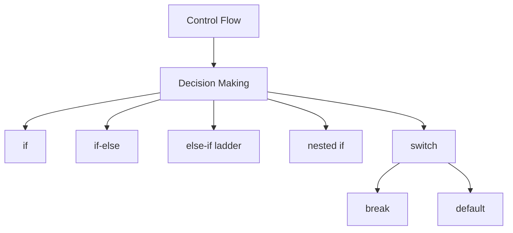
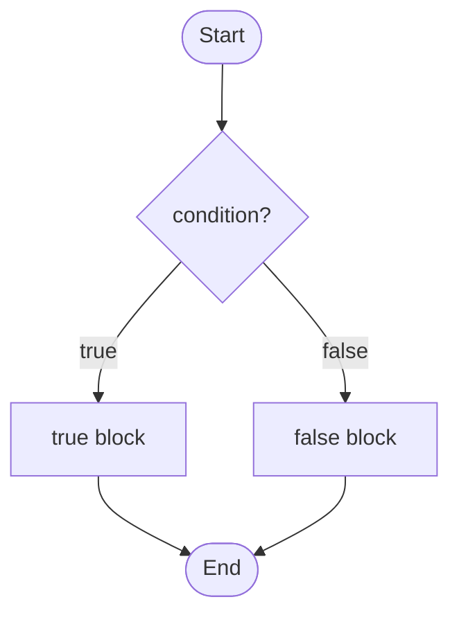
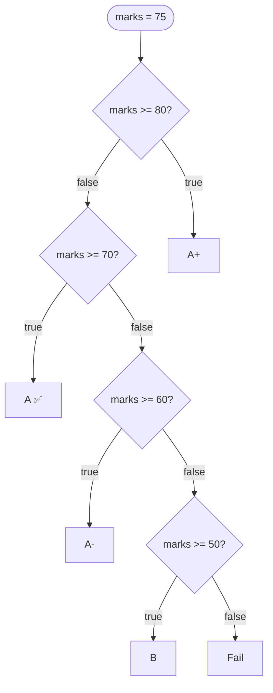
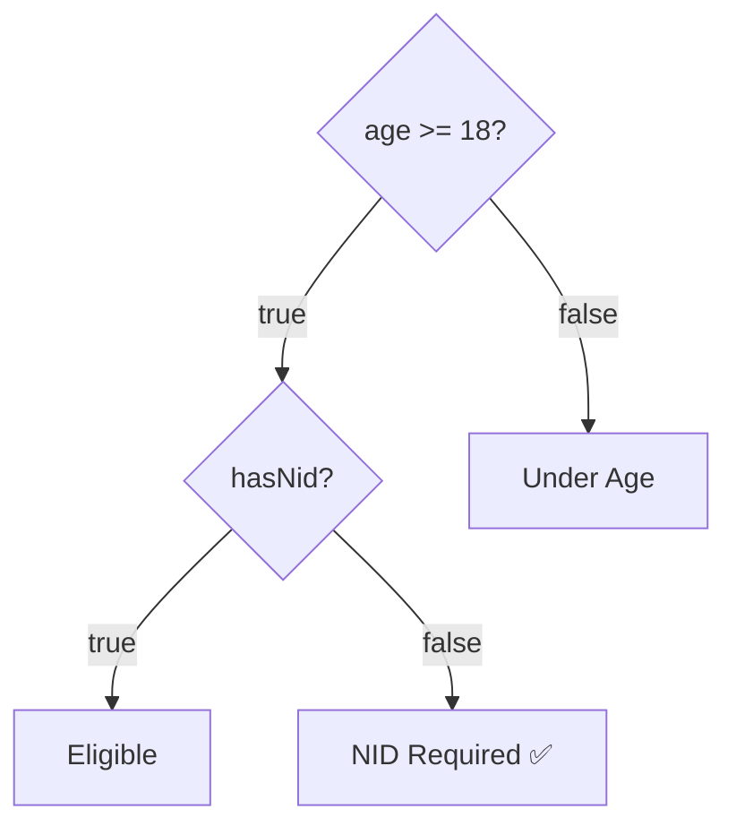
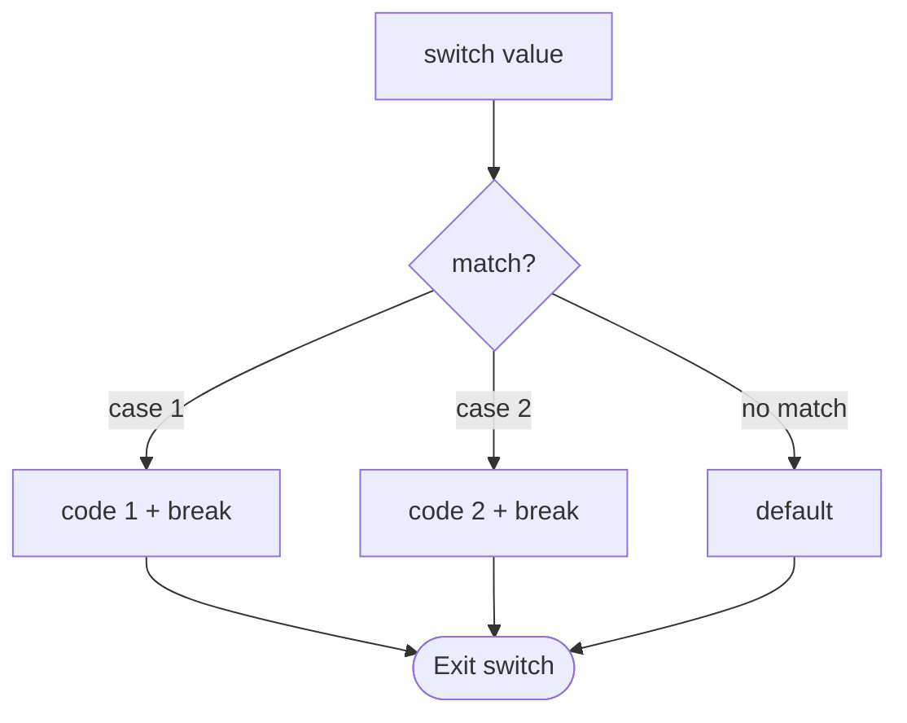

# 🔀 Control Flow in Java

> 📁 **Note File:** `02-Control-Flow/control-flow.md`

আজকের topic: **Control Flow**।

Control Flow মানে হচ্ছে program-এর **কোন code কখন execute হবে, কোন condition-এ execute হবে, আর কোন branch skip হবে** — এটা control করা।

## 🗺️ Control Flow Overview



## 📑 Table of Contents

1. [What is Control Flow?](#1-what-is-control-flow)
2. [if Statement](#2-if-statement)
3. [যদি Condition False হয়?](#3-যদি-condition-false-হয়)
4. [if-else](#4-if-else)
5. [Even or Odd Using if-else](#5-even-or-odd-using-if-else)
6. [Positive or Negative Number](#6-positive-or-negative-number)
7. [else-if Ladder](#7-else-if-ladder)
8. [else-if কীভাবে কাজ করে?](#8-else-if-কীভাবে-কাজ-করে)
9. [Condition Order Important](#9-condition-order-important)
10. [Logical Operator with if](#10-logical-operator-with-if)
11. [`&&` Example](#11--example)
12. [`||` Example](#12--example-1)
13. [Nested if](#13-nested-if)
14. [Nested if-else](#14-nested-if-else)
15. [Nested If vs Logical AND](#15-nested-if-vs-logical-and)
16. [switch Statement](#16-switch-statement)
17. [switch Structure](#17-switch-structure)
18. [What Does break Do?](#18-what-does-break-do)
19. [যদি break না দাও?](#19-যদি-break-না-দাও)
20. [default](#20-default)
21. [Switch with String](#21-switch-with-string)
22. [Modern Switch Expression](#22-modern-switch-expression)
23. [if-else vs switch](#23-if-else-vs-switch)
24. [Common Mistake: Semicolon after if](#24-common-mistake-semicolon-after-if)
25. [Common Mistake: `=` vs `==`](#25-common-mistake---vs-)
26. [Boolean Variable Directly Use করা](#26-boolean-variable-directly-use-করা)
27. [NOT Operator with Condition](#27-not-operator-with-condition)
28. [Real-Life Example — Login System](#28-real-life-example--login-system)
29. [Real-Life Example — Grade System](#29-real-life-example--grade-system)
30. [Real-Life Example — Largest of Two Numbers](#30-real-life-example--largest-of-two-numbers)
31. [Largest of Three Numbers](#31-largest-of-three-numbers)
32. [Leap Year Basic Problem](#32-leap-year-basic-problem)
33. [Day 4 Quick Summary](#-day-4-quick-summary)
34. [Day 4 Practice Problems](#-day-4-practice-problems)
35. [Day 4 Interview Questions](#-day-4-interview-questions)

---

## 📚 Day 4-এ যা শিখবে

1. `if`
2. `if-else`
3. `else-if` ladder
4. nested `if`
5. `switch`
6. `break`
7. basic decision-making practice

---

## 1. What is Control Flow?

Normally Java code **top থেকে bottom** execute হয়।

```java
public class Main {
    public static void main(String[] args) {

        System.out.println("Start");
        System.out.println("Middle");
        System.out.println("End");
    }
}
```

**Output:**

```
Start
Middle
End
```

কিন্তু আমরা অনেক সময় চাই:

- condition **true** হলে → একটা কাজ
- condition **false** হলে → অন্য কাজ

এখানেই **Control Flow** দরকার।

---

## 2. if Statement

`if` ব্যবহার করা হয় কোনো condition **true কিনা** check করতে।

### Syntax

```java
if (condition) {
    // code
}
```

### Example

```java
int age = 20;

if (age >= 18) {
    System.out.println("You are an adult.");
}
```

**Output:**

```
You are an adult.
```

কারণ `age >= 18` **true**।

---

## 3. যদি Condition False হয়?

```java
int age = 15;

if (age >= 18) {
    System.out.println("Adult");
}
```

এখানে **কোনো output হবে না**।

কারণ condition `15 >= 18` **false**। তাই `if` block execute হবে না।

---

## 4. if-else

Condition **true** হলে এক কাজ, **false** হলে অন্য কাজ।

### Syntax

```java
if (condition) {
    // true block
} else {
    // false block
}
```



### Example

```java
int age = 16;

if (age >= 18) {
    System.out.println("Adult");
} else {
    System.out.println("Minor");
}
```

**Output:**

```
Minor
```

---

## 5. Even or Odd Using if-else

Day 3-এর `%` operator এখানে কাজে লাগবে।

```java
int number = 7;

if (number % 2 == 0) {
    System.out.println("Even");
} else {
    System.out.println("Odd");
}
```

**Output:**

```
Odd
```

**Logic:** `number % 2 == 0` হলে even, নাহলে odd।

---

## 6. Positive or Negative Number

```java
int number = -10;

if (number >= 0) {
    System.out.println("Positive");
} else {
    System.out.println("Negative");
}
```

> ⚠️ কিন্তু এখানে একটা problem আছে। `0` technically positive নয়।

### ✅ Better version

```java
int number = 0;

if (number > 0) {
    System.out.println("Positive");
} else if (number < 0) {
    System.out.println("Negative");
} else {
    System.out.println("Zero");
}
```

**Output:**

```
Zero
```

---

## 7. else-if Ladder

একাধিক condition check করতে হলে `else if` ব্যবহার করি।

```java
int marks = 75;

if (marks >= 80) {
    System.out.println("A+");
} else if (marks >= 70) {
    System.out.println("A");
} else if (marks >= 60) {
    System.out.println("A-");
} else if (marks >= 50) {
    System.out.println("B");
} else {
    System.out.println("Fail");
}
```

**Output:**

```
A
```



---

## 8. else-if কীভাবে কাজ করে?

ধরো `marks = 75;`

Java check করবে:

```
marks >= 80 → false
```

তারপর:

```
marks >= 70 → true
```

এখন এই block execute হবে। এরপর নিচের আর কোনো `else if` **check হবে না**।

> ⭐ এটা খুব important।

---

## 9. Condition Order Important

এই code দেখো:

```java
int marks = 85;

if (marks >= 50) {
    System.out.println("B");
} else if (marks >= 80) {
    System.out.println("A+");
}
```

**Output:**

```
B
```

যদিও marks 85। কারণ প্রথম condition `marks >= 50` already **true**। তাই দ্বিতীয় condition আর check করবে না।

### ✅ Correct order

```java
if (marks >= 80) {
    System.out.println("A+");
} else if (marks >= 70) {
    System.out.println("A");
} else if (marks >= 50) {
    System.out.println("B");
}
```

> 📌 **Rule:** More specific / higher condition **first**.

---

## 10. Logical Operator with if

Day 3-এর `&&`, `||`, `!` এখন অনেক ব্যবহার হবে।

```java
int age = 22;
boolean hasNid = true;

if (age >= 18 && hasNid) {
    System.out.println("Eligible");
} else {
    System.out.println("Not Eligible");
}
```

**Output:**

```
Eligible
```

---

## 11. `&&` Example

Student pass করতে হলে দুইটি condition:

- Marks >= 40
- Attendance >= 75

```java
int marks = 70;
int attendance = 80;

if (marks >= 40 && attendance >= 75) {
    System.out.println("Passed");
} else {
    System.out.println("Failed");
}
```

---

## 12. `||` Example

User login করতে পারবে যদি **Admin** OR **Moderator** হয়।

```java
boolean isAdmin = false;
boolean isModerator = true;

if (isAdmin || isModerator) {
    System.out.println("Access Granted");
} else {
    System.out.println("Access Denied");
}
```

**Output:**

```
Access Granted
```

---

## 13. Nested if

একটা `if`-এর **ভিতরে আরেকটা `if`** থাকলে তাকে **Nested If** বলে।

```java
int age = 25;
boolean hasNid = true;

if (age >= 18) {

    if (hasNid) {
        System.out.println("Eligible");
    }

}
```

এখানে আগে `age` check হবে, তারপর NID check হবে।

---

## 14. Nested if-else

```java
int age = 20;
boolean hasNid = false;

if (age >= 18) {

    if (hasNid) {
        System.out.println("Eligible");
    } else {
        System.out.println("NID Required");
    }

} else {
    System.out.println("Under Age");
}
```

**Output:**

```
NID Required
```



---

## 15. Nested If vs Logical AND

**Nested if:**

```java
if (age >= 18) {
    if (hasNid) {
        System.out.println("Eligible");
    }
}
```

**Logical AND:**

```java
if (age >= 18 && hasNid) {
    System.out.println("Eligible");
}
```

দুটো অনেক ক্ষেত্রে **same result** দেয়। Simple condition হলে দ্বিতীয়টা **cleaner**।

---

## 16. switch Statement

একই variable-এর অনেক possible value থাকলে `switch` useful।

```java
int day = 3;

switch (day) {

    case 1:
        System.out.println("Saturday");
        break;

    case 2:
        System.out.println("Sunday");
        break;

    case 3:
        System.out.println("Monday");
        break;

    default:
        System.out.println("Invalid Day");
}
```

**Output:**

```
Monday
```

---

## 17. switch Structure

### Basic syntax

```java
switch (value) {

    case value1:
        // code
        break;

    case value2:
        // code
        break;

    default:
        // code
}
```



---

## 18. What Does `break` Do?

`break` switch-এর execution **থামিয়ে দেয়**।

```java
int number = 2;

switch (number) {

    case 1:
        System.out.println("One");
        break;

    case 2:
        System.out.println("Two");
        break;

    case 3:
        System.out.println("Three");
        break;
}
```

**Output:**

```
Two
```

---

## 19. যদি `break` না দাও?

```java
int number = 2;

switch (number) {

    case 1:
        System.out.println("One");

    case 2:
        System.out.println("Two");

    case 3:
        System.out.println("Three");
}
```

**Output:**

```
Two
Three
```

এটাকে বলে **Fall-through**। কারণ `case 2` match করার পর Java নিচের case-ও execute করেছে।

---

## 20. default

কোনো case match না করলে `default` execute হয়।

```java
int day = 10;

switch (day) {

    case 1:
        System.out.println("Saturday");
        break;

    case 2:
        System.out.println("Sunday");
        break;

    default:
        System.out.println("Invalid Day");
}
```

**Output:**

```
Invalid Day
```

---

## 21. Switch with String

Java-তে **String** দিয়েও switch করা যায়।

```java
String role = "admin";

switch (role) {

    case "admin":
        System.out.println("Full Access");
        break;

    case "user":
        System.out.println("Limited Access");
        break;

    default:
        System.out.println("Unknown Role");
}
```

**Output:**

```
Full Access
```

---

## 22. Modern Switch Expression

Modern Java-তে cleaner switch syntax আছে।

```java
int day = 2;

String result = switch (day) {
    case 1 -> "Saturday";
    case 2 -> "Sunday";
    case 3 -> "Monday";
    default -> "Invalid";
};

System.out.println(result);
```

**Output:**

```
Sunday
```

এই syntax-এ সাধারণত `break` লাগে না।

> 💡 Beginner হিসেবে **দুইটা syntax-ই** চিনে রাখো।

---

## 23. if-else vs switch

### `if-else`

**Condition-based logic**-এর জন্য better।

```java
if (age >= 18)

if (marks >= 80)

if (salary > 50000 && experience > 3)
```

### `switch`

একটা variable-এর **exact value match** করার জন্য useful।

```java
switch (day)

switch (role)

switch (option)
```

### Simple rule

| Situation                         | Use         |
| --------------------------------- | ----------- |
| Range / complex condition         | `if-else`   |
| Exact fixed values                | `switch`    |

---

## 24. Common Mistake: Semicolon after if

### ❌ Wrong

```java
if (age >= 18); {
    System.out.println("Adult");
}
```

এখানে `;` problem create করে।

### ✅ Correct

```java
if (age >= 18) {
    System.out.println("Adult");
}
```

---

## 25. Common Mistake: `=` vs `==`

### ❌ Wrong

```java
if (number = 10) {
}
```

For an `int`, এটা condition হিসেবে valid boolean expression না।

### ✅ Correct

```java
if (number == 10) {
}
```

মনে রাখো:

| Operator | Purpose |
| -------- | ------- |
| `=`      | assign  |
| `==`     | compare |

---

## 26. Boolean Variable Directly Use করা

```java
boolean loggedIn = true;
```

এভাবে লেখা যায়:

```java
if (loggedIn) {
    System.out.println("Welcome");
}
```

অযথা `if (loggedIn == true)` লেখার দরকার নেই।

**Better:** `if (loggedIn)`

---

## 27. NOT Operator with Condition

```java
boolean loggedIn = false;

if (!loggedIn) {
    System.out.println("Please Login");
}
```

**Output:**

```
Please Login
```

কারণ `!false = true`

---

## 28. Real-Life Example — Login System

```java
String username = "admin";
String password = "1234";

if (username.equals("admin") && password.equals("1234")) {
    System.out.println("Login Successful");
} else {
    System.out.println("Invalid Username or Password");
}
```

এখানে একটা নতুন important বিষয়:

> String compare করতে সাধারণত **`.equals()`** ব্যবহার করবে। শুধু `==` না।

String topic-এ পরে এটা detail-এ আসবে।

---

## 29. Real-Life Example — Grade System

```java
int marks = 78;

if (marks >= 80) {
    System.out.println("Grade: A+");

} else if (marks >= 70) {
    System.out.println("Grade: A");

} else if (marks >= 60) {
    System.out.println("Grade: A-");

} else if (marks >= 50) {
    System.out.println("Grade: B");

} else if (marks >= 40) {
    System.out.println("Grade: C");

} else {
    System.out.println("Fail");
}
```

---

## 30. Real-Life Example — Largest of Two Numbers

```java
int a = 20;
int b = 15;

if (a > b) {
    System.out.println("A is larger");
} else if (b > a) {
    System.out.println("B is larger");
} else {
    System.out.println("Both are equal");
}
```

---

## 31. Largest of Three Numbers

এটা practice-এর জন্য খুব important।

```java
int a = 10;
int b = 25;
int c = 15;

if (a >= b && a >= c) {
    System.out.println("A is largest");

} else if (b >= a && b >= c) {
    System.out.println("B is largest");

} else {
    System.out.println("C is largest");
}
```

**Output:**

```
B is largest
```

---

## 32. Leap Year Basic Problem

Interview/practice-এ common।

```java
int year = 2024;

if ((year % 400 == 0) || (year % 4 == 0 && year % 100 != 0)) {
    System.out.println("Leap Year");
} else {
    System.out.println("Not a Leap Year");
}
```

---

## 📋 Day 4 Quick Summary

| Keyword     | Meaning                                    |
| ----------- | ------------------------------------------ |
| `if`        | condition true হলে code execute            |
| `if-else`   | true/false অনুযায়ী দুইটা path             |
| `else-if`   | multiple condition check                   |
| nested `if` | `if`-এর ভিতরে `if`                         |
| `switch`    | one value against multiple fixed cases     |
| `break`     | switch stop করে                            |
| `default`   | কোনো case match না করলে execute            |

### ⭐ Important Concepts

আজকের জন্য সবচেয়ে important:

1. `if`
2. `if-else`
3. `else-if` ladder
4. condition ordering
5. nested `if`
6. `switch`
7. `break`
8. `default`
9. fall-through
10. `if-else` vs `switch`

---

## 🧩 Day 4 Practice Problems

আগে **নিজে solve** করবে।

### Problem 1

একটি number even নাকি odd বের করো।

```
Input:  7
Output: Odd
```

### Problem 2

একটি number positive, negative নাকি zero check করো।

### Problem 3

দুইটি number-এর মধ্যে largest number বের করো।

### Problem 4

তিনটি number-এর মধ্যে largest number বের করো।

### Problem 5

Marks অনুযায়ী grade বের করো।

| Marks    | Grade  |
| -------- | ------ |
| 80+      | A+     |
| 70+      | A      |
| 60+      | A-     |
| 50+      | B      |
| 40+      | C      |
| Below 40 | Fail   |

### Problem 6

Age check করো।

- Age >= 18 → Eligible to vote
- Otherwise → Not eligible

### Problem 7

একটি year leap year কিনা check করো।

### Problem 8

`switch` ব্যবহার করে calculator বানাও।

```
Input:
a = 20
b = 10
operator = +

Output:
30
```

Possible operators: `+` `-` `*` `/` `%`

### 🖩 Mini Calculator with switch

```java
public class Calculator {

    public static void main(String[] args) {

        int a = 20;
        int b = 10;
        char operator = '+';

        switch (operator) {

            case '+':
                System.out.println(a + b);
                break;

            case '-':
                System.out.println(a - b);
                break;

            case '*':
                System.out.println(a * b);
                break;

            case '/':
                System.out.println(a / b);
                break;

            case '%':
                System.out.println(a % b);
                break;

            default:
                System.out.println("Invalid Operator");
        }
    }
}
```

---

## 🎯 Day 4 Interview Questions

> এগুলো তোমার `Interview Questions.docx`-এ রাখতে পারো।

### 1. What is control flow in Java?

Control flow determines the order in which statements are executed in a Java program.

### 2. What is an `if` statement?

An `if` statement executes a block of code only when a given condition is true.

```java
if (age >= 18) {
    System.out.println("Adult");
}
```

### 3. What is the difference between `if` and `if-else`?

- `if` executes code only when the condition is true.
- `if-else` provides two execution paths:
  - true → `if`
  - false → `else`

### 4. What is an else-if ladder?

It is used when multiple conditions need to be checked sequentially.

```java
if (...) {

} else if (...) {

} else {

}
```

### 5. What is nested if?

An `if` statement inside another `if` statement is called a nested if.

### 6. What is a switch statement?

A `switch` statement selects one block of code from multiple cases based on the value of an expression.

### 7. What is the purpose of `break` in switch?

`break` terminates the current switch case and exits the switch statement.

### 8. What happens if we don't use `break`?

Java may continue executing subsequent cases. This behavior is called **Fall-through**.

### 9. What is `default` in switch?

`default` executes when none of the cases match.

### 10. Difference between `if-else` and `switch`?

- `if-else` is suitable for: ranges, complex conditions, logical expressions
- `switch` is suitable for: fixed exact values

### 11. What is the output?

```java
int age = 20;

if (age >= 18) {
    System.out.println("Adult");
} else {
    System.out.println("Minor");
}
```

**Answer:**

```
Adult
```

### 12. What is the output?

```java
int marks = 85;

if (marks >= 50) {
    System.out.println("Pass");
} else if (marks >= 80) {
    System.out.println("Excellent");
}
```

**Answer:**

```
Pass
```

কারণ প্রথম true condition পাওয়ার পর else-if chain stop হয়ে যায়।

### 13. Can switch use String in Java?

Yes.

```java
switch (role) {
    case "admin":
        break;
}
```

### 14. Can we use relational expressions directly as switch cases?

Traditional switch-এ এভাবে না:

```java
case age > 18:
```

এই ধরনের range-based condition-এর জন্য সাধারণত `if-else` ব্যবহার করা হয়।
