# 🧬 Inheritance in Java

> **Java Programming Journey | Java OOP | SWE Interview + University Lecturer Preparation**

আজকের Topic: **Inheritance in Java**

Day 9-এ তুমি Class, Object, Constructor, `this`, Encapsulation এবং OOP-এর Four Pillars সম্পর্কে শিখেছো। আজ OOP-এর **দ্বিতীয় গুরুত্বপূর্ণ Pillar — Inheritance** বিস্তারিত শিখবে।

এই lesson-এ আমরা শুধু syntax শিখব না। **কেন** Inheritance প্রয়োজন, Java internally **কীভাবে** কাজ করে, **কোথায়** ব্যবহার করা উচিত এবং interview-তে কী ধরনের প্রশ্ন আসে — সবকিছু উদাহরণসহ বুঝব।

## 🗺️ Inheritance Overview

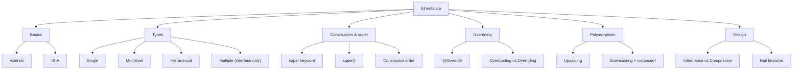

## 🎯 Today's Learning Objectives

1. What is Inheritance?
2. Why Do We Need Inheritance?
3. Parent Class and Child Class
4. `extends` Keyword
5. IS-A Relationship
6. Types of Inheritance
7. `super` Keyword and `super()`
8. Constructor Execution Order
9. Method Overriding
10. Inheritance vs Composition
11. Access Modifiers and `protected`
12. `final` Keyword
13. Object Reference and Upcasting
14. Common Mistakes
15. Mini Project
16. Coding Practice
17. Interview Questions
18. GitHub Push

## 📑 Table of Contents

1. [What is Inheritance in Java?](#1-what-is-inheritance-in-java)
2. [Parent Class vs Child Class](#2-parent-class-vs-child-class)
3. [`extends` Keyword](#3-extends-keyword)
4. [IS-A Relationship](#4-is-a-relationship)
5. [Why Do We Need Inheritance?](#5-why-do-we-need-inheritance)
6. [Types of Inheritance in Java](#6-types-of-inheritance-in-java)
7. [`super` Keyword in Java](#7-super-keyword-in-java)
8. [Constructor Inheritance and `super()`](#8-constructor-inheritance-and-super)
9. [Method Overriding](#9-method-overriding)
10. [Method Overloading vs Method Overriding](#10-method-overloading-vs-method-overriding)
11. [Access Modifiers in Inheritance](#11-access-modifiers-in-inheritance)
12. [`final` Keyword in Inheritance](#12-final-keyword-in-inheritance)
13. [Upcasting and Parent Reference](#13-upcasting-and-parent-reference)
14. [Downcasting and `instanceof`](#14-downcasting-and-instanceof)
15. [Inheritance vs Composition](#15-inheritance-vs-composition)
16. [Common Mistakes in Inheritance](#16-common-mistakes-in-inheritance)
17. [Mini Project — University Management System](#17-mini-project--university-management-system)

---

## 1. What is Inheritance in Java?

### Interview Definition

> **Inheritance** is an object-oriented programming mechanism that allows one class to **acquire accessible fields and methods from another class**, promoting **code reuse** and establishing an **IS-A relationship**.

### সহজ ভাষায়

Inheritance হলো এমন একটি OOP concept, যেখানে একটি class অন্য একটি class-এর **properties এবং methods inherit** করতে পারে।

ধরো, তুমি একটি **University Management System** বানাচ্ছো। সেখানে আছে:

- Student
- Teacher
- Staff

এই তিন ধরনের ব্যক্তির কিছু **common information** থাকে: `name`, `age`, `address`।

যদি প্রতিটি class-এ একই code লিখো, তাহলে **code duplication** হবে।

### ❌ Without Inheritance

```java
class Student {
    String name;
    int age;

    void displayInfo() {
        System.out.println(name);
        System.out.println(age);
    }
}

class Teacher {
    String name;
    int age;

    void displayInfo() {
        System.out.println(name);
        System.out.println(age);
    }
}
```

এখানে `name`, `age` এবং `displayInfo()` **বারবার** লিখতে হচ্ছে।

### ✅ With Inheritance

Inheritance ব্যবহার করলে common code একটি **parent class**-এ রাখা যাবে।

```java
class Person {

    String name;
    int age;

    void displayInfo() {
        System.out.println(name);
        System.out.println(age);
    }
}

class Student extends Person {

    String studentId;
}

class Teacher extends Person {

    String subject;
}
```

এখানে `Student` এবং `Teacher` উভয়ই `Person` থেকে inherited members ব্যবহার করতে পারবে।

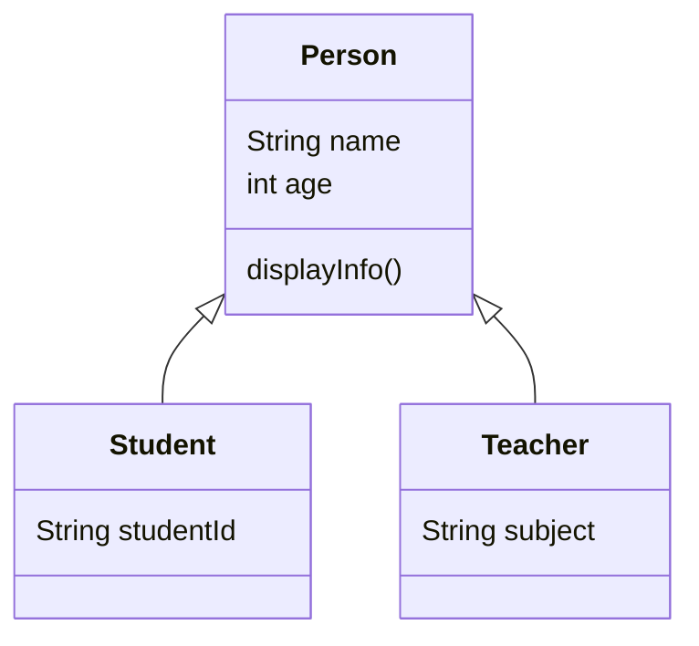

এটাই Inheritance-এর basic idea।

---

## 2. Parent Class vs Child Class

Inheritance-এ দুটি গুরুত্বপূর্ণ concept রয়েছে।

| Parent Class                     | Child Class                   |
| -------------------------------- | ----------------------------- |
| **Superclass**                   | **Subclass**                  |
| Common properties define করে     | Common properties inherit করে |
| **Base class**                   | **Derived class**             |
| Example: `Animal`                | Example: `Dog`                |

```java
class Animal {
    void eat() {
        System.out.println("Animal is eating");
    }
}

class Dog extends Animal {
    void bark() {
        System.out.println("Dog is barking");
    }
}
```

এখানে:

```
Animal → Parent / Superclass
Dog    → Child / Subclass
```

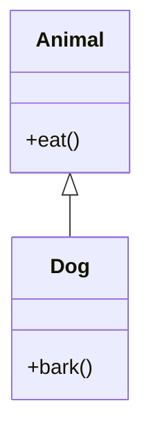

> 📝 Inheritance diagram: `Dog extends Animal`। UML-এ **arrow superclass-এর দিকে** নির্দেশ করে।

---

## 3. `extends` Keyword

Java-তে class inheritance implement করার জন্য **`extends`** keyword ব্যবহার করা হয়।

### Syntax

```java
class ChildClass extends ParentClass {
    // fields and methods
}
```

### Complete example

```java
class Animal {

    void eat() {
        System.out.println("Eating...");
    }
}

class Dog extends Animal {

    void bark() {
        System.out.println("Barking...");
    }
}

public class Main {

    public static void main(String[] args) {

        Dog dog = new Dog();

        dog.eat();
        dog.bark();
    }
}
```

**Output:**

```
Eating...
Barking...
```

### Execution Explanation

প্রথমে:

```java
Dog dog = new Dog();
```

একটি `Dog` object তৈরি হয়েছে।

তারপর:

```java
dog.eat();
```

`Dog` class-এ `eat()` declare করা নেই। কিন্তু `Animal` class থেকে method-টি **inherited** হয়েছে।

আর:

```java
dog.bark();
```

এটি `Dog` class-এর **নিজস্ব method**।

সুতরাং child object **parent-এর accessible inherited behavior** এবং **নিজের behavior** — দুটিই ব্যবহার করতে পারে।

---

## 4. IS-A Relationship

Inheritance বুঝতে **IS-A relationship** খুব গুরুত্বপূর্ণ।

```java
class Animal {
}

class Dog extends Animal {
}
```

এখানে **`Dog IS-A Animal`** — অর্থাৎ Dog এক ধরনের Animal।

আরেকটি example:

```java
class Vehicle {
}

class Car extends Vehicle {
}
```

এখানে **`Car IS-A Vehicle`**।

কিন্তু **`Car IS-A Engine`** সঠিক নয়। কারণ Car একটি Engine নয়; Car-এর একটি Engine **থাকে**।

তাই: **`Car HAS-A Engine`**

এটাকে **Composition**-এর মাধ্যমে represent করা যায়। পরে বিস্তারিত আসবে।

| Relationship | অর্থ         | Java-তে কীভাবে           |
| ------------ | ------------ | ------------------------ |
| **IS-A**     | "একটি ধরন"   | Inheritance (`extends`)  |
| **HAS-A**    | "এর আছে"     | Composition (field)      |

> 🎯 **Interview Rule:** Inheritance ব্যবহার করার আগে দেখতে হবে child class সত্যিই parent class-এর **specialized type** কিনা।

---

## 5. Why Do We Need Inheritance?

Inheritance-এর প্রধান সুবিধা:

- **Code Reusability:** Common fields ও methods reuse করা যায়।
- **Maintainability:** Common behavior এক জায়গায় রাখা যায়।
- **Extensibility:** Existing parent behavior-এর উপর specialized behavior তৈরি করা যায়।
- **Polymorphism:** Parent reference দিয়ে child object handle করা যায়।
- **Logical Hierarchy:** বাস্তব domain-এর subtype relationship model করা যায়।

> ⚠️ তবে সব code reuse করার জন্য Inheritance ব্যবহার করা উচিত নয়। **ভুল relationship তৈরি করলে tightly coupled design** তৈরি হতে পারে।

---

## 6. Types of Inheritance in Java

Java class inheritance-এর ক্ষেত্রে প্রধানত **তিন ধরনের structure** সরাসরি support করে।

### 6.1 Single Inheritance

একটি child class **একটি parent class** inherit করে।

```java
class Animal {
}

class Dog extends Animal {
}
```

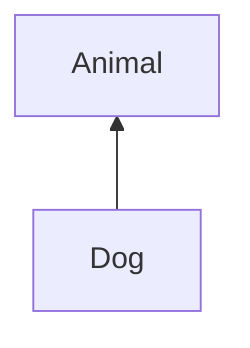

### 6.2 Multilevel Inheritance

একটি class আরেকটি class inherit করে এবং **তৃতীয় class সেই child class inherit** করে।

```java
class Animal {

    void eat() {
        System.out.println("Eating");
    }
}

class Mammal extends Animal {

    void walk() {
        System.out.println("Walking");
    }
}

class Dog extends Mammal {

    void bark() {
        System.out.println("Barking");
    }
}
```

**Usage:**

```java
Dog dog = new Dog();

dog.eat();
dog.walk();
dog.bark();
```

**Output:**

```
Eating
Walking
Barking
```

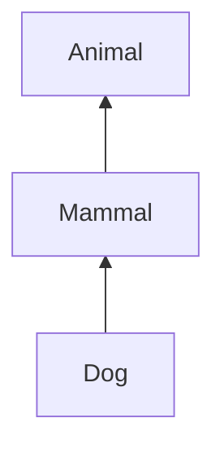

### 6.3 Hierarchical Inheritance

**একটি parent class থেকে একাধিক child class** inherit করে।

```java
class Animal {

    void eat() {
        System.out.println("Eating");
    }
}

class Dog extends Animal {
}

class Cat extends Animal {
}
```

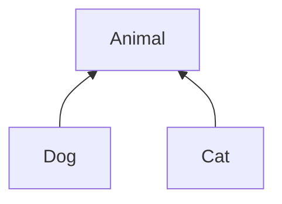

### 6.4 Multiple Inheritance

Multiple inheritance মানে একটি class **একাধিক parent class** থেকে directly inherit করছে।

**Example concept:**

```java
class C extends A, B { }   // ❌ Java-তে invalid
```

কারণ Java একটি class-কে **সর্বোচ্চ একটি direct superclass** extend করতে দেয়।

তবে Java **multiple interfaces implement** করতে পারে।

```java
interface Printable {
    void print();
}

interface Scannable {
    void scan();
}

class Machine implements Printable, Scannable {

    public void print() {
        System.out.println("Printing");
    }

    public void scan() {
        System.out.println("Scanning");
    }
}
```

এটি **interfaces-এর মাধ্যমে multiple inheritance of types** support করে।

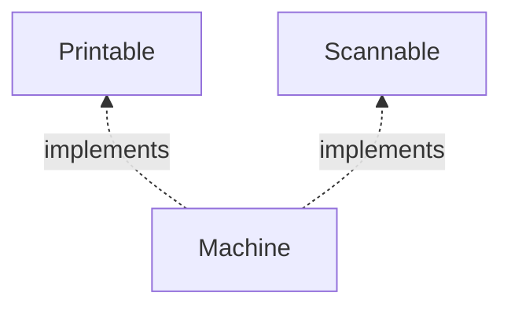

### 📊 Summary Table

| Inheritance Type                    | Java Classes        |
| ----------------------------------- | ------------------- |
| Single                              | ✅ Supported        |
| Multilevel                          | ✅ Supported        |
| Hierarchical                        | ✅ Supported        |
| Multiple direct class inheritance   | ❌ Not supported    |
| Multiple interfaces                 | ✅ Supported        |

---

## 7. `super` Keyword in Java

`super` keyword ব্যবহার করে child class থেকে **parent class-এর accessible members** access করা যায়।

প্রধান ব্যবহার **তিনটি:**

1. Parent class-এর **field** access
2. Parent class-এর **method** call
3. Parent class-এর **constructor** invoke

### 7.1 Access Parent Class Field

```java
class Animal {

    String name = "Animal";
}

class Dog extends Animal {

    String name = "Dog";

    void display() {
        System.out.println(name);
        System.out.println(super.name);
    }
}

public class Main {

    public static void main(String[] args) {

        Dog dog = new Dog();
        dog.display();
    }
}
```

**Output:**

```
Dog
Animal
```

এখানে:

| Expression    | কী বোঝায়                      |
| ------------- | ------------------------------ |
| `name`        | **child class**-এর field       |
| `super.name`  | **parent class**-এর field      |

### 7.2 Call Parent Class Method

```java
class Animal {

    void sound() {
        System.out.println("Animal sound");
    }
}

class Dog extends Animal {

    @Override
    void sound() {

        super.sound();

        System.out.println("Dog barks");
    }
}
```

**Call:**

```java
Dog dog = new Dog();
dog.sound();
```

**Output:**

```
Animal sound
Dog barks
```

এখানে `super.sound();` parent class-এর implementation call করেছে।

---

## 8. Constructor Inheritance and `super()`

> ⭐ এটি অত্যন্ত গুরুত্বপূর্ণ interview concept।

> **Constructors are not inherited in Java.**

তবে child object তৈরি হওয়ার সময় **superclass constructor invocation হয়**।

```java
class Animal {

    Animal() {
        System.out.println("Animal Constructor");
    }
}

class Dog extends Animal {

    Dog() {
        System.out.println("Dog Constructor");
    }
}

public class Main {

    public static void main(String[] args) {

        Dog dog = new Dog();
    }
}
```

**Output:**

```
Animal Constructor
Dog Constructor
```

### কেন?

কারণ child constructor-এর body execute হওয়ার **আগে** superclass-এর initialization সম্পন্ন হয়।

### Execution Sequence

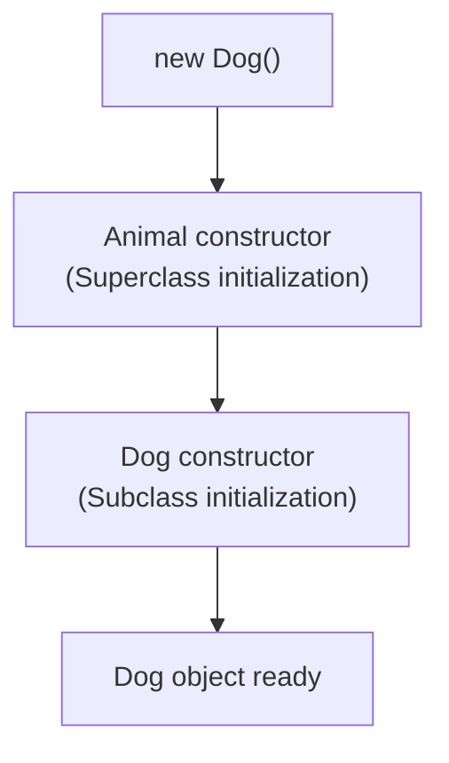

### 8.1 Explicit `super()`

```java
class Animal {

    Animal(String name) {
        System.out.println("Animal: " + name);
    }
}

class Dog extends Animal {

    Dog() {

        super("Tommy");

        System.out.println("Dog Created");
    }
}
```

**Output when creating `new Dog()`:**

```
Animal: Tommy
Dog Created
```

`super("Tommy")` parent constructor-এর argument pass করছে।

### Important Rules

- `super()` superclass constructor invoke করে।
- Compiler প্রযোজ্য ক্ষেত্রে **implicit `super()`** যোগ করে।
- Superclass-এ accessible no-argument constructor না থাকলে **explicit arguments দিয়ে** applicable superclass constructor invoke করতে হবে।
- **Constructors inherited হয় না।**
- Traditional constructor syntax-এ `super()` **প্রথম statement** হয়; newer Java versions-এ restricted statements এর আগে থাকতে পারে।

---

## 9. Method Overriding

Inheritance-এর সবচেয়ে গুরুত্বপূর্ণ application-গুলোর একটি হলো **Method Overriding**।

### Interview Definition

> **Method overriding** occurs when a subclass provides its own implementation of an inherited instance method with a **compatible signature and return type**.

```java
class Animal {

    void sound() {
        System.out.println("Animal makes sound");
    }
}

class Dog extends Animal {

    @Override
    void sound() {
        System.out.println("Dog barks");
    }
}
```

**Call:**

```java
Dog dog = new Dog();

dog.sound();
```

**Output:**

```
Dog barks
```

কারণ `Dog` parent class-এর `sound()` method **override** করেছে।

### Why Use `@Override`?

`@Override` Java compiler-কে বলে তুমি parent বা interface-এর method override করতে চাচ্ছো।

এতে **method signature ভুল হলে compiler error** দিয়ে ধরতে পারে।

### Overriding Rules

- Method **signature compatible** হতে হবে।
- Return type compatible হতে হবে; **covariant return type permitted**।
- Child method parent method-এর তুলনায় **বেশি restrictive access** দিতে পারবে না।
- **`final` method** override করা যায় না।
- **`private` method** override করা যায় না।
- **Static methods override নয়, method hiding** করে।
- Overriding **checked exceptions**-এর ক্ষেত্রে Java নির্দিষ্ট restrictions প্রয়োগ করে।

> 📚 Oracle documentation-ও method overriding ও static method hiding-এর পার্থক্য নিশ্চিত করে।

---

## 10. Method Overloading vs Method Overriding

Day 6-এ Method Overloading শিখেছিলে। এখন দুটোর difference বুঝি।

| Feature                      | Overloading                         | Overriding                                   |
| ---------------------------- | ----------------------------------- | -------------------------------------------- |
| **Method name**              | Same                                | Same                                         |
| **Parameters**               | Different list                      | Same/compatible signature                    |
| **Inheritance required**     | No                                  | Yes, superclass/interface relationship       |
| **Binding**                  | Typically compile-time selection    | Runtime dispatch for instance methods        |
| **Return type alone enough?** | No                                 | Must be compatible                           |
| **Main purpose**             | Multiple parameter forms            | Specialized behavior                         |

### Overloading

```java
class Calculator {

    int add(int a, int b) {
        return a + b;
    }

    int add(int a, int b, int c) {
        return a + b + c;
    }
}
```

### Overriding

```java
class Animal {

    void sound() {
        System.out.println("Animal");
    }
}

class Cat extends Animal {

    @Override
    void sound() {
        System.out.println("Meow");
    }
}
```

> 🎯 Interview-এ দুইটার পার্থক্য অবশ্যই explain করতে পারতে হবে।

---

## 11. Access Modifiers in Inheritance

Inheritance করার সময় **সব superclass member সরাসরি access করা যায় না।**

| Modifier           | Subclass access                          |
| ------------------ | ---------------------------------------- |
| `public`           | ✅ Accessible                            |
| `protected`        | ✅ Accessible, subject to cross-package rules |
| *package-private*  | Same package হলে accessible              |
| `private`          | ❌ Directly accessible নয়               |

```java
class Person {

    private String name = "Rahim";

    protected int age = 22;

    public String getName() {
        return name;
    }
}

class Student extends Person {

    void display() {

        System.out.println(getName());
        System.out.println(age);
    }
}
```

এটা **valid**।

কিন্তু child class থেকে সরাসরি `System.out.println(name);` লিখলে **error** হবে, কারণ `name` **private**।

> ⚠️ **Important:** Parent class-এর `private` members subclass-এ **inherit হয় না**। তবে accessible inherited methods-এর মাধ্যমে parent-এর private state ব্যবহার করা যায়।

---

## 12. `final` Keyword in Inheritance

`final` তিনটি জায়গায় গুরুত্বপূর্ণ।

### Final Variable

```java
final int MAX_AGE = 100;
```

এটার value **পুনরায় assign করা যাবে না**।

### Final Method

```java
class Animal {

    final void eat() {
        System.out.println("Eating");
    }
}
```

Child class `eat()` **override করতে পারবে না**।

### Final Class

```java
final class Vehicle {
}
```

এখন:

```java
class Car extends Vehicle {   // ❌ Compile error
}
```

কারণ **final class subclass করা যায় না**।

> 💡 Java-র `String` class-ও `final`।

| `final` কোথায় | প্রভাব                          |
| ------------- | ------------------------------- |
| Variable      | value আর বদলানো যাবে না          |
| Method        | override করা যাবে না             |
| Class         | inherit (extend) করা যাবে না     |

---

## 13. Upcasting and Parent Reference

Java-তে **Upcasting এবং Parent Reference** হলো **Runtime Polymorphism বা Dynamic Method Dispatch**-এর সবচেয়ে গুরুত্বপূর্ণ mechanism।

এই code দেখো:

```java
class Animal {

    void sound() {
        System.out.println("Animal sound");
    }
}

class Dog extends Animal {

    @Override
    void sound() {
        System.out.println("Dog barks");
    }

    void bark() {
        System.out.println("Barking");
    }
}
```

এখন:

```java
Animal animal = new Dog();

animal.sound();
```

**Output:**

```
Dog barks
```

এখানে reference type `Animal`, কিন্তু actual object `Dog`। এটাকে **Upcasting** বলা হয়।

### 🥇 Golden Rule

> **Compiler দেখে Reference Type (বাম পাশ), আর JVM (Runtime) দেখে Actual Object (ডান পাশ)।**

```
Animal animal = new Dog();
└─────┬─────┘   └───┬───┘
  Compiler        JVM (Runtime)
  এটা দেখে        এটা দেখে
 (Reference Type) (Actual Object)
```

### Important Concept

`Animal animal = new Dog();`

- **Reference type** → `Animal`
- **Runtime object type** → `Dog`
- **Accessible methods** → compile-time reference type অনুযায়ী
- **Overridden method implementation** → runtime object type অনুযায়ী

তাই `animal.sound();` **Valid**।

কিন্তু `animal.bark();` **Compile error** হবে, কারণ `Animal` reference type-এ `bark()` method নেই।

### 🧱 ১. মেমরি ড্রয়িং ও Upcasting-এর ভেতরের রূপ

```java
Animal animal = new Dog();
```

```
   STACK MEMORY (Reference)                HEAP MEMORY (Actual Object)
 ┌───────────────────────┐              ┌──────────────────────────────┐
 │ animal                │ ───────────► │ Object of Dog                │
 │ (Type: Animal)        │              │  - sound() → "Dog barks"     │
 └───────────────────────┘              │  - bark()  → "Barking"       │
                                        └──────────────────────────────┘
```

**Upcasting কী:** Child class-এর object-কে (`Dog`) Parent class-এর type-এ (`Animal`) reference করাকে **Upcasting** বলে। যেহেতু সব `Dog` আসলে একটি `Animal` (**IS-A** সম্পর্ক), তাই Java-তে এটি **automatic বা implicitly** ঘটে।

### ২. কেন `animal.sound()` কল করলে "Dog barks" আসে?

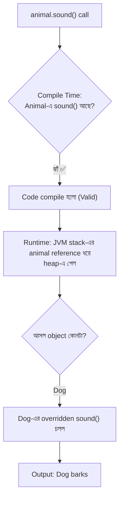

- **Compile Time:** Compiler reference type `Animal`-এর ভেতর গিয়ে দেখে `sound()` method আছে কি না। যেহেতু `Animal`-এ `sound()` আছে, তাই code compile হয়ে যায় (**Valid**)।
- **Runtime:** Program চলার সময় JVM stack-এর `animal` reference ধরে heap memory-তে পৌঁছায়। সেখানে সে দেখে মূল object-টি আসলে `Dog`-এর।
- যেহেতু `Dog` class-এ method-টি **Override** করা হয়েছে, তাই JVM parent-এর method না চালিয়ে **runtime object-এর overridden version** চালায়। ফলে output আসে: `Dog barks`।

### ৩. কেন `animal.bark()` দিলে Compile Error হয়?

```java
animal.bark();   // ❌ Compile-Time Error!
```

- **Compiler-এর দৃষ্টি:** Compiler code check করার সময় memory-র ভেতরে object তৈরি করে দেখে না। সে শুধু দেখে বাম পাশের **reference type** কী — এখানে তা হলো `Animal`।
- সে `Animal` class-এর blueprint-এ গিয়ে খোঁজে: *"এখানে কি `bark()` নামে কোনো method আছে?"*
- `Animal`-এ `bark()` না থাকায় compiler runtime-এ যাওয়ার আগেই code আটকে দেয় এবং বলে:

```
cannot find symbol: method bark()
```

### ৪. বাস্তব জীবনের রূপক (Security Guard Analogy)

মনে করুন, একজন মানুষ **ডাক্তার (`Dog`)**, কিন্তু তিনি গায়ে **সাধারণ নাগরিকের পোশাক (`Animal`)** পরে একটি অফিসের গেটে দাঁড়িয়ে আছেন।

| Analogy                                | Java concept                          |
| -------------------------------------- | ------------------------------------- |
| **পোশাক** (সাধারণ নাগরিক)              | **Reference Type** (`Animal`)         |
| **Security Guard**                     | **Compiler**                          |
| **ক্ষমতা** (কথা বলা, হাত মেলানো)       | **Accessible Methods** (`sound()`)    |
| **আসল পরিচয়** (ডাক্তার)               | **Runtime Object** (`Dog`)            |

- **পোশাক (Reference Type):** দূর থেকে security guard (Compiler) শুধু তার সাধারণ নাগরিকের পোশাক দেখতে পাচ্ছে।
- **ক্ষমতা (Accessible Methods):** সাধারণ নাগরিক হিসেবে তার সাথে কথা বলা বা হাত মেলানো (`sound()`) যাবে। কিন্তু security তাকে সরাসরি অপারেশনের নির্দেশ (`bark()`) দিতে দেবে না, কারণ পোশাকে সে শুধুই একজন সাধারণ মানুষ।
- **বাস্তব রূপ (Runtime Object):** যখন কথা বলা শুরু হলো (`sound()` execute হলো), তখন দেখা গেল সাধারণ নাগরিকের বেশে থাকলেও তিনি **ডাক্তারের বুদ্ধিমত্তা দিয়েই** কথা বলছেন (`Dog barks`)।

### ৫. যদি `bark()` চালাতেই হয়, তবে কী করতে হবে? (Downcasting)

Compiler-কে আশ্বস্ত করে বলতে হবে — *"Reference-টা `Animal` দেখালেও ভেতরে আসলে `Dog` object-ই আছে।"* একে বলা হয় **Downcasting**:

```java
Animal animal = new Dog();

// Downcasting: Animal reference-কে আবার Dog-এ রূপান্তর
Dog dog = (Dog) animal;
dog.bark();   // Output: Barking (এখন compiler আর আটকাবে না)
```

### ⚡ দ্রুত Revision-এর জন্য ৩টি পয়েন্ট

1. **Upcasting:** `Parent p = new Child();` (automatic হয়)।
2. **Method Calling Limit:** Reference type-এ (`Parent`) যে যে method আছে, dot (`.`) দিয়ে **শুধু সেগুলোই** কল করা সম্ভব।
3. **Overriding Execution:** Method-টি parent-এ থাকতে হবে, কিন্তু কল করলে output আসবে **child-এর overridden logic** থেকে।

### 📊 Upcasting Cheat Sheet

| কোড                  | Compile হবে? | কেন                                                 | Output       |
| -------------------- | ------------ | --------------------------------------------------- | ------------ |
| `animal.sound();`    | ✅ হ্যাঁ     | `Animal`-এ `sound()` আছে                            | `Dog barks`  |
| `animal.eat();`      | ✅ হ্যাঁ     | `Animal`-এ থাকলে (inherited)                        | parent-এর    |
| `animal.bark();`     | ❌ না        | `Animal` type-এ `bark()` নেই                        | Compile error |
| `((Dog) animal).bark();` | ✅ হ্যাঁ | Downcast করা হয়েছে                                 | `Barking`    |

---

## 14. Downcasting and `instanceof`

Parent reference থেকে **child reference-এ cast** করাকে **Downcasting** বলা হয়।

```java
Animal animal = new Dog();

if (animal instanceof Dog) {

    Dog dog = (Dog) animal;

    dog.bark();
}
```

**Output:**

```
Barking
```

`instanceof` check না করে ভুল downcast করলে **`ClassCastException`** হতে পারে।

### ❌ Example

```java
Animal animal = new Animal();

Dog dog = (Dog) animal;
```

**Runtime error** হবে। এখানে actual object `Dog` নয়।

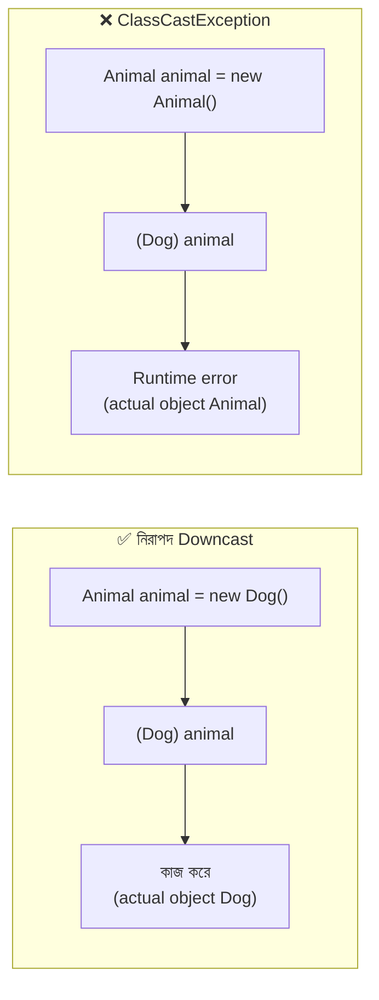

---

## 15. Inheritance vs Composition

এটি **Software Design**-এর জন্য অত্যন্ত গুরুত্বপূর্ণ।

- **Inheritance:** `IS-A Relationship`
- **Composition:** `HAS-A Relationship`

```java
class Engine {

    void start() {
        System.out.println("Engine started");
    }
}

class Car {

    private Engine engine = new Engine();

    void startCar() {
        engine.start();
    }
}
```

এখানে `Car HAS-A Engine`। তাই `Engine` object-কে `Car`-এর **field হিসেবে** ব্যবহার করেছি।

Inheritance-এর বদলে `class Car extends Engine` লেখা **semantic দিক থেকে ভুল design** হবে।

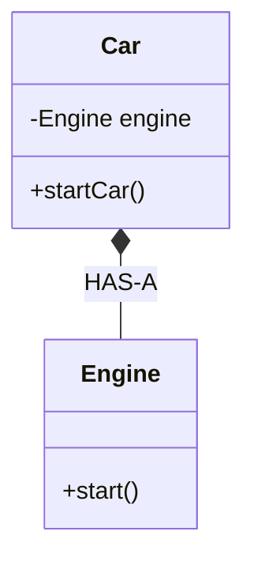

### When to Use Which?

| Inheritance                      | Composition                              |
| -------------------------------- | ---------------------------------------- |
| Genuine **IS-A** relation        | **HAS-A** relation                       |
| Subtype behavior                 | Combining independent components         |
| Parent-child coupling            | More flexible component replacement      |
| Polymorphic subtype design       | Delegation-based design                  |

> 💡 Practical software design-এ প্রায়ই **"Favor composition over inheritance"** principle অনুসরণ করা হয়, বিশেষত যখন inheritance দিয়ে সত্যিকারের subtype relation প্রকাশ করা যাচ্ছে না।

---

## 16. Common Mistakes in Inheritance

### Mistake 1 — Trying to Inherit Two Classes

#### ❌ Wrong

```java
class Dog extends Animal, Pet {
}
```

Java class একাধিক direct superclass extend করতে পারে না।

### Mistake 2 — Assuming Constructors Are Inherited

```java
class Parent {

    Parent(int x) {
        System.out.println(x);
    }
}

class Child extends Parent {

    Child() {
        super(10);
    }
}
```

এখানে explicit `super(10)` প্রয়োজন, কারণ `Parent`-এ **no-argument constructor নেই**।

### Mistake 3 — Overriding a Private Method

Parent-এর `private` method subclass-এ inherited হয় না, তাই সেটিকে **override করা যায় না**।

### Mistake 4 — Confusing Overloading and Overriding

```java
class Parent {
    void show(int x) {}
}

class Child extends Parent {
    void show(String x) {}
}
```

এখানে **overriding নয়, overloading** হয়েছে (parameter type আলাদা)।

| Mistake                                | সমাধান                                              |
| -------------------------------------- | --------------------------------------------------- |
| দুইটা class `extends` করা              | একটা `extends`, বাকিগুলো `interface` দিয়ে          |
| Constructor inherit হবে ভাবা           | `super(...)` দিয়ে explicit call করো                |
| `private` method override করতে চাওয়া  | `protected`/`public` রাখো                            |
| Overload ও Override গুলিয়ে ফেলা       | `@Override` ব্যবহার করো, compiler ধরে দেবে          |

---

## 17. Mini Project — University Management System

আজকের Mini Project-এ আমরা বাস্তব **OOP design practice** করব।

### Project-এর class hierarchy

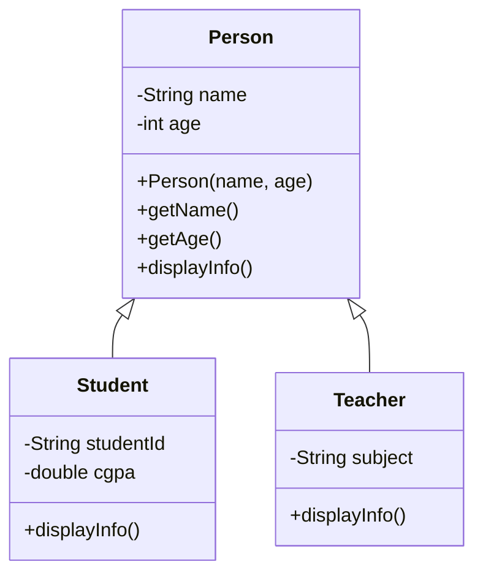

```
University-Management-System
├── Person.java
├── Student.java
├── Teacher.java
└── Main.java
```

### File 1 — `Person.java`

```java
public class Person {

    private String name;
    private int age;

    public Person(String name, int age) {
        this.name = name;
        this.age = age;
    }

    public String getName() {
        return name;
    }

    public int getAge() {
        return age;
    }

    public void displayInfo() {
        System.out.println("Name: " + name);
        System.out.println("Age: " + age);
    }
}
```

### File 2 — `Student.java`

```java
public class Student extends Person {

    private String studentId;
    private double cgpa;

    public Student(String name, int age,
                   String studentId, double cgpa) {

        super(name, age);

        this.studentId = studentId;
        this.cgpa = cgpa;
    }

    @Override
    public void displayInfo() {

        super.displayInfo();

        System.out.println("Student ID: " + studentId);
        System.out.println("CGPA: " + cgpa);
    }
}
```

### File 3 — `Teacher.java`

```java
public class Teacher extends Person {

    private String subject;

    public Teacher(String name, int age, String subject) {

        super(name, age);

        this.subject = subject;
    }

    @Override
    public void displayInfo() {

        super.displayInfo();

        System.out.println("Subject: " + subject);
    }
}
```

### File 4 — `Main.java`

```java
public class Main {

    public static void main(String[] args) {

        Person student = new Student(
            "Rahim", 22, "CSE101", 3.85
        );

        Person teacher = new Teacher(
            "Karim", 35, "Java Programming"
        );

        System.out.println("Student Information:");
        student.displayInfo();

        System.out.println();

        System.out.println("Teacher Information:");
        teacher.displayInfo();
    }
}
```

### Expected Output

```
Student Information:
Name: Rahim
Age: 22
Student ID: CSE101
CGPA: 3.85

Teacher Information:
Name: Karim
Age: 35
Subject: Java Programming
```

### 🔍 এই Project-এ কোন কোন concept ব্যবহার হয়েছে?

| Concept                | কোথায়                                                        |
| ---------------------- | ------------------------------------------------------------- |
| `extends`              | `Student extends Person`, `Teacher extends Person`            |
| `super(...)`           | `Student` ও `Teacher` constructor-এ parent constructor call   |
| Method Overriding      | `displayInfo()` দুই child class-এ override                   |
| `super.displayInfo()`  | Parent-এর implementation reuse                                |
| Encapsulation          | `private` fields + `getName()`, `getAge()`                    |
| Upcasting              | `Person student = new Student(...)`                           |
| Runtime Polymorphism   | `student.displayInfo()` কল করলে `Student`-এর version চলে      |
