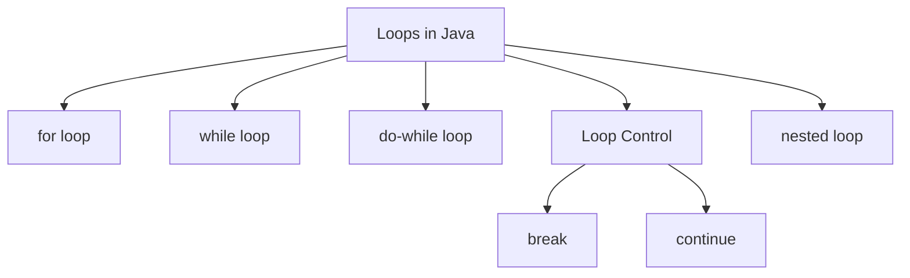
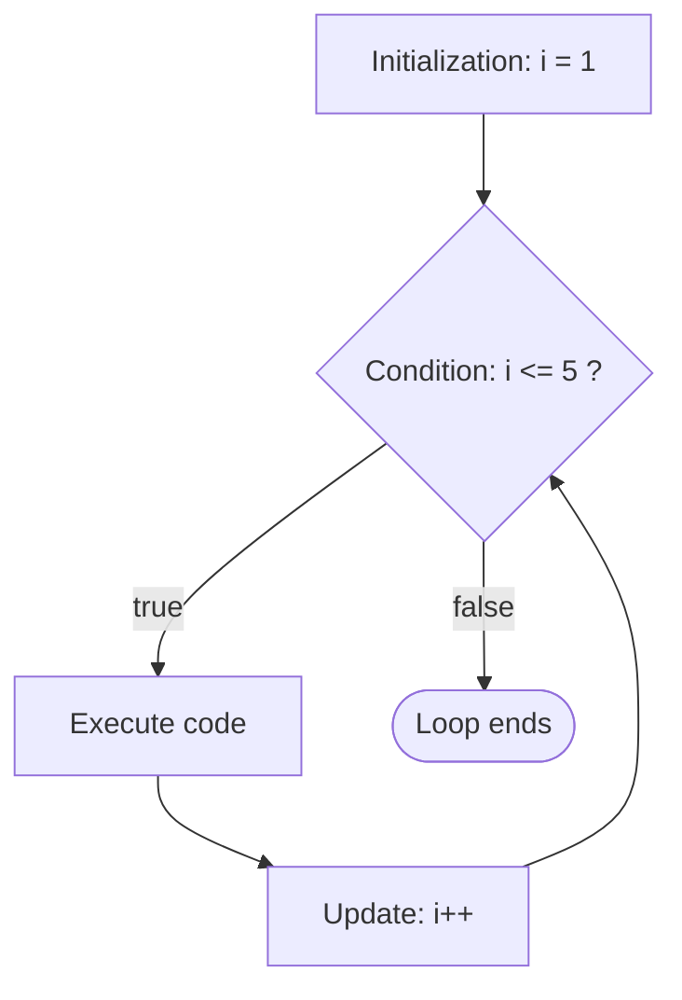
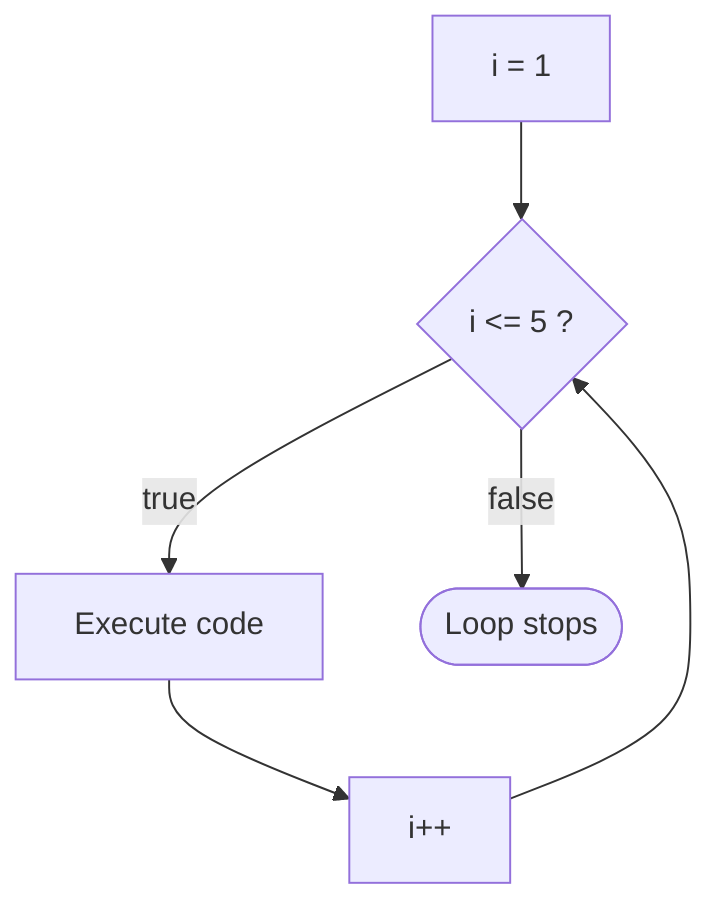
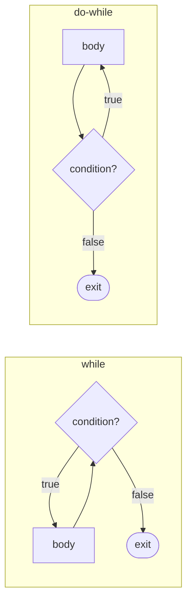

# 🔁 Loops in Java

আজকের topic: **Loops**

Loop ব্যবহার করা হয় **একই কাজ বারবার repeat** করার জন্য।

ধরো তুমি 1 থেকে 5 print করতে চাও।

**Loop ছাড়া:**

```java
System.out.println(1);
System.out.println(2);
System.out.println(3);
System.out.println(4);
System.out.println(5);
```

**Loop ব্যবহার করলে:**

```java
for (int i = 1; i <= 5; i++) {
    System.out.println(i);
}
```

এটাই loop-এর মূল idea।

## 🗺️ Loops Overview



## 📑 Table of Contents

1. [Why Do We Use Loops?](#1-why-do-we-use-loops)
2. [for Loop](#2-for-loop)
3. [for Loop কীভাবে কাজ করে?](#3-for-loop-কীভাবে-কাজ-করে)
4. [What is an Iteration?](#4-what-is-an-iteration)
5. [Print 1 to 10](#5-print-1-to-10)
6. [Print 10 to 1](#6-print-10-to-1)
7. [Print Even Numbers](#7-print-even-numbers)
8. [Print Odd Numbers](#8-print-odd-numbers)
9. [Sum of 1 to 10](#9-sum-of-1-to-10)
10. [Sum কীভাবে হচ্ছে?](#10-sum-কীভাবে-হচ্ছে)
11. [Multiplication Table](#11-multiplication-table)
12. [while Loop](#12-while-loop)
13. [while Loop কীভাবে কাজ করে?](#13-while-loop-কীভাবে-কাজ-করে)
14. [for vs while](#14-for-vs-while)
15. [do-while Loop](#15-do-while-loop)
16. [while vs do-while](#16-while-vs-do-while)
17. [Main Difference](#17-main-difference)
18. [Infinite Loop](#18-infinite-loop)
19. [break](#19-break)
20. [continue](#20-continue)
21. [break vs continue](#21-break-vs-continue)
22. [Print 1 to 10 Except 5](#22-print-1-to-10-except-5)
23. [Stop at 5](#23-stop-at-5)
24. [Nested Loop](#24-nested-loop)
25. [Nested Loop কীভাবে কাজ করে?](#25-nested-loop-কীভাবে-কাজ-করে)
26. [Simple Star Pattern](#26-simple-star-pattern)
27. [Pattern Logic](#27-pattern-logic)
28. [Reverse Star Pattern](#28-reverse-star-pattern)
29. [Factorial](#29-factorial)
30. [Count Digits](#30-count-digits)
31. [Reverse a Number](#31-reverse-a-number)
32. [Logic of Reverse Number](#32-logic-of-reverse-number)
33. [Sum of Digits](#33-sum-of-digits)
34. [Multiplication Table Using while](#34-multiplication-table-using-while)
35. [Important Scope Concept](#35-important-scope-concept)
36. [Common Mistake — Wrong Condition](#36-common-mistake--wrong-condition)
37. [Common Mistake — Wrong Increment](#37-common-mistake--wrong-increment)
38. [Common Mistake — Semicolon](#38-common-mistake--semicolon)
39. [Common Mistake with while](#39-common-mistake-with-while)
40. [Which Loop Should I Use?](#40-which-loop-should-i-use)
41. [Day 5 Quick Summary](#-day-5-quick-summary)
42. [Day 5 Most Important Topics](#-day-5-most-important-topics)
43. [Day 5 Practice Problems](#-day-5-practice-problems)
44. [Extra Practice — FizzBuzz](#-extra-practice--fizzbuzz)
45. [Day 5 Interview Questions](#-day-5-interview-questions)

---

## 1. Why Do We Use Loops?

Loop দরকার হয় যখন:

- Same task **repeatedly** করতে হয়
- **Known number of times** কাজ করতে হয়
- **Condition true** থাকা পর্যন্ত কাজ করতে হয়
- Array/String **traverse** করতে হয়
- **Counting** করতে হয়
- **Pattern** print করতে হয়
- **DSA problem** solve করতে হয়

### Java-তে main loop

1. `for` loop
2. `while` loop
3. `do-while` loop

### এছাড়া

- `break`
- `continue`
- nested loop

আজকে এগুলোও শিখবে।

---

## 2. for Loop

যখন আগে থেকেই মোটামুটি জানি loop **কতবার চলবে**, তখন `for` loop খুব useful।

### Syntax

```java
for (initialization; condition; update) {
    // code
}
```

### Example

```java
for (int i = 1; i <= 5; i++) {
    System.out.println(i);
}
```

**Output:**

```
1
2
3
4
5
```

---

## 3. for Loop কীভাবে কাজ করে?

```java
for (int i = 1; i <= 5; i++) {
    System.out.println(i);
}
```

ভেঙে দেখি:

| Part         | Code        | Meaning                                  |
| ------------ | ----------- | ---------------------------------------- |
| **Initialization** | `int i = 1` | loop শুরু হবে `i = 1` থেকে               |
| **Condition**      | `i <= 5`    | true হলে loop চলবে                       |
| **Update**         | `i++`       | প্রতি iteration শেষে `i` এক বাড়বে       |

### Flow



---

## 4. What is an Iteration?

Loop **একবার execute** হওয়াকে বলে **Iteration**।

```java
for (int i = 1; i <= 3; i++) {
    System.out.println("Java");
}
```

এখানে loop চলবে **3 বার**। তাই:

- Iteration 1
- Iteration 2
- Iteration 3

**Output:**

```
Java
Java
Java
```

---

## 5. Print 1 to 10

```java
for (int i = 1; i <= 10; i++) {
    System.out.println(i);
}
```

---

## 6. Print 10 to 1

এবার **decreasing** loop।

```java
for (int i = 10; i >= 1; i--) {
    System.out.println(i);
}
```

**Output:**

```
10
9
8
7
6
5
4
3
2
1
```

---

## 7. Print Even Numbers

1 থেকে 10 পর্যন্ত even number:

```java
for (int i = 1; i <= 10; i++) {

    if (i % 2 == 0) {
        System.out.println(i);
    }
}
```

**Output:**

```
2
4
6
8
10
```

### ✅ আর cleaner way

```java
for (int i = 2; i <= 10; i += 2) {
    System.out.println(i);
}
```

---

## 8. Print Odd Numbers

```java
for (int i = 1; i <= 10; i += 2) {
    System.out.println(i);
}
```

**Output:**

```
1
3
5
7
9
```

---

## 9. Sum of 1 to 10

এটা খুব important basic problem।

```java
int sum = 0;

for (int i = 1; i <= 10; i++) {
    sum = sum + i;
}

System.out.println(sum);
```

**Output:**

```
55
```

**Short form:** `sum += i;`

---

## 10. Sum কীভাবে হচ্ছে?

শুরুতে `sum = 0`

তারপর:

| `i` | Calculation      | `sum` |
| --- | ---------------- | ----- |
| 1   | `0 + 1`          | 1     |
| 2   | `1 + 2`          | 3     |
| 3   | `3 + 3`          | 6     |
| ... | ...              | ...   |
| 10  | `45 + 10`        | **55** |

---

## 11. Multiplication Table

ধরো 5-এর নামতা print করতে হবে।

```java
int number = 5;

for (int i = 1; i <= 10; i++) {
    System.out.println(number + " x " + i + " = " + (number * i));
}
```

**Output:**

```
5 x 1 = 5
5 x 2 = 10
5 x 3 = 15
...
5 x 10 = 50
```

---

## 12. while Loop

যতক্ষণ condition **true** থাকবে, ততক্ষণ loop চলবে।

### Syntax

```java
while (condition) {
    // code
}
```

### Example

```java
int i = 1;

while (i <= 5) {
    System.out.println(i);
    i++;
}
```

**Output:**

```
1
2
3
4
5
```

---

## 13. while Loop কীভাবে কাজ করে?

```java
int i = 1;

while (i <= 5) {
    System.out.println(i);
    i++;
}
```



> Condition **false** হলে loop stop।

---

## 14. for vs while

### `for`

যখন **iteration count জানা থাকে**:

```java
for (int i = 1; i <= 10; i++)
```

### `while`

যখন **exact iteration count জানা নাও থাকতে পারে**:

```java
while (condition)
```

**Example:** User correct password না দেওয়া পর্যন্ত input নেওয়া — এখানে কতবার loop চলবে আগে জানা নেই।

---

## 15. do-while Loop

`do-while`-এর special feature হলো:

> **Condition false হলেও অন্তত একবার execute হবে।**

### Syntax

```java
do {
    // code
} while (condition);
```

### Example

```java
int i = 1;

do {
    System.out.println(i);
    i++;
} while (i <= 5);
```

**Output:**

```
1
2
3
4
5
```

---

## 16. while vs do-while

### `while`

```java
int i = 10;

while (i < 5) {
    System.out.println("Hello");
}
```

**Output:** *Nothing*

কারণ শুরুতেই condition false।

### `do-while`

```java
int i = 10;

do {
    System.out.println("Hello");
} while (i < 5);
```

**Output:**

```
Hello
```

কারণ `do` block আগে execute হয়, তারপর condition check হয়।

---

## 17. Main Difference

| Loop         | Order                                 |
| ------------ | ------------------------------------- |
| `while`      | condition first → then execution      |
| `do-while`   | execution first → then condition      |



---

## 18. Infinite Loop

যে loop **কখনো stop হয় না** তাকে বলে **Infinite Loop**।

```java
while (true) {
    System.out.println("Hello");
}
```

এটা continuously চলতেই থাকবে।

### আরেকটা mistake

```java
int i = 1;

while (i <= 5) {
    System.out.println(i);
}
```

এখানে `i++` **নেই**। তাই `i` সবসময় `1` থাকবে। Condition `i <= 5` সবসময় true। ফলে **infinite loop**।

### ✅ Correct

```java
int i = 1;

while (i <= 5) {
    System.out.println(i);
    i++;
}
```

---

## 19. break

`break` loop **immediately stop** করে।

```java
for (int i = 1; i <= 10; i++) {

    if (i == 5) {
        break;
    }

    System.out.println(i);
}
```

**Output:**

```
1
2
3
4
```

যখন `i == 5` তখন `break` execute হয়েছে। Loop শেষ।

---

## 20. continue

`continue` পুরো loop stop করে না। শুধু **current iteration skip** করে।

```java
for (int i = 1; i <= 5; i++) {

    if (i == 3) {
        continue;
    }

    System.out.println(i);
}
```

**Output:**

```
1
2
4
5
```

`3` skip হয়েছে।

---

## 21. break vs continue

| Keyword    | কাজ                            |
| ---------- | ------------------------------ |
| `break`    | পুরো loop **শেষ** (Stop)       |
| `continue` | শুধু current iteration **skip** |

> ⭐ এটা interview-এর খুব common question।

---

## 22. Print 1 to 10 Except 5

```java
for (int i = 1; i <= 10; i++) {

    if (i == 5) {
        continue;
    }

    System.out.println(i);
}
```

---

## 23. Stop at 5

```java
for (int i = 1; i <= 10; i++) {

    if (i == 5) {
        break;
    }

    System.out.println(i);
}
```

**Output:**

```
1
2
3
4
```

---

## 24. Nested Loop

একটি loop-এর **ভিতরে আরেকটি loop** থাকলে তাকে বলে **Nested Loop**।

```java
for (int i = 1; i <= 3; i++) {

    for (int j = 1; j <= 3; j++) {
        System.out.println("i = " + i + ", j = " + j);
    }
}
```

**Output:**

```
i = 1, j = 1
i = 1, j = 2
i = 1, j = 3

i = 2, j = 1
i = 2, j = 2
i = 2, j = 3

i = 3, j = 1
i = 3, j = 2
i = 3, j = 3
```

---

## 25. Nested Loop কীভাবে কাজ করে?

- **Outer loop:** `i`
- **Inner loop:** `j`

যখন `i = 1` তখন `j` **complete 1 থেকে 3** পর্যন্ত চলবে।

তারপর `i = 2` — আবার `j` 1 থেকে 3 পর্যন্ত।

---

## 26. Simple Star Pattern

```java
for (int i = 1; i <= 5; i++) {

    for (int j = 1; j <= i; j++) {
        System.out.print("* ");
    }

    System.out.println();
}
```

**Output:**

```
*
* *
* * *
* * * *
* * * * *
```

> Pattern problem বুঝতে nested loop খুব important।

---

## 27. Pattern Logic

| Loop                                  | কাজ                              |
| ------------------------------------- | -------------------------------- |
| Outer: `for (int i = 1; i <= 5; i++)` | **number of rows** decide করে    |
| Inner: `for (int j = 1; j <= i; j++)` | প্রতি row-তে **কয়টা star** decide করে |

---

## 28. Reverse Star Pattern

```java
for (int i = 5; i >= 1; i--) {

    for (int j = 1; j <= i; j++) {
        System.out.print("* ");
    }

    System.out.println();
}
```

**Output:**

```
* * * * *
* * * *
* * *
* *
*
```

---

## 29. Factorial

খুব common interview/practice problem।

```
5! = 5 × 4 × 3 × 2 × 1 = 120
```

### Code

```java
int number = 5;
int factorial = 1;

for (int i = 1; i <= number; i++) {
    factorial *= i;
}

System.out.println(factorial);
```

**Output:**

```
120
```

---

## 30. Count Digits

**Example:** `12345` → Digits: `5`

```java
int number = 12345;
int count = 0;

while (number != 0) {
    number = number / 10;
    count++;
}

System.out.println(count);
```

**Output:**

```
5
```

---

## 31. Reverse a Number

**Example:** `1234` → Reverse: `4321`

```java
int number = 1234;
int reverse = 0;

while (number != 0) {

    int digit = number % 10;

    reverse = reverse * 10 + digit;

    number = number / 10;
}

System.out.println(reverse);
```

**Output:**

```
4321
```

---

## 32. Logic of Reverse Number

ধরো `number = 1234`

**First:** `1234 % 10 = 4`, তাই `digit = 4`

তারপর:

```
reverse = 0 * 10 + 4
        = 4
```

তারপর:

```
number = 1234 / 10
       = 123
```

এভাবে repeat হবে।

### Step-by-step Table

| Step | `number` | `digit` | `reverse`        |
| ---- | -------- | ------- | ---------------- |
| 1    | 1234     | 4       | `0 * 10 + 4 = 4`     |
| 2    | 123      | 3       | `4 * 10 + 3 = 43`    |
| 3    | 12       | 2       | `43 * 10 + 2 = 432`  |
| 4    | 1        | 1       | `432 * 10 + 1 = 4321` |

---

## 33. Sum of Digits

**Example:** `1234` → `1 + 2 + 3 + 4 = 10`

```java
int number = 1234;
int sum = 0;

while (number != 0) {

    int digit = number % 10;

    sum += digit;

    number /= 10;
}

System.out.println(sum);
```

**Output:**

```
10
```

---

## 34. Multiplication Table Using while

```java
int number = 5;
int i = 1;

while (i <= 10) {

    System.out.println(number + " x " + i + " = " + (number * i));

    i++;
}
```

---

## 35. Important Scope Concept

```java
for (int i = 1; i <= 5; i++) {
    System.out.println(i);
}
```

এর **বাইরে** `System.out.println(i);` লিখলে **error** হবে।

কারণ `i` declare করা হয়েছে `for` loop-এর ভিতরে। তার **scope শুধু loop-এর মধ্যে**।

### যদি বাইরে দরকার হয়

```java
int i;

for (i = 1; i <= 5; i++) {
    System.out.println(i);
}

System.out.println(i);
```

---

## 36. Common Mistake — Wrong Condition

### ❌ Wrong

```java
for (int i = 1; i >= 10; i++) {
    System.out.println(i);
}
```

এটা **execute হবে না**। কারণ শুরুতেই `1 >= 10` false।

### ✅ Correct

```java
for (int i = 1; i <= 10; i++) {
    System.out.println(i);
}
```

---

## 37. Common Mistake — Wrong Increment

### ❌ Wrong

```java
for (int i = 1; i <= 10; i--) {
    System.out.println(i);
}
```

**Problem:**

```
1
0
-1
-2
...
```

Condition সবসময় `i <= 10` true থাকবে। ফলে **infinite loop**।

### ✅ Correct

`i++`

---

## 38. Common Mistake — Semicolon

### ❌ Wrong

```java
for (int i = 1; i <= 5; i++);
{
    System.out.println("Hello");
}
```

এখানে semicolon loop-কে **empty body** বানিয়ে দেয়।

### ✅ Correct

```java
for (int i = 1; i <= 5; i++) {
    System.out.println("Hello");
}
```

---

## 39. Common Mistake with while

### ❌ Wrong

```java
int i = 1;

while (i <= 5) {
    System.out.println(i);
}
```

Missing: `i++;`

### ✅ Correct

```java
int i = 1;

while (i <= 5) {
    System.out.println(i);
    i++;
}
```

---

## 40. Which Loop Should I Use?

সহজ rule:

| Loop         | কখন ব্যবহার করবে                              |
| ------------ | --------------------------------------------- |
| `for`        | কতবার চলবে **জানা আছে**                        |
| `while`      | condition-based, **exact count জানা নেই**      |
| `do-while`   | **অন্তত একবার** execute করতেই হবে              |

### Example

| Situation                         | Loop         |
| --------------------------------- | ------------ |
| Print 1–100                       | `for`        |
| Correct password না পাওয়া পর্যন্ত  | `while`      |
| Menu at least once show করা        | `do-while`   |

---

## 📋 Day 5 Quick Summary

| Concept         | Meaning                              |
| --------------- | ------------------------------------ |
| `for` loop      | fixed/repetitive iteration           |
| `while` loop    | condition true থাকা পর্যন্ত          |
| `do-while`      | minimum one execution                |
| `break`         | loop stop                            |
| `continue`      | current iteration skip               |
| nested loop     | loop inside loop                     |

---

## ⭐ Day 5 Most Important Topics

আজকে বিশেষভাবে clear করবে:

1. `for` loop structure
2. initialization
3. condition
4. increment/decrement
5. `while` loop
6. `do-while` loop
7. infinite loop
8. `break`
9. `continue`
10. nested loop
11. sum problems
12. factorial
13. reverse number
14. sum of digits
15. simple pattern

---

## 🧩 Day 5 Practice Problems

### Problem 1

1 থেকে 100 print করো।

### Problem 2

100 থেকে 1 print করো।

### Problem 3

1 থেকে 50-এর **even** numbers print করো।

### Problem 4

1 থেকে 50-এর **odd** numbers print করো।

### Problem 5

1 থেকে 100 পর্যন্ত numbers-এর sum বের করো।

**Expected:** `5050`

### Problem 6

একটা number-এর multiplication table print করো।

```
Example: 7

Output:
7 x 1 = 7
...
7 x 10 = 70
```

### Problem 7

Factorial বের করো।

```
Input:  5
Output: 120
```

### Problem 8

Number-এর digits count করো।

```
Input:  56789
Output: 5
```

### Problem 9

Number reverse করো।

```
Input:  12345
Output: 54321
```

### Problem 10

Digits-এর sum বের করো।

```
Input:  12345
Output: 15
```

### Problem 11

1–20 print করো কিন্তু **10 skip** করো।

**Use:** `continue`

### Problem 12

1–20 print করো কিন্তু **10-এ পৌঁছালে loop stop** করো।

**Use:** `break`

---

## 🎯 Extra Practice — FizzBuzz

Interview-এর জন্য useful beginner problem।

**1 থেকে 30:**

| Condition                          | Output       |
| ---------------------------------- | ------------ |
| 3 দ্বারা divisible                 | `Fizz`       |
| 5 দ্বারা divisible                 | `Buzz`       |
| 3 ও 5 **উভয় দ্বারা** divisible    | `FizzBuzz`   |
| Otherwise                          | number       |

### Solution

```java
for (int i = 1; i <= 30; i++) {

    if (i % 3 == 0 && i % 5 == 0) {
        System.out.println("FizzBuzz");

    } else if (i % 3 == 0) {
        System.out.println("Fizz");

    } else if (i % 5 == 0) {
        System.out.println("Buzz");

    } else {
        System.out.println(i);
    }
}
```

> ⚠️ এখানে **order important**। প্রথমে `i % 3 == 0 && i % 5 == 0` check করতে হবে।

---

## 💼 Day 5 Interview Questions

> এগুলো `Interview Questions.docx`-এ রাখতে পারো।

### 1. What is a loop in Java?

A loop is a control structure used to execute a block of code repeatedly based on a condition.

### 2. What are the main types of loops in Java?

- `for` loop
- `while` loop
- `do-while` loop

### 3. What is the syntax of a for loop?

```java
for (initialization; condition; update) {
    // statements
}
```

### 4. What is the difference between `for` and `while`?

- `for` is generally used when the number of iterations is known.
- `while` is generally used when execution depends primarily on a condition and the exact number of iterations may not be known.

### 5. Difference between `while` and `do-while`?

- `while` checks the condition **before** executing the body.
- `do-while` executes the body **first** and checks the condition afterward.

Therefore, a `do-while` loop executes **at least once**.

### 6. What is an infinite loop?

A loop that never terminates is called an infinite loop.

```java
while (true) {
}
```

### 7. What does `break` do?

`break` immediately terminates the loop.

### 8. What does `continue` do?

`continue` skips the remaining statements of the current iteration and moves to the next iteration.

### 9. Difference between `break` and `continue`?

- `break` → exits loop
- `continue` → skips current iteration

### 10. What is a nested loop?

A loop inside another loop is called a nested loop.

### 11. What is an iteration?

One complete execution of a loop body is called an iteration.

### 12. What is the output?

```java
for (int i = 1; i <= 5; i++) {

    if (i == 3) {
        continue;
    }

    System.out.print(i + " ");
}
```

**Answer:**

```
1 2 4 5
```

### 13. What is the output?

```java
for (int i = 1; i <= 5; i++) {

    if (i == 3) {
        break;
    }

    System.out.print(i + " ");
}
```

**Answer:**

```
1 2
```

### 14. How many times does this loop execute?

```java
for (int i = 0; i < 5; i++) {
    System.out.println(i);
}
```

**Answer:** `5 times`

Values: `0`, `1`, `2`, `3`, `4`

### 15. What is wrong with this code?

```java
int i = 1;

while (i <= 5) {
    System.out.println(i);
}
```

**Answer:** `i` is never updated, so the condition always remains true and the loop becomes infinite.

### 16. Will this execute?

```java
int x = 10;

while (x < 5) {
    System.out.println("Java");
}
```

**Answer:** No. Because the condition is false initially.

### 17. Will this execute?

```java
int x = 10;

do {
    System.out.println("Java");
} while (x < 5);
```

**Answer:** Yes, once. Because a `do-while` executes the body before checking the condition.
