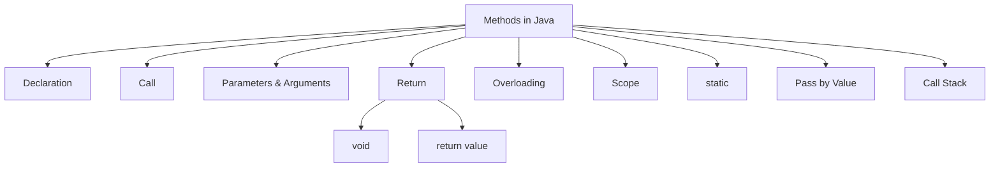
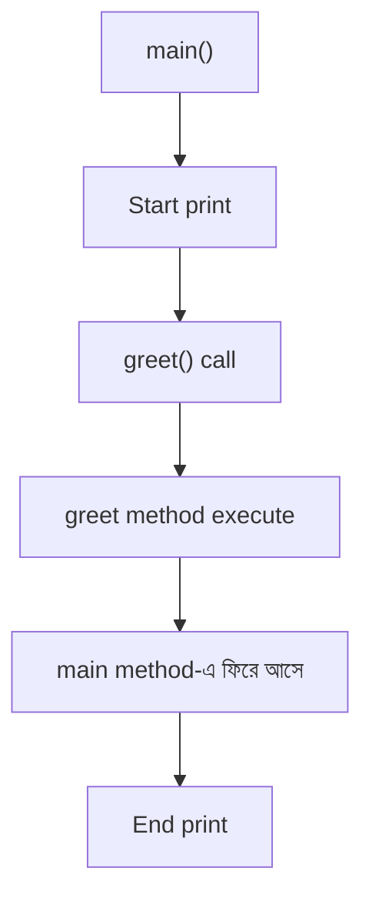
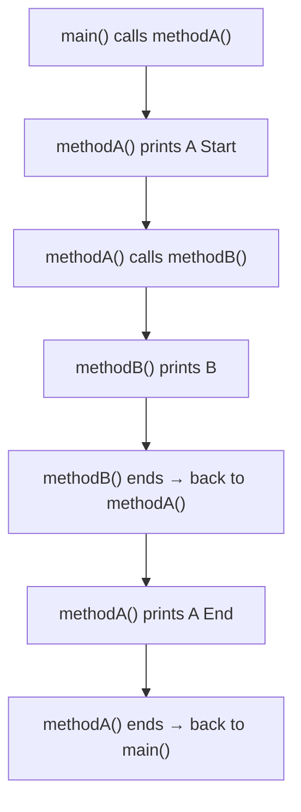

# 🧩 Methods in Java

আজকের topic: **Methods in Java**

**Method** হলো এমন একটি **reusable block of code** যেটা নির্দিষ্ট একটি কাজ করে। একই code বারবার না লিখে method বানিয়ে প্রয়োজনমতো **call** করা যায়।

## 🗺️ Methods Overview



## 📚 আজকে যা শিখবে

1. What is a Method
2. Method Syntax
3. Calling a Method
4. Parameters
5. Arguments
6. Return Type
7. `void` Method
8. Method Overloading
9. Variable Scope
10. `static` Method
11. Pass by Value
12. Basic Call Stack Idea

## 📑 Table of Contents

1. [What is a Method?](#1-what-is-a-method)
2. [Why Do We Use Methods?](#2-why-do-we-use-methods)
3. [Basic Method Syntax](#3-basic-method-syntax)
4. [Method Call](#4-method-call)
5. [Flow of Execution](#5-flow-of-execution)
6. [void Method](#6-void-method)
7. [Method with Parameter](#7-method-with-parameter)
8. [Parameter vs Argument](#8-parameter-vs-argument)
9. [Multiple Parameters](#9-multiple-parameters)
10. [Method Returning a Value](#10-method-returning-a-value)
11. [Understanding return](#11-understanding-return)
12. [Return Type Must Match](#12-return-type-must-match)
13. [void vs Return Method](#13-void-vs-return-method)
14. [Example — Square of a Number](#14-example--square-of-a-number)
15. [Example — Even or Odd](#15-example--even-or-odd)
16. [Example — Find Maximum](#16-example--find-maximum)
17. [Method Overloading](#17-method-overloading)
18. [Overloading by Data Type](#18-overloading-by-data-type)
19. [Overloading Rules](#19-overloading-rules)
20. [Return Type দিয়ে Overloading হয় না](#20-return-type-দিয়ে-overloading-হয়-না)
21. [Variable Scope](#21-variable-scope)
22. [Local Variable](#22-local-variable)
23. [Block Scope](#23-block-scope)
24. [What is static?](#24-what-is-static)
25. [Method Without static](#25-method-without-static)
26. [Java is Pass by Value](#26-java-is-pass-by-value)
27. [return Immediately Ends the Method](#27-return-immediately-ends-the-method)
28. [Multiple Return Statements](#28-multiple-return-statements)
29. [Method Calling Another Method](#29-method-calling-another-method)
30. [Basic Call Stack Idea](#30-basic-call-stack-idea)
31. [Real Example — Calculator Using Methods](#31-real-example--calculator-using-methods)
32. [Factorial Using a Method](#32-factorial-using-a-method)
33. [Sum from 1 to N](#33-sum-from-1-to-n)
34. [Prime Number Using Method](#34-prime-number-using-method)
35. [Better Prime Method](#35-better-prime-method)
36. [Common Mistake — Forgetting Method Call](#36-common-mistake--forgetting-method-call)
37. [Common Mistake — Missing Return](#37-common-mistake--missing-return)
38. [Common Mistake — Wrong Argument Count](#38-common-mistake--wrong-argument-count)
39. [Common Mistake — Wrong Data Type](#39-common-mistake--wrong-data-type)
40. [Method Naming Convention](#40-method-naming-convention)
41. [Day 6 Quick Summary](#-day-6-quick-summary)
42. [Day 6 Most Important Concepts](#-day-6-most-important-concepts)
43. [Day 6 Practice Problems](#-day-6-practice-problems)
44. [Mini Project — Method Based Calculator](#-mini-project--method-based-calculator)
45. [Day 6 Interview Questions](#-day-6-interview-questions)

---

## 1. What is a Method?

ধরো তুমি বারবার দুইটা number যোগ করতে চাও।

### Method ছাড়া

```java
int a = 10;
int b = 20;

System.out.println(a + b);
```

আবার অন্য জায়গায়:

```java
int x = 30;
int y = 40;

System.out.println(x + y);
```

একই ধরনের logic **বারবার লিখতে** হচ্ছে।

### Method ব্যবহার করলে

```java
static int add(int a, int b) {
    return a + b;
}
```

তারপর:

```java
System.out.println(add(10, 20));
System.out.println(add(30, 40));
```

এখন একই method **বারবার reuse** করা যাচ্ছে।

---

## 2. Why Do We Use Methods?

Methods ব্যবহার করি:

- **Code reuse** করার জন্য
- Code **ছোট ও clean** রাখার জন্য
- Complex problem **ছোট অংশে ভাগ** করার জন্য
- **Debugging** সহজ করার জন্য
- **Maintainability** বাড়ানোর জন্য
- **Readable** code লেখার জন্য

---

## 3. Basic Method Syntax

```java
accessModifier static returnType methodName(parameters) {
    // method body
}
```

### Beginner level example

```java
static void greet() {
    System.out.println("Hello Java");
}
```

এখানে:

| Part     | Meaning                  |
| -------- | ------------------------ |
| `static` | method type/context      |
| `void`   | return type              |
| `greet`  | method name              |
| `()`     | parameter list           |
| `{}`     | method body              |

---

## 4. Method Call

Method শুধু declare করলেই execute হয় না। Method-কে **call** করতে হয়।

```java
public class Main {

    static void greet() {
        System.out.println("Hello Java");
    }

    public static void main(String[] args) {

        greet();
    }
}
```

**Output:**

```
Hello Java
```

---

## 5. Flow of Execution

```java
public class Main {

    static void greet() {
        System.out.println("Hello");
    }

    public static void main(String[] args) {

        System.out.println("Start");

        greet();

        System.out.println("End");
    }
}
```

**Output:**

```
Start
Hello
End
```

### Flow



---

## 6. void Method

যে method কোনো value **return করে না** তাকে সাধারণভাবে **void method** বলা হয়।

```java
static void sayHello() {
    System.out.println("Hello");
}
```

**Call:**

```java
sayHello();
```

এখানে method শুধু কাজ করছে। কোনো result return করছে না।

---

## 7. Method with Parameter

Method-এর **input নিতে** parameter ব্যবহার করা হয়।

```java
static void greet(String name) {
    System.out.println("Hello " + name);
}
```

**Call:**

```java
greet("Arif");
```

**Output:**

```
Hello Arif
```

এখানে:

- `String name` হলো **parameter**
- `"Arif"` হলো **argument**

---

## 8. Parameter vs Argument

এই difference interview-এ প্রায়ই আসে।

**Method declaration:**

```java
static void greet(String name) {
    System.out.println(name);
}
```

এখানে `String name` হলো **parameter**।

**Method call:**

```java
greet("Rahim");
```

এখানে `"Rahim"` হলো **argument**।

### সহজভাবে

| Term          | Meaning                                  |
| ------------- | ---------------------------------------- |
| **Parameter** | method **definition**-এর variable       |
| **Argument**  | method **call**-এর actual value          |

---

## 9. Multiple Parameters

```java
static void displayInfo(String name, int age) {

    System.out.println("Name: " + name);
    System.out.println("Age: " + age);
}
```

**Call:**

```java
displayInfo("Rahim", 25);
```

**Output:**

```
Name: Rahim
Age: 25
```

---

## 10. Method Returning a Value

Method যদি result **return** করে, তাহলে **return type** দিতে হয়।

```java
static int add(int a, int b) {

    return a + b;
}
```

**Call:**

```java
int result = add(10, 20);

System.out.println(result);
```

**Output:**

```
30
```

---

## 11. Understanding return

```java
static int add(int a, int b) {
    return a + b;
}
```

এখানে:

- `int` মানে method একটি **integer return** করবে।
- `return a + b;` method-এর result **caller-এর কাছে পাঠায়**।

---

## 12. Return Type Must Match

### ❌ Wrong

```java
static int greet() {
    return "Hello";
}
```

এখানে method বলছে *"আমি `int` return করবো"*, কিন্তু return করছে `String`। তাই **compile error**।

### ✅ Correct

```java
static String greet() {
    return "Hello";
}
```

---

## 13. void vs Return Method

### Void

```java
static void add(int a, int b) {
    System.out.println(a + b);
}
```

এখানে result শুধু print হচ্ছে। **Reuse করা কঠিন**।

### Returning method

```java
static int add(int a, int b) {
    return a + b;
}
```

এখন:

```java
int result = add(10, 20);

System.out.println(result);
```

আবার:

```java
int doubleResult = add(10, 20) * 2;
```

এটা **বেশি flexible**।

---

## 14. Example — Square of a Number

```java
static int square(int number) {
    return number * number;
}
```

**Call:**

```java
System.out.println(square(5));
```

**Output:**

```
25
```

---

## 15. Example — Even or Odd

```java
static boolean isEven(int number) {

    return number % 2 == 0;
}
```

**Call:**

```java
System.out.println(isEven(10));
```

**Output:**

```
true
```

আর:

```java
if (isEven(7)) {
    System.out.println("Even");
} else {
    System.out.println("Odd");
}
```

**Output:**

```
Odd
```

---

## 16. Example — Find Maximum

```java
static int findMax(int a, int b) {

    if (a > b) {
        return a;
    } else {
        return b;
    }
}
```

**Call:**

```java
System.out.println(findMax(10, 20));
```

**Output:**

```
20
```

### ✅ Cleaner version

```java
static int findMax(int a, int b) {
    return a > b ? a : b;
}
```

---

## 17. Method Overloading

একই নামের **একাধিক method** থাকতে পারে, যদি তাদের **parameter list আলাদা** হয়। এটাকে বলে **Method Overloading**।

```java
static int add(int a, int b) {
    return a + b;
}

static int add(int a, int b, int c) {
    return a + b + c;
}
```

**Call:**

```java
System.out.println(add(10, 20));
System.out.println(add(10, 20, 30));
```

**Output:**

```
30
60
```

---

## 18. Overloading by Data Type

```java
static int add(int a, int b) {
    return a + b;
}

static double add(double a, double b) {
    return a + b;
}
```

**Call:**

```java
System.out.println(add(10, 20));
System.out.println(add(10.5, 20.5));
```

Java **parameter type** দেখে ঠিক method select করবে।

---

## 19. Overloading Rules

Method overloading হতে পারে parameter পরিবর্তন করে। যেমন:

- **Number** of parameters
- **Type** of parameters
- **Order** of parameter types

```java
display(int a)
display(int a, int b)
display(double a)
display(String name, int age)
display(int age, String name)
```

সবগুলো valid overload হতে পারে।

---

## 20. Return Type দিয়ে Overloading হয় না

### ❌ Wrong

```java
static int test(int a) {
    return a;
}

static double test(int a) {
    return a;
}
```

এটা valid না। কারণ শুধু **return type আলাদা**, parameter list same। Java method call দেখে বুঝতে পারবে না কোনটা ব্যবহার করবে।

---

## 21. Variable Scope

Variable **কোথা থেকে access** করা যাবে, সেটাকে **scope** বলে।

```java
static void test() {

    int number = 10;

    System.out.println(number);
}
```

`number` শুধু `test()` method-এর **ভিতরে** available।

### ❌ এই code wrong

```java
static void test() {

    int number = 10;
}

public static void main(String[] args) {

    System.out.println(number);
}
```

কারণ `number` `main` method-এর scope-এ নেই।

---

## 22. Local Variable

Method-এর **ভিতরে declare** করা variable হলো **Local Variable**।

```java
static void calculate() {

    int result = 10 + 20;

    System.out.println(result);
}
```

`result` local variable।

---

## 23. Block Scope

```java
if (true) {

    int number = 10;

    System.out.println(number);
}
```

এর **বাইরে** `System.out.println(number);` করলে **error**। কারণ variable block-এর বাইরে visible না।

---

## 24. What is static?

এখন beginner-level concept হিসেবে মনে রাখো:

`main()` method **static**। তাই `main`-এর ভেতর থেকে object তৈরি না করে আরেকটি method directly call করতে চাইলে সেই method-ও **static** রাখা সহজ।

```java
static void greet() {
    System.out.println("Hello");
}

public static void main(String[] args) {
    greet();
}
```

OOP শেখার সময় static vs instance method detail-এ বুঝবে। এখন শুধু:

| Type                | Related to          |
| ------------------- | ------------------- |
| **static** method   | **class**-এর সাথে   |
| **instance** method | **object**-এর সাথে  |

এই basic idea যথেষ্ট।

---

## 25. Method Without static

```java
public class Main {

    void greet() {
        System.out.println("Hello");
    }

    public static void main(String[] args) {

        Main obj = new Main();

        obj.greet();
    }
}
```

এখানে `Main obj = new Main();` — **object তৈরি** হয়েছে। তারপর `obj.greet();` — **instance method call** হয়েছে।

এই concept OOP-তে বিস্তারিত আসবে।

---

## 26. Java is Pass by Value

> ⭐ Interview-এর জন্য খুব important।

**Java সবসময় pass by value।**

### Primitive example

```java
public class Main {

    static void change(int number) {
        number = 100;
    }

    public static void main(String[] args) {

        int x = 10;

        change(x);

        System.out.println(x);
    }
}
```

**Output:**

```
10
```

### কেন?

কারণ method **original `x` পায়নি**। `x`-এর value-এর **copy** পেয়েছে।

### Flow

```
x = 10

change(x)

number = copy of 10

number = 100

original x remains 10
```

---

### 🧱 Stack Memory Flow — Example 1: Value Return করা হয়নি

নিচের code-এ `change()` method `a`-এর মান `20` করে, কিন্তু **কিছু return করে না**। তাই `main()`-এর মূল `a` অপরিবর্তিত থাকে।

```java
public class Method {

    static void change(int a) {
        a = 20;
        System.out.println(a);   // প্রিন্ট করবে 20
    }

    public static void main(String[] args) {
        int a = 10;
        change(a);
        System.out.println(a);   // প্রিন্ট করবে 10
    }
}
```

**Output:**

```
20
10
```

#### Step 1: `main()` শুরু — *main Frame Push*

```
┌─────────────────────┐
│    main() Frame     │
│     [ a = 10 ]      │
└─────────────────────┘
```

- JVM কল স্ট্যাকে `main()` মেথডের ফ্রেম পুশ করে।
- এর ভেতরে লোকাল ভ্যারিয়েবল `a = 10` স্টোর হয়।

#### Step 2: `change(a)` কল — *change Frame Push*

```
┌─────────────────────┐
│   change() Frame    │
│     [ a = 10 ]      │  ← main-এর a-এর copy
├─────────────────────┤
│    main() Frame     │
│     [ a = 10 ]      │
└─────────────────────┘
```

- স্ট্যাকের উপরে `change()` মেথডের জন্য **সম্পূর্ণ নতুন ফ্রেম** তৈরি হয়।
- `main()`-এর `a`-এর মানের **কপি** (`10`) এসে `change()` ফ্রেমের নিজস্ব লোকাল ভ্যারিয়েবল `a`-তে বসে।

#### Step 3: `a = 20` (Local) — *Value Updated*

```
┌─────────────────────┐
│   change() Frame    │
│     [ a = 20 ]      │  ← শুধু এটা বদলেছে
├─────────────────────┤
│    main() Frame     │
│     [ a = 10 ]      │  ← অপরিবর্তিত
└─────────────────────┘
```

- শুধু `change()` ফ্রেমের ভেতরের লোকাল `a` আপডেট হয়ে `20` হয় এবং স্ক্রিনে `20` প্রিন্ট করে।
- নিচে থাকা `main()` ফ্রেমের মূল `a` সম্পূর্ণ অপরিবর্তিত (`10`) থাকে।

#### Step 4: `change()` শেষ — *change Frame Pop*

```
┌─────────────────────┐
│    main() Frame     │
│     [ a = 10 ]      │
└─────────────────────┘
```

- `change()` মেথডের কাজ শেষ হওয়ায় এর ফ্রেমটি স্ট্যাক থেকে **পপ (Destroy)** হয়ে যায়।
- কন্ট্রোল `main()`-এ ফিরে আসে এবং `main()` ফ্রেমের ভেতরে সংরক্ষিত থাকা আগের `a` দিয়ে স্ক্রিনে `10` প্রিন্ট করে।

#### Step 5: `main()` শেষ — *Stack Empty*

```
┌─────────────────────┐
│                     │
│     STACK EMPTY     │
│                     │
└─────────────────────┘
```

- `main()` মেথডের কাজ শেষ হলে তার ফ্রেমটিও স্ট্যাক থেকে মুছে যায় এবং স্ট্যাক পুরোপুরি খালি হয়ে যায়।

#### 📊 Step-by-step Summary (Example 1)

| Step | ঘটনা                  | `main()`-এর `a` | `change()`-এর `a` |
| ---- | --------------------- | --------------- | ----------------- |
| 1    | `main()` শুরু         | 10              | —                 |
| 2    | `change(a)` কল        | 10              | 10 (copy)         |
| 3    | `a = 20` (Local)      | 10              | **20**            |
| 4    | `change()` শেষ (Pop)  | **10**          | destroyed         |
| 5    | `main()` শেষ          | destroyed       | —                 |

---

### 🧱 Stack Memory Flow — Example 2: `return` দিয়ে নতুন মান ফেরত পাঠানো

এখন `change()` method নতুন মানটি **return** করছে, আর `main()` সেটা নিজের `a`-তে **assign** করছে। তাই `main()`-এর `a`-ও `20` হয়ে যায়।

```java
public class Method {

    static int change(int a) {
        a = 20;
        System.out.println(a);   // প্রিন্ট করবে 20
        return a;                // নতুন মানটি ফেরত পাঠানো হলো
    }

    public static void main(String[] args) {
        int a = 10;
        a = change(a);           // মূল 'a'-এর মান আপডেট হয়ে গেল 20
        System.out.println(a);   // প্রিন্ট করবে 20
    }
}
```

**Output:**

```
20
20
```

#### Step 1: `main()` শুরু — *Stack Frame Push*

```
┌─────────────────────┐
│    main() Frame     │
│     [ a = 10 ]      │
└─────────────────────┘
```

- JVM কল স্ট্যাকে `main()`-এর জন্য ফ্রেম তৈরি করে।
- লোকাল ভ্যারিয়েবল `a = 10` স্টোর হয়।

#### Step 2: `change(a)` কল — *New Frame Push*

```
┌─────────────────────┐
│   change() Frame    │
│     [ a = 10 ]      │  ← main-এর a-এর copy
├─────────────────────┤
│    main() Frame     │
│     [ a = 10 ]      │
└─────────────────────┘
```

- `change()`-এর জন্য স্ট্যাকের উপরে নতুন ফ্রেম পুশ হয়।
- `main()`-এর `a`-এর মান (`10`) কপি হয়ে `change()`-এর প্যারামিটার `a`-তে বসে।

#### Step 3: `a = 20` আপডেট — *Local Copy Changed*

```
┌─────────────────────┐
│   change() Frame    │
│     [ a = 20 ]      │  ← local copy বদলেছে
├─────────────────────┤
│    main() Frame     │
│     [ a = 10 ]      │  ← এখনো আগের মতো
└─────────────────────┘
```

- শুধুমাত্র `change()` ফ্রেমের ভেতরের **লোকাল কপিটি** আপডেট হয়ে `20` হয় এবং স্ক্রিনে `20` প্রিন্ট হয়।
- এই সময় পর্যন্ত `main()` ফ্রেমের `a` কিন্তু আগের মতোই `10` থাকে।

#### Step 4: `return a` শেষ — *Frame Pop / Destroy*

```
┌─────────────────────┐
│    main() Frame     │
│     [ a = 20 ]      │  ← return করা মান assign হলো
└─────────────────────┘
```

- `change()` মেথড `20` মানটি **return** করে।
- `change()`-এর ফ্রেম স্ট্যাক থেকে **পপ (Destroy)** হয়ে মেমরি থেকে মুছে যায়।
- রিটার্ন করা মানটি `main()` ফ্রেমের `a`-তে **assign** হয়, ফলে `main()`-এর `a` এখন আপডেট হয়ে `20` হয় এবং দ্বিতীয়বার `20` প্রিন্ট করে।

#### Step 5: `main()` শেষ — *Execution Complete*

```
┌─────────────────────┐
│                     │
│     STACK EMPTY     │
│                     │
└─────────────────────┘
```

- `main()` মেথডের কাজ শেষ হলে তার ফ্রেমটিও স্ট্যাক থেকে পপ হয়ে যায় এবং পুরো স্ট্যাক মেমরি খালি হয়ে যায়।

#### 📊 Step-by-step Summary (Example 2)

| Step | ঘটনা                       | `main()`-এর `a` | `change()`-এর `a` |
| ---- | -------------------------- | --------------- | ----------------- |
| 1    | `main()` শুরু              | 10              | —                 |
| 2    | `change(a)` কল             | 10              | 10 (copy)         |
| 3    | `a = 20` (Local Copy)      | 10              | **20**            |
| 4    | `return a` + Pop           | **20**          | destroyed         |
| 5    | `main()` শেষ               | destroyed       | —                 |

---

### 🔑 দুই Example-এর পার্থক্য

| বিষয়                         | Example 1 (`void`)               | Example 2 (`return`)                  |
| ----------------------------- | -------------------------------- | ------------------------------------- |
| Method signature              | `static void change(int a)`      | `static int change(int a)`            |
| Call                          | `change(a);`                     | `a = change(a);`                      |
| `main()`-এর `a` শেষে          | `10` (অপরিবর্তিত)                | `20` (update হয়েছে)                  |
| কারণ                          | শুধু copy বদলেছে, ফেরত আসেনি     | নতুন মান return হয়ে assign হয়েছে    |

> 📌 **মনে রাখো:** Method-এর ভিতরে primitive parameter বদলালে মূল variable বদলায় না। মূল variable বদলাতে চাইলে method থেকে মান **return** করে caller-এ **assign** করতে হবে।

---

## 27. return Immediately Ends the Method

```java
static int test(int number) {

    if (number > 0) {
        return 1;
    }

    return 0;
}
```

একবার `return` execute হলে method **immediately শেষ**।

এটার পরে code লিখলে অনেক ক্ষেত্রে **unreachable code error** হতে পারে।

```java
static int test() {

    return 10;

    // System.out.println("Hello");
}
```

`return`-এর পরে আর execution যাবে না।

---

## 28. Multiple Return Statements

এটা valid:

```java
static String checkNumber(int number) {

    if (number > 0) {
        return "Positive";
    }

    if (number < 0) {
        return "Negative";
    }

    return "Zero";
}
```

**Call:**

```java
System.out.println(checkNumber(-5));
```

**Output:**

```
Negative
```

---

## 29. Method Calling Another Method

একটা method অন্য method **call করতে পারে**।

```java
static int add(int a, int b) {
    return a + b;
}

static void displayResult() {

    int result = add(10, 20);

    System.out.println(result);
}
```

তারপর:

```java
public static void main(String[] args) {

    displayResult();
}
```

**Output:**

```
30
```

---

## 30. Basic Call Stack Idea

```java
public class Main {

    static void methodB() {
        System.out.println("B");
    }

    static void methodA() {

        System.out.println("A Start");

        methodB();

        System.out.println("A End");
    }

    public static void main(String[] args) {

        methodA();
    }
}
```

**Output:**

```
A Start
B
A End
```

Internally conceptually:

```
main()
↓
methodA()
↓
methodB()
```

`methodB()` শেষ হলে `methodA()`-এ ফিরে আসে। তারপর `methodA` শেষ হলে `main()`-এ ফিরে আসে।

এই mechanism **call stack**-এর basic idea।



---

## 31. Real Example — Calculator Using Methods

```java
public class Calculator {

    static int add(int a, int b) {
        return a + b;
    }

    static int subtract(int a, int b) {
        return a - b;
    }

    static int multiply(int a, int b) {
        return a * b;
    }

    static double divide(double a, double b) {
        return a / b;
    }

    public static void main(String[] args) {

        System.out.println(add(10, 5));
        System.out.println(subtract(10, 5));
        System.out.println(multiply(10, 5));
        System.out.println(divide(10, 5));
    }
}
```

**Output:**

```
15
5
50
2.0
```

---

## 32. Factorial Using a Method

Day 5-এর loop এখন method-এর মধ্যে use করি।

```java
static int factorial(int number) {

    int result = 1;

    for (int i = 1; i <= number; i++) {
        result *= i;
    }

    return result;
}
```

**Call:**

```java
System.out.println(factorial(5));
```

**Output:**

```
120
```

---

## 33. Sum from 1 to N

```java
static int calculateSum(int n) {

    int sum = 0;

    for (int i = 1; i <= n; i++) {
        sum += i;
    }

    return sum;
}
```

**Call:**

```java
System.out.println(calculateSum(100));
```

**Output:**

```
5050
```

---

## 34. Prime Number Using Method

এটা important practice।

```java
static boolean isPrime(int number) {

    if (number <= 1) {
        return false;
    }

    for (int i = 2; i < number; i++) {

        if (number % i == 0) {
            return false;
        }
    }

    return true;
}
```

**Call:**

```java
System.out.println(isPrime(7));
```

**Output:**

```
true
```

আর:

```java
System.out.println(isPrime(10));
```

**Output:**

```
false
```

---

## 35. Better Prime Method

আরও efficient:

```java
static boolean isPrime(int number) {

    if (number <= 1) {
        return false;
    }

    for (int i = 2; i * i <= number; i++) {

        if (number % i == 0) {
            return false;
        }
    }

    return true;
}
```

> 💡 এটা এখন শুধু idea হিসেবে রাখো। Complexity পরে DSA-তে বিস্তারিত আসবে।

---

## 36. Common Mistake — Forgetting Method Call

```java
static void greet() {
    System.out.println("Hello");
}
```

শুধু method লিখলে **কিছু print হবে না**।

### ✅ Call করতে হবে

```java
greet();
```

---

## 37. Common Mistake — Missing Return

### ❌ Wrong

```java
static int add(int a, int b) {

    int result = a + b;
}
```

এখানে method বলছে *"আমি `int` return করবো"*, কিন্তু কিছু return করছে না।

### ✅ Correct

```java
static int add(int a, int b) {

    int result = a + b;

    return result;
}
```

---

## 38. Common Mistake — Wrong Argument Count

**Method:**

```java
static int add(int a, int b) {
    return a + b;
}
```

### ❌ Wrong call

```java
add(10);
```

কারণ method **দুইটা argument** চায়।

### ✅ Correct

```java
add(10, 20);
```

---

## 39. Common Mistake — Wrong Data Type

```java
static void displayAge(int age) {
    System.out.println(age);
}
```

### ❌ Wrong

```java
displayAge("Twenty");
```

কারণ method চাচ্ছে `int`, কিন্তু দেওয়া হয়েছে `String`।

---

## 40. Method Naming Convention

Java method সাধারণত **camelCase** style ব্যবহার করে।

| ✅ Good            | ❌ Avoid            |
| ------------------ | ------------------- |
| `calculateTotal()` | `Calculate_total()` |
| `findMaximum()`    | `FINDMAX()`         |
| `isPrime()`        | `abc()`             |
| `getUserName()`    |                     |
| `printResult()`    |                     |

> Method name ideally **কাজ বোঝাবে**।

---

## 📋 Day 6 Quick Summary

| Concept              | Meaning                                         |
| -------------------- | ----------------------------------------------- |
| **Method**           | reusable block of code                          |
| **Parameter**        | method definition-এর input variable             |
| **Argument**         | method call-এর actual value                     |
| **void**             | no returned value                               |
| **return**           | value ফেরত দেয় এবং method শেষ করে               |
| **Method Overloading** | same method name, different parameters        |
| **Scope**            | variable কোথায় accessible                      |
| **static**           | class-level method/context                      |
| **Java**             | always pass by value                            |

---

## ⭐ Day 6 Most Important Concepts

আজকে অবশ্যই clear করবে:

1. Method declaration
2. Method call
3. Parameter
4. Argument
5. `void`
6. `return`
7. Return type
8. Method overloading
9. Local variable
10. Scope
11. `static` method
12. Pass by value
13. Basic call stack

---

## 🧩 Day 6 Practice Problems

### Problem 1

একটি method বানাও: `printHello()`

যেটা output করবে: `Hello Java`

### Problem 2

Method বানাও: `add(int a, int b)`

যেটা দুইটি number-এর **sum return** করবে।

### Problem 3

Method: `isEven(int number)`

যেটা even হলে `true`, odd হলে `false` return করবে।

### Problem 4

Method: `findMax(int a, int b)`

দুইটির মধ্যে **বড় number return** করবে।

### Problem 5

Method: `findMax(int a, int b, int c)`

তিনটি number-এর মধ্যে **বড় number return** করবে।

### Problem 6

Method: `factorial(int n)`

```
Input:  5
Output: 120
```

### Problem 7

Method: `sumOfDigits(int number)`

```
Input:  1234
Return: 10
```

### Problem 8

Method: `reverseNumber(int number)`

```
Input:  1234
Return: 4321
```

### Problem 9

Method: `isPrime(int number)`

```
Input:  7
Return: true
```

### Problem 10

**Method overloading** ব্যবহার করে তিনটি method তৈরি করো:

- `add(int, int)`
- `add(int, int, int)`
- `add(double, double)`

---

## 🚀 Mini Project — Method Based Calculator

```java
public class MethodCalculator {

    static double add(double a, double b) {
        return a + b;
    }

    static double subtract(double a, double b) {
        return a - b;
    }

    static double multiply(double a, double b) {
        return a * b;
    }

    static double divide(double a, double b) {

        if (b == 0) {
            System.out.println("Cannot divide by zero");
            return 0;
        }

        return a / b;
    }

    public static void main(String[] args) {

        System.out.println("Addition: " + add(20, 10));

        System.out.println("Subtraction: " + subtract(20, 10));

        System.out.println("Multiplication: " + multiply(20, 10));

        System.out.println("Division: " + divide(20, 10));
    }
}
```

---

## 💼 Day 6 Interview Questions

> এগুলো তোমার `Interview Questions.docx`-এ রাখতে পারো।

### 1. What is a method in Java?

A method is a reusable block of code designed to perform a specific task.

### 2. Why do we use methods?

Methods improve:

- Reusability
- Readability
- Maintainability
- Modularity
- Testing
- Debugging

### 3. What is the difference between a parameter and an argument?

A **parameter** is a variable declared in the method definition. An **argument** is the actual value passed when calling the method.

```java
static void greet(String name) {
}
```

`name` is a parameter.

```java
greet("Rahim");
```

`"Rahim"` is an argument.

### 4. What is a void method?

A void method does not return a value.

```java
static void greet() {
    System.out.println("Hello");
}
```

### 5. What does `return` do?

`return` sends a value back to the caller and terminates the current method.

### 6. What is method overloading?

Method overloading means defining multiple methods with the same name but different parameter lists.

```java
add(int, int)

add(int, int, int)

add(double, double)
```

### 7. Can we overload methods only by changing return type?

**No.** This is invalid:

```java
int test(int a)

double test(int a)
```

Because the parameter lists are identical.

### 8. What is a local variable?

A variable declared inside a method or block is called a local variable.

### 9. What is variable scope?

Scope defines where a variable can be accessed in a program.

### 10. What is a static method?

A static method belongs to the class rather than a specific object. It can be called using the class context without creating an instance.

### 11. Is Java pass-by-value or pass-by-reference?

Java is **always pass-by-value**.

### 12. What is the output?

```java
static int add(int a, int b) {
    return a + b;
}

public static void main(String[] args) {

    int result = add(5, 10);

    System.out.println(result);
}
```

**Answer:**

```
15
```

### 13. What is the output?

```java
static void change(int x) {
    x = 100;
}

public static void main(String[] args) {

    int x = 10;

    change(x);

    System.out.println(x);
}
```

**Answer:**

```
10
```

Because Java passes a copy of the value.

### 14. What happens after a return statement executes?

The current method terminates and control returns to the calling method.

### 15. Can one method call another method?

Yes.

```java
static void methodA() {
    methodB();
}
```
