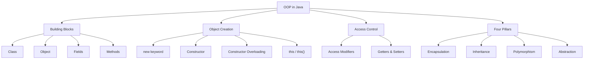
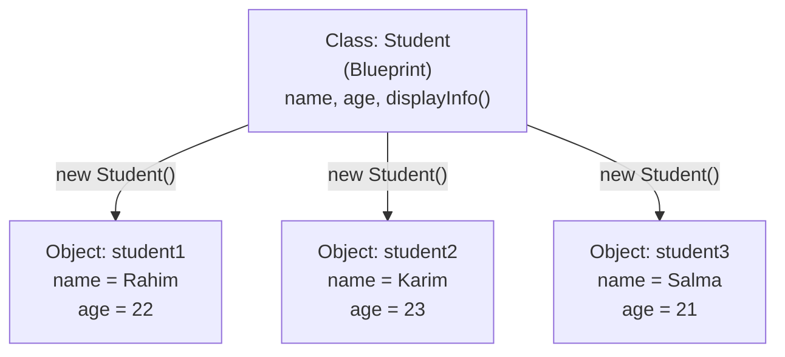
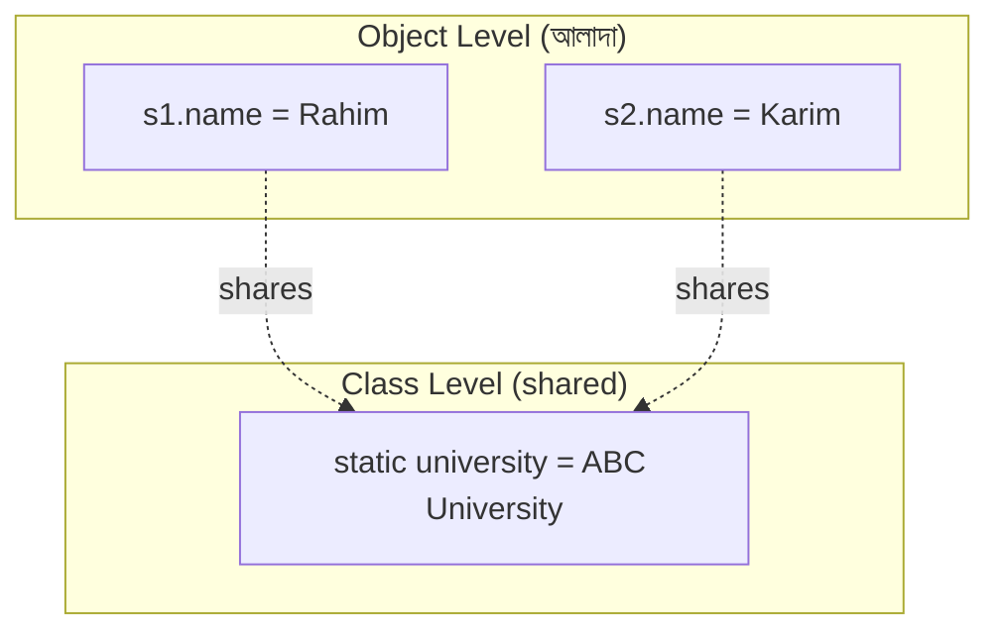
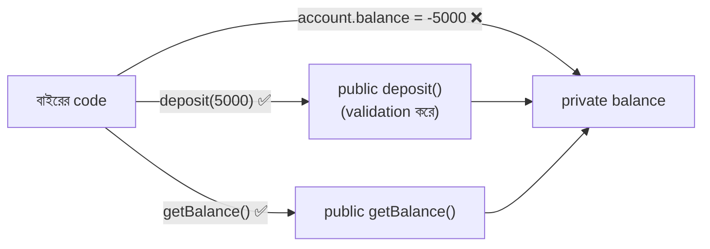
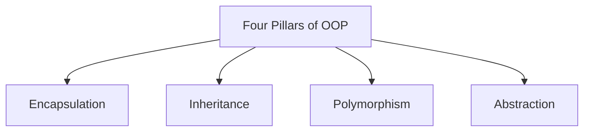
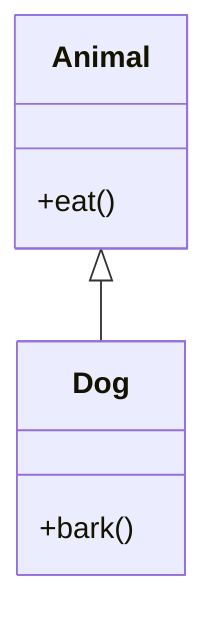
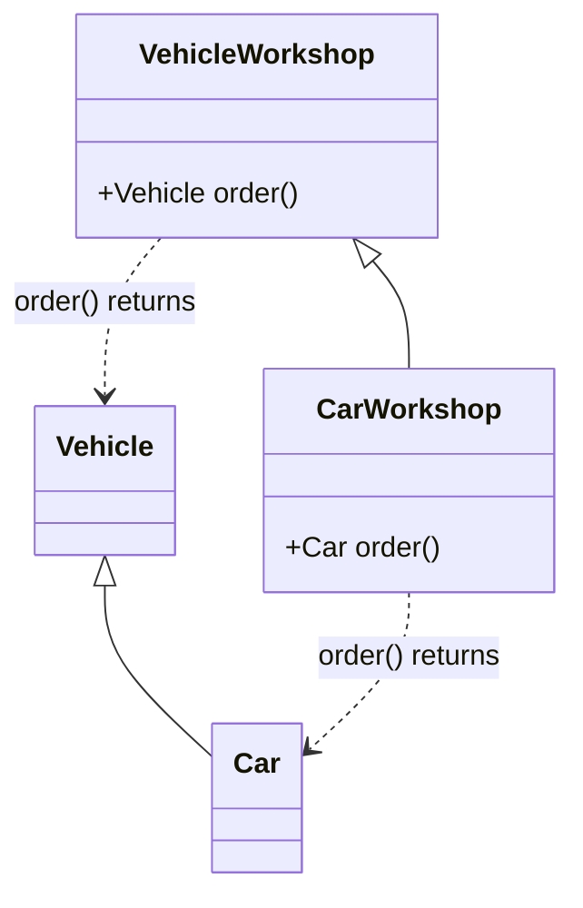

# 🏛️ Object-Oriented Programming (OOP) Introduction in Java

> **Java Programming Journey | Beginner to Software Engineer & Lecturer Preparation**

আজকের topic **Object-Oriented Programming (OOP)**। Day 8 পর্যন্ত তুমি Java Basics, Control Flow, Loops, Methods, Arrays এবং Strings শিখেছো। এখন Java-এর সবচেয়ে গুরুত্বপূর্ণ concept-গুলোর একটি শুরু করবে।

OOP শুধু Java interview-এর জন্য নয়, **Spring Boot, Backend Development, Software Design** এবং **University Lecturer Viva**-এর জন্যও গুরুত্বপূর্ণ।

আজকের lesson-এ আমরা OOP-এর **foundation** শিখব। এরপর Inheritance, Polymorphism, Abstraction এবং Interface আরও বিস্তারিতভাবে শেখা যাবে।

## 🗺️ OOP Overview



## 🎯 Today's Learning Objectives

1. What is OOP?
2. Procedural vs Object-Oriented Programming
3. Class and Object
4. Fields, Methods and Object State
5. Object Creation using `new`
6. Constructor and Constructor Overloading
7. `this` Keyword
8. Instance vs Local vs Static Variables
9. Static vs Instance Methods
10. Encapsulation and Access Modifiers
11. Getters and Setters
12. Four Pillars of OOP
13. Object References and Memory Basics
14. Practical Mini Project
15. Interview Questions and Coding Practice
16. GitHub Commit and Push

## 📑 Table of Contents

1. [What is Object-Oriented Programming (OOP)?](#1-what-is-object-oriented-programming-oop)
2. [Procedural vs Object-Oriented Programming](#2-procedural-vs-object-oriented-programming)
3. [What is a Class?](#3-what-is-a-class)
4. [What is an Object?](#4-what-is-an-object)
5. [Creating Multiple Objects](#5-creating-multiple-objects)
6. [Fields and Methods](#6-fields-and-methods)
7. [Constructor in Java](#7-constructor-in-java)
8. [Parameterized Constructor](#8-parameterized-constructor)
9. [What is the `this` Keyword?](#9-what-is-the-this-keyword)
10. [Constructor Overloading](#10-constructor-overloading)
11. [`this()` — Constructor Chaining](#11-this--constructor-chaining)
12. [Instance Variable vs Local Variable vs Static Variable](#12-instance-variable-vs-local-variable-vs-static-variable)
13. [Static vs Instance Methods](#13-static-vs-instance-methods)
14. [Encapsulation in Java](#14-encapsulation-in-java)
15. [Access Modifiers in Java](#15-access-modifiers-in-java)
16. [Getters and Setters](#16-getters-and-setters)
17. [Four Pillars of OOP](#17-four-pillars-of-oop)
18. [Covariant Return Type](#18-covariant-return-type)
19. [Object References and Memory Basics](#19-object-references-and-memory-basics)

---

## 1. What is Object-Oriented Programming (OOP)?

### Interview Definition

> **Object-Oriented Programming** is a programming paradigm that organizes software around **objects** containing **data (fields)** and **behavior (methods)**.

সহজভাবে, OOP হলো programming-এর এমন একটি approach যেখানে আমরা **বাস্তব জগতের entity-গুলোকে object হিসেবে model** করি।

ধরো একটি **University Management System** তৈরি করবে। সেখানে আছে:

- Student
- Teacher
- Course
- Department
- University

প্রতিটি entity-র কিছু **data** এবং **behavior** থাকে।

### উদাহরণ: Student Object

```
┌──────────────────────────────┐
│        Student Object        │
├──────────────────────────────┤
│  Data / State                │
│    name  = "Rahim"           │
│    id    = 101               │
│    cgpa  = 3.75              │
├──────────────────────────────┤
│  Behavior                    │
│    study()                   │
│    attendClass()             │
│    displayInfo()             │
└──────────────────────────────┘
```

একটি object-এর মধ্যে **state এবং behavior একসাথে** organize করা হয়।

| OOP concept | Java-তে কীভাবে represent করি |
| ----------- | ---------------------------- |
| Data / State | **Field**                   |
| Behavior     | **Method**                  |

---

## 2. Procedural vs Object-Oriented Programming

Day 1–8 পর্যন্ত আমরা বেশিরভাগ code লিখেছি `main()` এবং `static` methods ব্যবহার করে।

### Procedural style

```java
public class Main {

    static void displayStudent(String name, int age) {
        System.out.println(name);
        System.out.println(age);
    }

    public static void main(String[] args) {
        displayStudent("Rahim", 22);
    }
}
```

এখানে student-এর data **আলাদাভাবে** method-এ pass করা হচ্ছে।

### OOP approach

```java
class Student {

    String name;
    int age;

    void displayInfo() {
        System.out.println(name);
        System.out.println(age);
    }
}
```

এখন student-এর **data এবং behavior একই class-এর মধ্যে** আছে।

| Procedural style                       | Object-oriented style                    |
| -------------------------------------- | ---------------------------------------- |
| Functions/steps কেন্দ্রিক              | **Objects** কেন্দ্রিক                    |
| Data ও functions আলাদা থাকতে পারে      | Related data ও methods **একসাথে**        |
| Small algorithms-এ সহজ                 | Larger domain models-এ useful            |
| Function calls প্রধান                  | **Object interaction** প্রধান            |

> 📝 Java-তে OOP এবং procedural-style logic **দুটোই** ব্যবহার করা যায়। OOP মানেই সব সমস্যায় object তৈরি করতে হবে, এমন নয়।

---

## 3. What is a Class?

### Definition

> A **class** is a **blueprint or template** that defines the fields and methods of its objects.

ধরো তুমি Student-এর একটি structure বানাতে চাও।

```java
class Student {

    String name;
    int age;

    void study() {
        System.out.println(name + " is studying.");
    }
}
```

এখানে `Student` হলো **Class**। এর মধ্যে:

- `String name;` এবং `int age;` হলো **fields** বা **instance variables**।
- `void study()` হলো **instance method**।

> ⚠️ কিন্তু শুধু class declare করলে কোনো Student object **automatically তৈরি হয় না**।

---

## 4. What is an Object?

### Definition

> An **object** is an **instance of a class**. It has **identity, state, and behavior**.

```java
Student student1 = new Student();
```

এখানে:

| Part                | Meaning                          |
| ------------------- | -------------------------------- |
| `Student`           | **Class**                        |
| `student1`          | **Reference variable**           |
| `new Student()`     | নতুন **object তৈরি** করে         |

### Class vs Object Visualization

একটি Class থেকে **একাধিক independent Object** তৈরি করা যায়।



> 💡 **Analogy:** Class হলো **বাড়ির নকশা (blueprint)**, আর Object হলো সেই নকশা দিয়ে **তৈরি আসল বাড়ি**। একই নকশা থেকে অনেক বাড়ি বানানো যায়, প্রতিটি বাড়ি আলাদা।

---

## 5. Creating Multiple Objects

### Complete code

```java
class Student {

    String name;
    int age;

    void displayInfo() {
        System.out.println("Name: " + name);
        System.out.println("Age: " + age);
    }
}

public class Main {

    public static void main(String[] args) {

        Student student1 = new Student();
        Student student2 = new Student();

        student1.name = "Rahim";
        student1.age = 22;

        student2.name = "Karim";
        student2.age = 23;

        student1.displayInfo();
        student2.displayInfo();
    }
}
```

**Output:**

```
Name: Rahim
Age: 22
Name: Karim
Age: 23
```

এখানে `student1` এবং `student2` **আলাদা object**। তাই একটি object-এর data পরিবর্তন করলে অন্যটির data পরিবর্তিত হয় না।

---

## 6. Fields and Methods

একটি class-এর ভিতরে field এবং method-এর কাজ আলাদা।

```java
class Car {

    String brand;
    int speed;

    void accelerate() {
        speed += 10;
    }

    void showSpeed() {
        System.out.println(speed);
    }
}
```

| Member          | Type       | Purpose              |
| --------------- | ---------- | -------------------- |
| `brand`         | Field      | Car-এর brand         |
| `speed`         | Field      | Current speed        |
| `accelerate()`  | Method     | Speed বাড়ায়         |
| `showSpeed()`   | Method     | Speed print করে      |

### Example

```java
Car car1 = new Car();

car1.brand = "Toyota";
car1.speed = 40;

car1.accelerate();

car1.showSpeed();
```

**Output:**

```
50
```

কারণ `accelerate()` method `speed` field-এর value `10` বাড়িয়েছে।

---

## 7. Constructor in Java

**Constructor** হলো Java-এর special member, যা **object তৈরি হওয়ার সময় initialization**-এর কাজে ব্যবহৃত হয়।

### Interview Definition

> A **constructor** is a special class member used to **initialize new objects**. It has the **same name as the class** and has **no return type**.

### Constructor Example

```java
class Student {

    String name;
    int age;

    Student() {
        name = "Unknown";
        age = 0;
    }

    void displayInfo() {
        System.out.println(name + " " + age);
    }
}
```

**Object:**

```java
Student s1 = new Student();

s1.displayInfo();
```

**Output:**

```
Unknown 0
```

এখানে `Student()` হলো constructor। `new Student()` দিয়ে object তৈরি করলে constructor **execute** হয়।

### Constructor vs Method

| Constructor                                | Method                                          |
| ------------------------------------------ | ----------------------------------------------- |
| Class-এর **same name**                     | যেকোনো valid method name                         |
| **Return type নেই**                        | Return type থাকে, যেমন `void`, `int`             |
| **Object creation-এর সময়** invoked হয়    | Explicit call বা অন্য invocation-এ চলে           |
| Object **initialize** করে                  | বিভিন্ন operation perform করে                    |

---

## 8. Parameterized Constructor

Constructor-এ **parameter** ব্যবহার করা যায়।

```java
class Student {

    String name;
    int age;

    Student(String studentName, int studentAge) {

        name = studentName;
        age = studentAge;
    }

    void displayInfo() {
        System.out.println(name + " " + age);
    }
}
```

**Object creation:**

```java
Student s1 = new Student("Rahim", 22);
Student s2 = new Student("Karim", 23);

s1.displayInfo();
s2.displayInfo();
```

**Output:**

```
Rahim 22
Karim 23
```

এখন আলাদাভাবে field assign করতে হচ্ছে না।

---

## 9. What is the `this` Keyword?

`this` **current object-কে refer** করে।

ধরো class-এর field এবং constructor parameter-এর **নাম একই**।

```java
class Student {

    String name;
    int age;

    Student(String name, int age) {

        this.name = name;
        this.age = age;
    }
}
```

এখানে `this.name = name;` এর অর্থ:

| Part         | Meaning                              |
| ------------ | ------------------------------------ |
| `this.name`  | **current object's instance field**  |
| `name`       | **constructor parameter**            |

আর `this.age = age;` একইভাবে কাজ করে।

### Why is `this` important?

### ❌ Wrong

```java
Student(String name) {
    name = name;
}
```

তাহলে **parameter নিজেকেই assign** হচ্ছে। Instance field update হচ্ছে না।

### ✅ Correct

```java
Student(String name) {
    this.name = name;
}
```

> 🎯 **Interview:** `this` is a reference to the **current object** in an instance context.

---

## 10. Constructor Overloading

একই class-এর **একাধিক constructor** থাকতে পারে যদি তাদের **parameter list আলাদা** হয়।

```java
class Student {

    String name;
    int age;

    Student() {
        this.name = "Unknown";
        this.age = 0;
    }

    Student(String name) {
        this.name = name;
        this.age = 0;
    }

    Student(String name, int age) {
        this.name = name;
        this.age = age;
    }
}
```

**Usage:**

```java
Student s1 = new Student();

Student s2 = new Student("Rahim");

Student s3 = new Student("Karim", 23);
```

Java **arguments দেখে matching constructor select** করে।

> ⚠️ **Important:** তুমি কোনো constructor declare না করলে Java compiler একটি **default no-argument constructor** provide করতে পারে। কিন্তু নিজে **parameterized constructor declare করলে** automatic no-argument constructor আর পাওয়া যায় না।

---

## 11. `this()` — Constructor Chaining

একটি constructor থেকে **একই class-এর অন্য constructor call** করতে `this()` ব্যবহার করা হয়।

```java
class Student {

    String name;
    int age;

    Student() {
        this("Unknown", 0);
    }

    Student(String name, int age) {
        this.name = name;
        this.age = age;
    }
}
```

এখানে `this("Unknown", 0);` দ্বিতীয় constructor call করছে।


> 📝 Traditional constructor syntax-এ `this()` অবশ্যই **প্রথম statement** হতে হবে। Java-এর নতুন সংস্করণে কিছু constructor-body flexibility রয়েছে, তবে beginner হিসেবে প্রথম statement রাখাই ভালো।

---

## 12. Instance Variable vs Local Variable vs Static Variable

এগুলো interview-এর গুরুত্বপূর্ণ প্রশ্ন।

```java
class Student {

    String name;                // Instance variable

    static String university;   // Static variable

    void display() {

        int year = 2026;         // Local variable

        System.out.println(name);
        System.out.println(year);
    }
}
```

| Variable     | Belongs to                | Lifetime / Scope                  |
| ------------ | ------------------------- | --------------------------------- |
| **Instance** | **Object**                | Object-এর state-এর অংশ            |
| **Local**    | Method/block execution    | Declared scope-এর মধ্যে           |
| **Static**   | **Class**                 | Class-এর shared state             |

### Instance Variable Example

```java
Student s1 = new Student();
Student s2 = new Student();

s1.name = "Rahim";
s2.name = "Karim";
```

দুই object-এর `name` **আলাদা**।

### Static Variable Example

```java
class Student {

    String name;

    static String university = "ABC University";
}
```

**Access:**

```java
System.out.println(Student.university);
```

`university` **class-level variable**। তাই সব Student object **একই static field share** করে।



---

## 13. Static vs Instance Methods

### Static Method

```java
class Calculator {

    static int add(int a, int b) {
        return a + b;
    }
}
```

**Call:**

```java
System.out.println(Calculator.add(10, 20));
```

**Object তৈরি করতে হয়নি।**

### Instance Method

```java
class Calculator {

    int multiply(int a, int b) {
        return a * b;
    }
}
```

**Call:**

```java
Calculator calculator = new Calculator();

System.out.println(calculator.multiply(5, 6));
```

**Output:**

```
30
```

মনে রাখবে:

| Method type         | Level          |
| ------------------- | -------------- |
| **static** method   | class-level    |
| **instance** method | object-level   |

> ⚠️ Static method **সরাসরি `this` ব্যবহার করতে পারে না**, কারণ এর কোনো current object নেই।

---

## 14. Encapsulation in Java

এখন OOP-এর **প্রথম pillar** বিস্তারিত শিখব।

### Definition

> **Encapsulation** is the bundling of data and methods within a class while **controlling access to the internal state**.

সহজভাবে: Object-এর internal data বাইরে থেকে ইচ্ছেমতো পরিবর্তন করতে না দিয়ে **controlled access** প্রদান করা।

### ❌ Without Encapsulation

```java
class BankAccount {

    double balance;
}
```

এখন:

```java
BankAccount account = new BankAccount();

account.balance = -5000;
```

এখানে **invalid balance** assign হয়ে যেতে পারে।

### ✅ With Encapsulation

```java
class BankAccount {

    private double balance;

    public void deposit(double amount) {

        if (amount > 0) {
            balance += amount;
        }
    }

    public double getBalance() {
        return balance;
    }
}
```

**Usage:**

```java
BankAccount account = new BankAccount();

account.deposit(5000);

System.out.println(account.getBalance());
```

**Output:**

```
5000.0
```

এখন বাইরে থেকে `account.balance = -5000;` করতে গেলে **compile error** হবে, কারণ `balance` **private**।

এভাবেই **access control** দিয়ে **data integrity** রক্ষা করা যায়।



---

## 15. Access Modifiers in Java

Access modifier নির্ধারণ করে class member **কোথা থেকে access** করা যাবে।

Java-তে **চারটি access level**:

| Modifier         | Same Class | Same Package | Subclass (other package)        | Unrelated other package |
| ---------------- | ---------- | ------------ | ------------------------------- | ----------------------- |
| `public`         | ✅ Yes     | ✅ Yes       | ✅ Yes                          | ✅ Yes                  |
| `protected`      | ✅ Yes     | ✅ Yes       | ✅ Yes, inheritance rules apply | ❌ No                   |
| *No modifier*    | ✅ Yes     | ✅ Yes       | ❌ No                           | ❌ No                   |
| `private`        | ✅ Yes     | ❌ No        | ❌ No                           | ❌ No                   |

> **No modifier**-কে বলে **package-private**।

### Example

```java
class Student {

    public String name;

    private double cgpa;

    protected int semester;

    String department;
}
```

`private` field সাধারণত class-এর **public methods দিয়ে controlled access** করা হয়।

---

## 16. Getters and Setters

- **Getter** হলো field-এর value **read** করার method।
- **Setter** হলো field-এর value **update** করার method।

```java
class Student {

    private String name;
    private double cgpa;

    public String getName() {
        return name;
    }

    public void setName(String name) {
        this.name = name;
    }

    public double getCgpa() {
        return cgpa;
    }

    public void setCgpa(double cgpa) {

        if (cgpa >= 0 && cgpa <= 4.0) {
            this.cgpa = cgpa;
        }
    }
}
```

**Usage:**

```java
Student s1 = new Student();

s1.setName("Rahim");
s1.setCgpa(3.75);

System.out.println(s1.getName());
System.out.println(s1.getCgpa());
```

**Output:**

```
Rahim
3.75
```

> ⚠️ **Important:** Encapsulation মানেই প্রতিটি field-এর getter ও setter তৈরি করা নয়। **প্রয়োজন অনুযায়ী controlled methods** দেওয়া ভালো।

---

## 17. Four Pillars of OOP

Java interview-এর সবচেয়ে common theoretical question:

> **What are the four pillars of OOP?**

| Pillar            | সংক্ষেপে                                                                                   |
| ----------------- | ------------------------------------------------------------------------------------------ |
| **Encapsulation** | Internal state-এর access control করা এবং data ও behavior একসাথে organize করা।              |
| **Inheritance**   | একটি class অন্য class-এর inheritable members ব্যবহার করতে পারে।                            |
| **Polymorphism**  | একই operation/interface ভিন্ন object-এর ক্ষেত্রে ভিন্ন behavior দিতে পারে।                 |
| **Abstraction**   | Implementation details আড়াল করে প্রয়োজনীয় interface বা behavior প্রকাশ করা।              |



### Pillar 1 — Encapsulation

```java
class Account {

    private double balance;

    public double getBalance() {
        return balance;
    }
}
```

### Pillar 2 — Inheritance

```java
class Animal {

    void eat() {
        System.out.println("Eating");
    }
}

class Dog extends Animal {

    void bark() {
        System.out.println("Barking");
    }
}
```

এখানে `Dog` হলো `Animal`-এর **subclass**।



### Pillar 3 — Polymorphism

```java
class Animal {

    void sound() {
        System.out.println("Animal sound");
    }
}

class Dog extends Animal {

    @Override
    void sound() {
        System.out.println("Bark");
    }
}
```

এখন:

```java
Animal animal = new Dog();

animal.sound();
```

**Output:**

```
Bark
```

এটি **runtime polymorphism**-এর example।

### Pillar 4 — Abstraction

```java
abstract class Shape {

    abstract double area();
}

class Circle extends Shape {

    double radius;

    Circle(double radius) {
        this.radius = radius;
    }

    @Override
    double area() {
        return Math.PI * radius * radius;
    }
}
```

এখানে `Shape` বলে দিচ্ছে প্রতিটি concrete shape-কে `area` calculate করার behavior দিতে হবে, কিন্তু calculation **কীভাবে** হবে সেটা **subclass নির্ধারণ করছে**।

> আজ এই চারটি pillar-এর **basic ধারণা** যথেষ্ট। পরবর্তী lessons-এ detail আসবে।

---

## 18. Covariant Return Type

> 🔗 এটা **Method Overriding** (Pillar 3 — Polymorphism)-এর সাথে সম্পর্কিত একটি গুরুত্বপূর্ণ concept।

### ১. Definition (সহজ সংজ্ঞা)

Method Overriding-এর সময় child class-এর method যদি parent class-এর method-এর মতো **একই return type না রেখে**, তার কোনো **Subclass (Child Type)-কে return type হিসেবে ব্যবহার** করে, তবে তাকে **Covariant Return Type** বলা হয় (Java 5 থেকে এটা আসে)।

> 📌 **One-line Rule:** *Child class can return the **same type OR a sub-type** of the parent class's return type.*

### ২. বাস্তব রূপক (Real-Life Analogy)

| কে        | চুক্তি                                       |
| --------- | -------------------------------------------- |
| **Parent** | "আমি একটি **Vehicle (গাড়ি)** দেবো।"         |
| **Child**  | "আমি একটি **Car (প্রাইভেট কার)** দেবো।"      |

কেন এটা valid? কারণ `Car` নিজেও একটি `Vehicle` (**IS-A relationship**)। তাই parent-এর চুক্তির কোনো লঙ্ঘন হচ্ছে না।



### ৩. Code Example (Before vs After Covariant)

#### Class Setup

```java
class Vehicle {}
class Car extends Vehicle {}   // Car হলো Vehicle-এর child
```

#### ❌ Problem: Old Java Way (Covariant ছাড়া)

```java
class VehicleWorkshop {
    Vehicle order() {
        return new Vehicle();
    }
}

class CarWorkshop extends VehicleWorkshop {
    @Override
    Vehicle order() {              // বাধ্য হয়ে Vehicle দিতে হতো
        return new Car();
    }
}

// ব্যবহার করতে গেলে:
CarWorkshop cw = new CarWorkshop();
// Car myCar = cw.order();         // ERROR! Type mismatch
Car myCar = (Car) cw.order();      // Explicit Typecasting লাগতো
```

#### ✅ Solution: Modern Java (Covariant Return Type সহ)

```java
class VehicleWorkshop {
    Vehicle order() {
        return new Vehicle();
    }
}

class CarWorkshop extends VehicleWorkshop {
    // Vehicle-এর জায়গায় তার child 'Car' return type করা হলো
    @Override
    Car order() {
        return new Car();
    }
}

// Usage:
CarWorkshop cw = new CarWorkshop();
Car myCar = cw.order();   // সরাসরি Car পাওয়া গেল, কোনো casting লাগলো না!
```

#### 🔄 Parent Reference দিয়ে Call করলে কী হয়?

```java
VehicleWorkshop workshop = new CarWorkshop();

Vehicle vehicle = workshop.order();   // compile-time type: Vehicle
```

Parent reference দিয়ে call করলে compile-time-এ return type `Vehicle`-ই দেখা যায়। কিন্তু runtime-এ **আসল object হয় `Car`** (কারণ overridden method চলে)। এটা runtime polymorphism-এরই অংশ।

### ৪. Key Benefits (কেন ব্যবহার করবো?)

1. **No Explicit Casting:** Code clean থাকে, বারবার `(Car)` বা `(SubClass)` bracket দিয়ে typecast করতে হয় না।
2. **Type Safety:** Typecasting-এর সময় `ClassCastException` হওয়ার যে ঝুঁকি থাকে, সেটা দূর হয়।
3. **Better Readability:** Code পড়ে সরাসরি বোঝা যায় কোন specific object return হচ্ছে।

### ৫. Important Rules (Note-এ মনে রাখার মতো points)

| Rule                              | ব্যাখ্যা                                                                                              |
| --------------------------------- | ----------------------------------------------------------------------------------------------------- |
| **Only for Reference Types**      | এটা শুধু Objects/Classes-এর ক্ষেত্রে কাজ করে।                                                         |
| **Primitive-এ চলবে না**           | `double`-এর জায়গায় `int` বা `long` দিলে হবে না (**Compile Error** দেবে)। Primitive-এর return type অবশ্যই **same** হতে হবে। |
| **Must be IS-A relation**         | Child class-এর return type অবশ্যই parent-এর return type-কে `extends` বা `implements` করতে হবে।         |
| **শুধু Overriding-এ**             | এটা method overriding-এর rule। Overloading-এর সাথে এর সম্পর্ক নেই।                                    |

### ❌ Primitive-এ Covariant চলে না

```java
class Parent {
    double getValue() {
        return 1.0;
    }
}

class Child extends Parent {
    @Override
    int getValue() {        // ❌ Compile Error: double-এর জায়গায় int চলবে না
        return 1;
    }
}
```

### 💼 Interview Question

**Q. What is a covariant return type in Java?**

Covariant return type allows an overriding method to return a **subtype** of the return type declared in the overridden method of the parent class. It works only with **reference types** (not primitives) and was introduced in **Java 5**.

---

## 19. Object References and Memory Basics

এই example দেখো:

```java
Student s1 = new Student();

s1.name = "Rahim";

Student s2 = s1;

s2.name = "Karim";

System.out.println(s1.name);
```

**Output:**

```
Karim
```

### কেন?

কারণ `Student s2 = s1;` এখানে **নতুন object তৈরি হয়নি**। `s1` এবং `s2` **একই object-কে refer** করছে।

দুইটি reference variable একই object-কে point করছে।

### 🧱 Stack + Heap Visualization

#### Step 1: `Student s1 = new Student(); s1.name = "Rahim";`

```
   STACK MEMORY                    HEAP MEMORY
 ┌──────────────────┐            ┌──────────────────────┐
 │ s1 = 0x101       │ ─────────► │ Student Object       │
 └──────────────────┘            │ Address: 0x101       │
                                 │ name = "Rahim"       │
                                 └──────────────────────┘
```

#### Step 2: `Student s2 = s1;`

```
   STACK MEMORY                    HEAP MEMORY
 ┌──────────────────┐            ┌──────────────────────┐
 │ s1 = 0x101       │ ─────┐     │ Student Object       │
 ├──────────────────┤      ├───► │ Address: 0x101       │
 │ s2 = 0x101       │ ─────┘     │ name = "Rahim"       │
 └──────────────────┘            └──────────────────────┘

   নতুন object তৈরি হয়নি, শুধু reference (ঠিকানা) copy হয়েছে
```

#### Step 3: `s2.name = "Karim";`

```
   STACK MEMORY                    HEAP MEMORY
 ┌──────────────────┐            ┌──────────────────────┐
 │ s1 = 0x101       │ ─────┐     │ Student Object       │
 ├──────────────────┤      ├───► │ Address: 0x101       │
 │ s2 = 0x101       │ ─────┘     │ name = "Karim"       │
 └──────────────────┘            └──────────────────────┘

   s1.name প্রিন্ট করলে "Karim" আসবে, কারণ object একটাই
```

এখানেও Java **pass-by-value**, যা Day 6 এবং Day 7-এ শিখেছিলে, সেই নিয়মই অনুসরণ করে।
