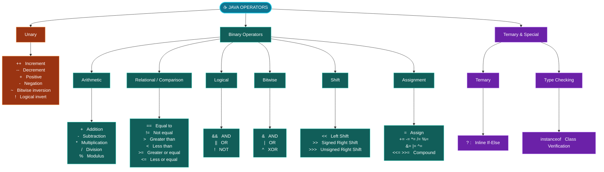

# ➕ Operators in Java

## 🗺️ Java Operators Diagram

A complete visual guide to operator categories & hierarchy in Java.



> 📌 `>>>`, `instanceof` ar `&=`, `|=`, `^=`, `<<=`, `>>=` ei note-er main section e detail e nai. Egulo ekhane diagram e complete overview-er jonno rakha hoyeche.

## 📑 Table of Contents

1. [What is an Operator?](#1-what-is-an-operator)
2. [Types of Operators in Java](#2-types-of-operators-in-java)
3. [Arithmetic Operators](#3-arithmetic-operators)
4. [Modulus Operator %](#4-modulus-operator-)
5. [Assignment Operators](#5-assignment-operators)
6. [Relational / Comparison Operators](#6-relational--comparison-operators)
7. [`=` vs `==`](#7--vs-)
8. [Logical Operators](#8-logical-operators)
9. [Logical OR `||`](#9-logical-or-)
10. [Logical NOT `!`](#10-logical-not-)
11. [Increment Operator `++`](#11-increment-operator-)
12. [Decrement Operator `--`](#12-decrement-operator---)
13. [Pre Increment vs Post Increment](#13-pre-increment-vs-post-increment)
14. [Unary Operators](#14-unary-operators)
15. [Ternary Operator](#15-ternary-operator)
16. [Bitwise Operators](#16-bitwise-operators)
17. [Operator Precedence](#17-operator-precedence)
18. [Short-Circuit Evaluation](#18-short-circuit-evaluation)
19. [Practical Example](#19-practical-example)
20. [`&&` vs `&`](#20-important-difference--vs-)
21. [`||` vs `|`](#21-important-difference--vs--1)
22. [Day 3 Quick Summary](#-day-3-quick-summary)
23. [Practice Problems](#-practice-problems)
24. [Day 3 Interview Questions](#-day-3-interview-questions)

---

## 1. What is an Operator?

Java-তে **Operator** হচ্ছে একটি symbol যা variable বা value-এর উপর কোনো operation perform করে।

```java
int a = 10;
int b = 5;

int sum = a + b;
```

এখানে:

| Part   | Meaning  |
| ------ | -------- |
| `a`, `b` | Operands |
| `+`    | Operator |

অর্থাৎ, `10 + 5` — এখানে `+` operator দুইটি value যোগ করছে।

---

## 2. Types of Operators in Java

Java-তে beginner level-এ সবচেয়ে গুরুত্বপূর্ণ operator হলো:

1. Arithmetic Operator
2. Assignment Operator
3. Relational Operator
4. Logical Operator
5. Unary Operator
6. Increment / Decrement Operator
7. Ternary Operator
8. Bitwise Operator

> 💡 সবচেয়ে বেশি ব্যবহার হবে প্রথম ৭টা।

---

## 3. Arithmetic Operators

Mathematical calculation করার জন্য ব্যবহার হয়।

| Operator | Meaning             | Example  |
| -------- | ------------------- | -------- |
| `+`      | Addition            | `10 + 5` |
| `-`      | Subtraction         | `10 - 5` |
| `*`      | Multiplication      | `10 * 5` |
| `/`      | Division            | `10 / 5` |
| `%`      | Modulus / Remainder | `10 % 3` |

### Example

```java
public class Main {
    public static void main(String[] args) {

        int a = 10;
        int b = 3;

        System.out.println(a + b);
        System.out.println(a - b);
        System.out.println(a * b);
        System.out.println(a / b);
        System.out.println(a % b);
    }
}
```

**Output:**

```
13
7
30
3
1
```

### ⚠️ Important: Integer Division

এটা interview-এও আসতে পারে।

```java
int a = 10;
int b = 3;

System.out.println(a / b);
```

**Output:**

```
3
```

`3.333` না। কারণ দুইটা variable-ই `int`।

Decimal result চাইলে:

```java
double result = 10.0 / 3;

System.out.println(result);
```

**Output (approximately):**

```
3.333333333
```

---

## 4. Modulus Operator `%`

`%` **remainder** বের করে।

```java
System.out.println(10 % 3);
```

**Output:**

```
1
```

এটা programming-এ খুব important। বিশেষ করে:

- Even/Odd checking
- Divisibility checking
- Cycle/rotation
- Array problems
- DSA problems

### Example

```java
int number = 10;

if (number % 2 == 0) {
    System.out.println("Even");
} else {
    System.out.println("Odd");
}
```

কারণ: `10 % 2 = 0`, তাই 10 **even**।

---

## 5. Assignment Operators

Variable-এর মধ্যে value assign করার জন্য ব্যবহার করি।

**Basic assignment:**

```java
int age = 25;
```

এখানে `=` হলো assignment operator।

আরও কিছু shortcut assignment operator:

| Operator | Example  | Same as      |
| -------- | -------- | ------------ |
| `=`      | `a = 10` | `a = 10`     |
| `+=`     | `a += 5` | `a = a + 5`  |
| `-=`     | `a -= 5` | `a = a - 5`  |
| `*=`     | `a *= 5` | `a = a * 5`  |
| `/=`     | `a /= 5` | `a = a / 5`  |
| `%=`     | `a %= 5` | `a = a % 5`  |

### Example

```java
int a = 10;

a += 5;

System.out.println(a);
```

**Output:**

```
15
```

কারণ `a += 5;` same as `a = a + 5;`

---

## 6. Relational / Comparison Operators

দুইটি value compare করার জন্য ব্যবহার হয়। Result সবসময় `true` অথবা `false`।

| Operator | Meaning                  |
| -------- | ------------------------ |
| `==`     | Equal to                 |
| `!=`     | Not equal                |
| `>`      | Greater than             |
| `<`      | Less than                |
| `>=`     | Greater than or equal    |
| `<=`     | Less than or equal       |

### Example

```java
int a = 10;
int b = 20;

System.out.println(a > b);
System.out.println(a < b);
System.out.println(a == b);
System.out.println(a != b);
```

**Output:**

```
false
true
false
true
```

---

## 7. `=` vs `==`

এটা খুবই important।

| Operator | Purpose    |
| -------- | ---------- |
| `=`      | Assignment |
| `==`     | Comparison |

```java
int a = 10;
```

মানে: `a`-এর মধ্যে 10 **assign** করো।

কিন্তু:

```java
a == 10
```

মানে: `a`-এর value 10 কিনা **check** করো।

### Example

```java
int age = 20;

System.out.println(age == 20);
```

**Output:**

```
true
```

---

## 8. Logical Operators

Multiple condition একসাথে check করার জন্য ব্যবহার হয়। মূলত তিনটি:

| Operator | Name |
| -------- | ---- |
| `&&`     | AND  |
| `\|\|`   | OR   |
| `!`      | NOT  |

### Logical AND `&&`

**সব condition true** হতে হবে।

```java
int age = 25;
boolean hasNid = true;

System.out.println(age >= 18 && hasNid);
```

**Output:**

```
true
```

**Truth table:**

| A     | B     | A && B  |
| ----- | ----- | ------- |
| true  | true  | **true**  |
| true  | false | false   |
| false | true  | false   |
| false | false | false   |

> সহজভাবে: **AND → সবাই true হলে true**

---

## 9. Logical OR `||`

যেকোনো **একটি condition true** হলেই result true।

```java
boolean hasPassport = false;
boolean hasNid = true;

System.out.println(hasPassport || hasNid);
```

**Output:**

```
true
```

**Truth table:**

| A     | B     | A \|\| B  |
| ----- | ----- | --------- |
| true  | true  | true      |
| true  | false | true      |
| false | true  | true      |
| false | false | **false** |

> সহজভাবে: **OR → অন্তত একটা true হলে true**

---

## 10. Logical NOT `!`

Boolean value **উল্টে** দেয়।

```java
boolean loggedIn = true;

System.out.println(!loggedIn);
```

**Output:**

```
false
```

অর্থাৎ:

```
true  → false
false → true
```

---

## 11. Increment Operator `++`

Value **এক বাড়ায়**।

```java
int a = 10;

a++;

System.out.println(a);
```

**Output:**

```
11
```

Same as: `a = a + 1;`

---

## 12. Decrement Operator `--`

Value **এক কমায়**।

```java
int a = 10;

a--;

System.out.println(a);
```

**Output:**

```
9
```

---

## 13. Pre Increment vs Post Increment

এটা খুব important interview topic।

### Post Increment `a++`

আগে বর্তমান value **use** করবে, পরে **increment** করবে।

```java
int a = 5;

int b = a++;

System.out.println(a);
System.out.println(b);
```

**Output:**

```
6
5
```

কারণ প্রথমে `b = 5;` তারপর `a = 6;`

### Pre Increment `++a`

আগে **increment** করবে, তারপর value **use** করবে।

```java
int a = 5;

int b = ++a;

System.out.println(a);
System.out.println(b);
```

**Output:**

```
6
6
```

### 🧠 মনে রাখার সহজ rule

| Form  | Rule                           |
| ----- | ------------------------------ |
| `a++` | Use First, Increase Later      |
| `++a` | Increase First, Use Later      |

---

## 14. Unary Operators

একটি operand-এর উপর কাজ করে।

```java
int number = 10;

System.out.println(+number);
System.out.println(-number);
```

**Output:**

```
10
-10
```

Common unary operators: `+`, `-`, `++`, `--`, `!`

---

## 15. Ternary Operator

Simple **if-else এক লাইনে** লেখার জন্য ব্যবহার করা যায়।

### Syntax

```java
condition ? valueIfTrue : valueIfFalse;
```

### Example

```java
int age = 20;

String result = age >= 18 ? "Adult" : "Minor";

System.out.println(result);
```

**Output:**

```
Adult
```

**Equivalent if-else:**

```java
if (age >= 18) {
    result = "Adult";
} else {
    result = "Minor";
}
```

### আরেকটা common example

```java
int number = 7;

String result = number % 2 == 0 ? "Even" : "Odd";

System.out.println(result);
```

**Output:**

```
Odd
```

---

## 16. Bitwise Operators

**Bit level**-এ calculation করে।

| Operator | Name        |
| -------- | ----------- |
| `&`      | Bitwise AND |
| `\|`     | Bitwise OR  |
| `^`      | XOR         |
| `~`      | Complement  |
| `<<`     | Left Shift  |
| `>>`     | Right Shift |

Beginner হিসেবে এখন basic idea জানলেই চলবে।

### Example

```java
int a = 5;
int b = 3;

System.out.println(a & b);
```

**Binary:**

```
5 = 101
3 = 011
---------
    001
```

**Output:**

```
1
```

> 📌 DSA-তে পরে **Bit Manipulation** শেখার সময় এগুলো বেশি important হবে।

---

## 17. Operator Precedence

একই expression-এর মধ্যে একাধিক operator থাকলে **কোনটা আগে execute হবে** সেটা precedence determine করে।

```java
int result = 10 + 5 * 2;
```

**Output:**

```
20
```

কারণ multiplication আগে: `5 * 2 = 10`, তারপর `10 + 10 = 20`

কিন্তু:

```java
int result = (10 + 5) * 2;
```

**Output:**

```
30
```

কারণ parentheses আগে।

### Basic rule (উপর থেকে নিচে)

```
()
*  /  %
+  -
Comparison
&&
||
=
```

> 💡 সব precedence মুখস্থ করার দরকার নেই। Confusion হলে **parentheses** ব্যবহার করো।

---

## 18. Short-Circuit Evaluation

`&&` এবং `||`-এর একটি গুরুত্বপূর্ণ behavior।

```java
int a = 10;

if (a > 20 && a++ > 5) {
    System.out.println("Hello");
}

System.out.println(a);
```

এখানে `a > 20` **false**। AND-এর ক্ষেত্রে প্রথম condition false হলে পুরো expression false নিশ্চিত। তাই Java দ্বিতীয় condition `a++ > 5` **execute-ই করবে না**।

`a` থাকবে `10`।

এটাকেই বলে **Short-Circuit Evaluation**।

---

## 19. Practical Example

ধরো student exam pass করবে যদি:

- Marks >= 40
- **AND** Attendance >= 75

```java
public class Main {
    public static void main(String[] args) {

        int marks = 70;
        int attendance = 80;

        boolean result = marks >= 40 && attendance >= 75;

        System.out.println("Passed: " + result);
    }
}
```

**Output:**

```
Passed: true
```

এখানে একসাথে ব্যবহার হয়েছে:

| Operator | Type                 |
| -------- | -------------------- |
| `>=`     | Relational Operator  |
| `&&`     | Logical Operator     |
| `+`      | String Concatenation |

---

## 20. Important Difference: `&&` vs `&`

দুটো দেখতে কাছাকাছি কিন্তু same না।

| Operator | Type                           |
| -------- | ------------------------------ |
| `&&`     | Logical AND + Short Circuit    |
| `&`      | Bitwise AND                    |

Boolean-এর ক্ষেত্রেও `&` ব্যবহার করা যায়, কিন্তু সেটা **short-circuit করে না**।

Beginner Java code-এ logical condition-এর জন্য সাধারণত `&&` ব্যবহার করবে।

---

## 21. Important Difference: `||` vs `|`

| Operator | Type                          |
| -------- | ----------------------------- |
| `\|\|`   | Logical OR + Short Circuit    |
| `\|`     | Bitwise OR                    |

Condition-এর জন্য সাধারণত `||` ব্যবহার করবে।

---

## 📋 Day 3 Quick Summary

| Category              | Operators                         |
| --------------------- | --------------------------------- |
| **Arithmetic**        | `+` `-` `*` `/` `%`               |
| **Assignment**        | `=` `+=` `-=` `*=` `/=` `%=`      |
| **Relational**        | `==` `!=` `>` `<` `>=` `<=`       |
| **Logical**           | `&&` `\|\|` `!`                   |
| **Increment/Decrement** | `++` `--`                       |
| **Ternary**           | `condition ? trueValue : falseValue` |
| **Bitwise**           | `&` `\|` `^` `~` `<<` `>>`        |

### ⭐ সবচেয়ে important

- `=` vs `==`
- `&&` vs `||`
- `a++` vs `++a`
- Integer division
- `%`
- Ternary operator
- Short-circuit evaluation
- Operator precedence

---

## 🧩 Practice Problems

নিজে solve করার চেষ্টা করো।

### Problem 1

```java
int a = 10;
int b = 3;

System.out.println(a / b);
System.out.println(a % b);
```

Output কী?

<details>
<summary>Answer</summary>

```
3
1
```

</details>

### Problem 2

```java
int x = 5;

System.out.println(x++);
System.out.println(x);
```

<details>
<summary>Answer</summary>

```
5
6
```

</details>

### Problem 3

```java
int x = 5;

System.out.println(++x);
System.out.println(x);
```

<details>
<summary>Answer</summary>

```
6
6
```

</details>

### Problem 4

```java
int a = 10;
int b = 20;

System.out.println(a < b && b > 15);
```

<details>
<summary>Answer</summary>

```
true
```

</details>

### Problem 5

```java
int number = 11;

String result = number % 2 == 0 ? "Even" : "Odd";

System.out.println(result);
```

<details>
<summary>Answer</summary>

```
Odd
```

</details>

---

## 🎯 Day 3 Interview Questions

> এইগুলো আলাদা করে `Interview Questions.docx`-এ রাখতে পারো।

### 1. What is an operator in Java?

An operator is a special symbol used to perform operations on operands or values.

```java
int result = 10 + 20;
```

Here `+` is an operator.

### 2. What is the difference between `=` and `==`?

- `=` → Assignment operator
- `==` → Equality comparison operator

```java
int a = 10;

a == 10
```

### 3. What is the difference between `a++` and `++a`?

- `a++` → Post-increment
- `++a` → Pre-increment

Post-increment uses the current value first, then increments. Pre-increment increments first, then uses the new value.

### 4. What does `%` operator do?

It returns the **remainder** after division.

```java
10 % 3
```

Result: `1`

### 5. What is the difference between `&&` and `&`?

- `&&` → Logical AND with short-circuit evaluation
- `&` → Bitwise AND

### 6. What is short-circuit evaluation?

When using `&&` or `||`, Java may skip evaluating the second condition if the final result can already be determined from the first condition.

### 7. What is the output?

```java
int a = 5;
int b = a++;

System.out.println(a);
System.out.println(b);
```

**Answer:**

```
6
5
```

### 8. What is the output?

```java
int a = 5;
int b = ++a;

System.out.println(a);
System.out.println(b);
```

**Answer:**

```
6
6
```

### 9. What is a ternary operator?

It is a shorthand form of simple if-else.

```java
condition ? value1 : value2
```

### 10. What is operator precedence?

Operator precedence determines which operator is evaluated first when multiple operators appear in the same expression.
