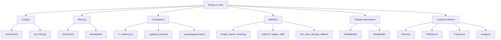

# 🔤 Strings in Java

> **Java Programming Journey | Beginner to SWE Interview Preparation**

আজকের topic **Strings in Java**। Day 7-এ তুমি Arrays শিখেছো। আজ শিখবে Java-তে **text কীভাবে store, compare, modify এবং process** করা হয়।

String অত্যন্ত গুরুত্বপূর্ণ, কারণ Software Engineering interview, DSA, Spring Boot, API development — প্রায় সব জায়গাতেই String নিয়ে কাজ করতে হয়।

আজকের নোট এমনভাবে সাজানো হয়েছে যেন তুমি concepts বুঝতে পারো, নিজে coding practice করতে পারো এবং শেষে **GitHub-এ push** করতে পারো।

## 🗺️ Strings Overview



## 🎯 Day 8 — Learning Objectives

1. What is String?
2. String Declaration and Creation
3. String Literal vs `new String()`
4. String Immutability
5. String Pool
6. `==` vs `.equals()`
7. Important String Methods
8. String Traversal
9. String Concatenation
10. StringBuilder and StringBuffer
11. Reverse String
12. Palindrome String
13. Character Frequency
14. Anagram Checking
15. String vs char Array
16. Common Mistakes
17. Practice Problems
18. Interview Questions
19. GitHub Push

## 📑 Table of Contents

1. [What is a String in Java?](#1-what-is-a-string-in-java)
2. [String Declaration and Initialization](#2-string-declaration-and-initialization)
3. [What is the String Pool?](#3-what-is-the-string-pool)
4. [String Immutability](#4-string-immutability)
5. [`==` vs `.equals()` in Java](#5--vs-equals-in-java)
6. [`.equalsIgnoreCase()`](#6-equalsignorecase)
7. [Important String Methods](#7-important-string-methods)
8. [String Traversal](#8-string-traversal)
9. [String Concatenation](#9-string-concatenation)
10. [StringBuilder in Java](#10-stringbuilder-in-java)
11. [String vs StringBuilder vs StringBuffer](#11-string-vs-stringbuilder-vs-stringbuffer)
12. [Important String Coding Problems](#12-important-string-coding-problems)
13. [String vs Character Array](#13-string-vs-character-array)
14. [Common String Mistakes](#14-common-string-mistakes)

---

## 1. What is a String in Java?

### Definition (Interview)

> A **String** in Java is an object that represents a **sequence of characters**. It belongs to the `java.lang.String` class and is **immutable**.

সহজভাবে, String ব্যবহার করা হয় **text store** করার জন্য।

```java
String name = "Rahim";
String language = "Java";
String message = "Hello World";
```

এখানে `"Rahim"`, `"Java"` এবং `"Hello World"` হলো String।

### String vs char

```java
char letter = 'A';

String name = "A";
```

| `char`                         | `String`                                  |
| ------------------------------ | ----------------------------------------- |
| Single UTF-16 code unit        | Sequence of UTF-16 code units             |
| **Primitive** data type        | **Reference** type                        |
| Single quotes `'A'`            | Double quotes `"A"`                       |
| `char letter = 'A';`           | `String name = "A";`                      |

মনে রাখবে:

```
char   → 'A'
String → "A"
```

> Java-তে String একটি **class**, primitive data type নয়।

---

## 2. String Declaration and Initialization

String তৈরি করার **প্রধান দুইটি উপায়** আছে।

### Method 1: String Literal

```java
String name = "Java";
```

এটি সবচেয়ে commonly used approach।

### Method 2: Using `new` Keyword

```java
String name = new String("Java");
```

এখানে explicitly একটি **নতুন String object** তৈরি হচ্ছে।

### Full example

```java
public class Main {
    public static void main(String[] args) {

        String a = "Hello";
        String b = new String("World");

        System.out.println(a);
        System.out.println(b);
    }
}
```

**Output:**

```
Hello
World
```

দুইভাবে String তৈরি করা গেলেও **memory behavior-এ পার্থক্য** আছে।

---

## 3. What is the String Pool?

Java-তে একই String literal বারবার তৈরি হলে JVM সাধারণত **একটি shared String object** ব্যবহার করে।

এই shared storage mechanism-কে বলা হয় **String Pool**।

```java
String a = "Java";
String b = "Java";
```

### Visualization

```
   STACK MEMORY                    HEAP MEMORY
                                   ┌────────────────────────────────┐
 ┌──────────────────┐              │  STRING POOL                   │
 │ a = 0x101        │ ───────┐     │                                │
 ├──────────────────┤        ├───► │  "Java"  (Address: 0x101)      │
 │ b = 0x101        │ ───────┘     │                                │
 └──────────────────┘              └────────────────────────────────┘

      a আর b একই object-কে refer করছে
```

তাই:

```java
String a = "Java";
String b = "Java";

System.out.println(a == b);
```

**Output:**

```
true
```

কারণ এখানে `a` এবং `b` একই **interned object**-কে refer করছে।

### But what about `new String()`?

```java
String a = "Java";
String b = new String("Java");

System.out.println(a == b);
```

**Output:**

```
false
```

কারণ `new` দিয়ে **আলাদা object** তৈরি হয়েছে।

```
   STACK MEMORY                    HEAP MEMORY
                                   ┌────────────────────────────────┐
 ┌──────────────────┐              │  STRING POOL                   │
 │ a = 0x101        │ ──────────►  │  "Java"  (Address: 0x101)      │
 ├──────────────────┤              ├────────────────────────────────┤
 │ b = 0x305        │ ──────────►  │  "Java"  (Address: 0x305)      │
 └──────────────────┘              │  (new দিয়ে তৈরি আলাদা object) │
                                   └────────────────────────────────┘

      দুটোর content এক, কিন্তু address আলাদা
```

এই বিষয়টি পরবর্তী `==` vs `.equals()` section বুঝতে সাহায্য করবে।

### 📊 Literal vs `new` — Quick Comparison

| বিষয়                    | `String a = "Java";`         | `String b = new String("Java");` |
| ------------------------ | ---------------------------- | -------------------------------- |
| Object কোথায় যায়        | String Pool (shared)         | আলাদা নতুন object                |
| একই literal দুইবার লিখলে | **একই object** reuse হয়     | প্রতিবার **নতুন object**         |
| `==` result              | `true` (দুটো literal হলে)    | `false` (literal-এর সাথে)        |

---

## 4. String Immutability

> ⭐ এটি Java interview-এর **সবচেয়ে গুরুত্বপূর্ণ** String concept-গুলোর একটি।

### Definition

> A String is **immutable**, meaning its content cannot be changed after the String object is created.

```java
String name = "Java";

name.concat(" Programming");

System.out.println(name);
```

**Output:**

```
Java
```

অনেকে মনে করে output হবে `Java Programming`। কিন্তু তা নয়।

কারণ `name.concat(" Programming");` একটি **নতুন String result** তৈরি করে, কিন্তু `name` reference-এ সেটি **assign করা হয়নি**।

### ✅ Correct

```java
String name = "Java";

name = name.concat(" Programming");

System.out.println(name);
```

**Output:**

```
Java Programming
```

এখানে **original String object পরিবর্তিত হয়নি**; `name` variable-টি **নতুন String object-কে refer** করছে।

### 🧱 Java Memory Workflow: String Immutability

#### Step 1: `String name = "Java";`

```
   STACK MEMORY                   HEAP MEMORY (String Constant Pool - SCP)
 ┌─────────────────────────┐     ┌─────────────────────────────────────┐
 │ name = 0x101 (Address)  │ ──► │ "Java"  (Address: 0x101)            │
 └─────────────────────────┘     │                                     │
                                 └─────────────────────────────────────┘
```

- JVM প্রথমে Heap Memory-র বিশেষ অংশ **String Constant Pool (SCP)**-এ খোঁজে `"Java"` নামে কোনো object আছে কিনা।
- না থাকায়, সে `"Java"` নামের একটি object তৈরি করে (ধরুন এর memory address `0x101`)।
- Stack Memory-তে থাকা `name` variable-টি এই `0x101` address-টিকে point করে।

#### Step 2: `name.concat(" Programming");` (re-assign ছাড়া)

```
   STACK MEMORY                   HEAP MEMORY (String Constant Pool - SCP)
 ┌─────────────────────────┐     ┌─────────────────────────────────────┐
 │ name = 0x101            │ ──► │ "Java"  (Address: 0x101)            │
 │ (অপরিবর্তিত)              │     │                                     │
 └─────────────────────────┘     │ "Java Programming"  (Address: 0x202)│
                                 │ ❌ নতুন object তৈরি হলো, কিন্তু       │
                                 │    কোনো reference নেই                │
                                 └─────────────────────────────────────┘
```

- `concat()` method কল করার পর, JVM মূল `"Java"` object-কে **কোনো পরিবর্তন না করে**, memory-তে সম্পূর্ণ **নতুন আরেকটি object** `"Java Programming"` (`0x202`) তৈরি করে।
- কিন্তু আমরা এই নতুন object-টিকে কোনো variable-এ store করিনি (`name = name.concat(...)` লিখিনি)।
- ফলে `name` এখনো আগের সেই `0x101` বা `"Java"` object-কেই নির্দেশ করছে। তাই `System.out.println(name)` করলে শুধু `"Java"` print হয়।
- এই নতুন `"Java Programming"` object-টি **reference-হীন অবস্থায়** memory-তে অলস পড়ে থাকে।

#### Step 3: `name = name.concat(" Programming");` (re-assign করার পর)

```
   STACK MEMORY                   HEAP MEMORY (String Constant Pool - SCP)
 ┌─────────────────────────┐     ┌─────────────────────────────────────┐
 │ name = 0x202            │ ─┐  │ "Java"  (Address: 0x101) [অব্যবহৃত]  │
 │ (নতুন ঠিকানা)             │  │  │                                     │
 └─────────────────────────┘  └► │ "Java Programming"  (Address: 0x202)│
                                 │ (এখন name একে point করছে)            │
                                 └─────────────────────────────────────┘
```

- এখানে আমরা method থেকে পাওয়া **নতুন String-এর reference**-টি সরাসরি `name` variable-এ assign করছি।
- এর ফলে `name` variable-টি তার পুরনো সংযোগ (`0x101`) ছিন্ন করে নতুন object `"Java Programming"` (`0x202`)-এর সাথে যুক্ত হয়।
- কিন্তু memory-তে থাকা মূল `"Java"` object-টি তার জায়গায় **একদম অপরিবর্তিত বা সুরক্ষিতই** থেকে যায়।

#### 📊 Summary Table

| Step | Code                                 | `name` কোথায় point করে | Pool-এ কী আছে                          |
| ---- | ------------------------------------ | ----------------------- | -------------------------------------- |
| 1    | `String name = "Java";`              | `0x101`                 | `"Java"`                               |
| 2    | `name.concat(" Programming");`       | `0x101` (অপরিবর্তিত)    | `"Java"`, `"Java Programming"` (reference নেই) |
| 3    | `name = name.concat(" Programming");`| `0x202`                 | `"Java"` (অব্যবহৃত), `"Java Programming"` |

### ❓ Why is String Immutable?

Interview-এর জন্য **চারটি** গুরুত্বপূর্ণ কারণ:

- **Security:** String-এর content অনিচ্ছাকৃতভাবে পরিবর্তিত হওয়া থেকে সুরক্ষিত থাকে।
- **String Pool:** Immutable object নিরাপদে share করা যায়।
- **Thread Safety:** একই String object read করার জন্য synchronization দরকার হয় না।
- **Hashing:** String-এর content স্থির থাকায় hash-based collections-এ key হিসেবে ব্যবহার সুবিধাজনক।

### 💡 ৩টি Interview Tips (মনে রাখার জন্য)

1. **SCP (String Constant Pool):** Heap memory-র ভেতরে থাকা এই বিশেষ pool-এ একই মানের String বারবার তৈরি না করে **একটিই object share** করা হয়, যা memory সাশ্রয় করে।
2. **চিনবেন কীভাবে:** String-এর ওপর আপনি যত method-ই চালান না কেন (যেমন: `replace()`, `toLowerCase()`, `substring()`), এগুলো **কখনোই মূল object পরিবর্তন করে না**, বরং প্রতিবার **নতুন একটি object return** করে।
3. **String modify করতে চাইলে:** যদি বারবার কোনো text পরিবর্তন বা যোগ-বিয়োগ করতে হয়, তবে `String` ব্যবহার না করে **`StringBuilder` বা `StringBuffer`** ব্যবহার করা উচিত, কারণ সেগুলো **mutable (পরিবর্তনযোগ্য)**।

---

## 5. `==` vs `.equals()` in Java

এই difference অবশ্যই বুঝতে হবে।

| `==`                                           | `.equals()`                              |
| ---------------------------------------------- | ---------------------------------------- |
| Object **references** compare করে             | String **content** compare করে           |
| **Same object** কিনা পরীক্ষা করে               | Characters **একই কিনা** পরীক্ষা করে      |
| Reference types-এর ক্ষেত্রে identity comparison | String-এর ক্ষেত্রে value comparison      |

```java
String a = "Hello";
String b = new String("Hello");

System.out.println(a == b);
System.out.println(a.equals(b));
```

**Output:**

```
false
true
```

কারণ `a` এবং `b` দুইটি **আলাদা object** refer করছে, কিন্তু তাদের **content একই**।

### Real-Life Example — Login System

```java
String username = "admin";
String password = "1234";

if (username.equals("admin") &&
    password.equals("1234")) {

    System.out.println("Login Successful");

} else {
    System.out.println("Invalid Credentials");
}
```

**Output:**

```
Login Successful
```

> 📌 **Important Rule:** String-এর content compare করতে **`.equals()`** ব্যবহার করবে।

---

## 6. `.equalsIgnoreCase()`

Uppercase এবং lowercase **ignore** করে String compare করে।

```java
String a = "JAVA";
String b = "java";

System.out.println(a.equalsIgnoreCase(b));
```

**Output:**

```
true
```

কিন্তু:

```java
System.out.println(a.equals(b));
```

**Output:**

```
false
```

কারণ `.equals()` **case-sensitive**।

---

## 7. Important String Methods

Java-তে String class-এর অনেক built-in method আছে। নিচেরগুলো সবচেয়ে বেশি কাজে লাগে।

| Method               | Purpose                                      |
| -------------------- | -------------------------------------------- |
| `length()`           | String length                                |
| `charAt()`           | Character access                             |
| `toUpperCase()`      | Uppercase conversion                         |
| `toLowerCase()`      | Lowercase conversion                         |
| `equals()`           | Content comparison                           |
| `equalsIgnoreCase()` | Case-insensitive comparison                  |
| `contains()`         | Substring check                              |
| `substring()`        | Extract part of String                       |
| `indexOf()`          | First matching position                      |
| `lastIndexOf()`      | Last matching position                       |
| `replace()`          | Replace characters/text                      |
| `trim()`             | Remove leading/trailing spaces               |
| `strip()`            | Remove leading/trailing Unicode whitespace   |
| `startsWith()`       | Check beginning                              |
| `endsWith()`         | Check ending                                 |
| `split()`            | Split using regex                            |
| `isEmpty()`          | Check length zero                            |
| `isBlank()`          | Check empty/whitespace-only                  |
| `concat()`           | Concatenate Strings                          |

এবার examples দেখে বুঝি।

### 7.1 `length()`

```java
String name = "Java";

System.out.println(name.length());
```

**Output:**

```
4
```

Day 7-এর Array মনে আছে?

```java
numbers.length;   // Array

name.length();    // String
```

### 7.2 `charAt()`

একটি নির্দিষ্ট index-এর character return করে।

```java
String name = "Java";

System.out.println(name.charAt(0));
System.out.println(name.charAt(2));
```

**Output:**

```
J
v
```

```
Character: J  a  v  a
Index:     0  1  2  3
```

### 7.3 `toUpperCase()` and `toLowerCase()`

```java
String text = "Java Programming";

System.out.println(text.toUpperCase());
System.out.println(text.toLowerCase());
```

**Output:**

```
JAVA PROGRAMMING
java programming
```

Original `text` **অপরিবর্তিত** থাকবে।

### 7.4 `contains()`

```java
String text = "I love Java Programming";

System.out.println(text.contains("Java"));
System.out.println(text.contains("Python"));
```

**Output:**

```
true
false
```

### 7.5 `substring()`

String-এর নির্দিষ্ট অংশ বের করে।

```java
String text = "Programming";

System.out.println(text.substring(0, 4));
```

**Output:**

```
Prog
```

কারণ:

```
startIndex = 0  (inclusive)
endIndex   = 4  (exclusive)
```

অর্থাৎ index `0, 1, 2, 3` পর্যন্ত নেয়।

```
Character: P  r  o  g  r  a  m  m  i  n  g
Index:     0  1  2  3  4  5  6  7  8  9  10
           └──────────┘
          substring(0, 4) = "Prog"
```

আরেকটি example:

```java
String name = "Bangladesh";

System.out.println(name.substring(6));
```

**Output:**

```
desh
```

### 7.6 `indexOf()`

```java
String text = "Java Programming";

System.out.println(text.indexOf("a"));
System.out.println(text.indexOf("Python"));
```

**Output:**

```
1
-1
```

`-1` মানে matching character/text **পাওয়া যায়নি**।

### 7.7 `replace()`

```java
String text = "I love Java";

String result = text.replace("Java", "Python");

System.out.println(result);
```

**Output:**

```
I love Python
```

### 7.8 `trim()` and `strip()`

```java
String name = "   Rahim   ";

System.out.println(name.trim());
System.out.println(name.strip());
```

দুটোর visible output:

```
Rahim
Rahim
```

`strip()` Unicode whitespace বেশি ভালোভাবে handle করে। **Java 11** থেকে available।

### 7.9 `startsWith()` and `endsWith()`

```java
String file = "report.pdf";

System.out.println(file.startsWith("report"));
System.out.println(file.endsWith(".pdf"));
```

**Output:**

```
true
true
```

### 7.10 `split()`

একটি String-কে multiple parts-এ ভাগ করে।

```java
String fruits = "Apple,Banana,Mango";

String[] items = fruits.split(",");

for (String fruit : items) {
    System.out.println(fruit);
}
```

**Output:**

```
Apple
Banana
Mango
```

> মনে রাখবে: `split()` একটি **regular expression** নেয় এবং `String[]` return করে।

### 7.11 `isEmpty()` vs `isBlank()`

```java
String a = "";
String b = "   ";

System.out.println(a.isEmpty());
System.out.println(b.isEmpty());
System.out.println(b.isBlank());
```

**Output:**

```
true
false
true
```

- `isEmpty()` → length **zero** কিনা দেখে।
- `isBlank()` → শুধু **whitespace** থাকলেও `true` return করে।

---

## 8. String Traversal

Day 5-এর Loop এবং Day 7-এর Array concept এখন String-এ ব্যবহার করব।

```java
String text = "Java";

for (int i = 0; i < text.length(); i++) {
    System.out.println(text.charAt(i));
}
```

**Output:**

```
J
a
v
a
```

### How does it work?

```
i = 0 → J
i = 1 → a
i = 2 → v
i = 3 → a
```

এখানে `charAt(i)` দিয়ে প্রতিটি character access করা হচ্ছে।

---

## 9. String Concatenation

দুই বা একাধিক String একসাথে যোগ করাকে **concatenation** বলে।

```java
String firstName = "Java";
String lastName = "Programming";

String result = firstName + " " + lastName;

System.out.println(result);
```

**Output:**

```
Java Programming
```

আরেকটি way:

```java
String result = firstName.concat(" ").concat(lastName);
```

### ⚠️ Important Output Question

```java
System.out.println(10 + 20 + "Java");
System.out.println("Java" + 10 + 20);
```

**Output:**

```
30Java
Java1020
```

কারণ expression **left-to-right** evaluate হয়। String concatenation শুরু হলে পরবর্তী values String হিসেবে যুক্ত হতে পারে।

| Expression           | Step-by-step                                   | Result     |
| -------------------- | ---------------------------------------------- | ---------- |
| `10 + 20 + "Java"`   | `(10 + 20)` = `30` → `30 + "Java"`             | `30Java`   |
| `"Java" + 10 + 20`   | `"Java" + 10` = `"Java10"` → `"Java10" + 20`   | `Java1020` |

---

## 10. StringBuilder in Java

ধরো loop-এর ভিতরে বারবার String concatenate করতে হবে।

```java
String result = "";

for (int i = 1; i <= 5; i++) {
    result += i;
}
```

ছোট program-এ ঠিক আছে, কিন্তু বড় repeated concatenation-এর জন্য **inefficient** হতে পারে। কারণ String **immutable**।

এখানে **`StringBuilder`** useful।

```java
StringBuilder sb = new StringBuilder();

for (int i = 1; i <= 5; i++) {
    sb.append(i);
}

System.out.println(sb.toString());
```

**Output:**

```
12345
```

### Important StringBuilder Methods

| Method       | Work                |
| ------------ | ------------------- |
| `append()`   | Add text            |
| `insert()`   | Insert text         |
| `delete()`   | Delete part         |
| `replace()`  | Replace part        |
| `reverse()`  | Reverse characters  |
| `toString()` | Convert to String   |
| `length()`   | Current length      |

### Example

```java
StringBuilder sb = new StringBuilder("Java");

sb.append(" Programming");

System.out.println(sb);
```

**Output:**

```
Java Programming
```

### Reverse

```java
StringBuilder sb = new StringBuilder("Java");

System.out.println(sb.reverse());
```

**Output:**

```
avaJ
```

---

## 11. String vs StringBuilder vs StringBuffer

| Feature                                  | `String`               | `StringBuilder`                        | `StringBuffer`                         |
| ---------------------------------------- | ---------------------- | -------------------------------------- | -------------------------------------- |
| **Mutable**                              | No                     | Yes                                    | Yes                                    |
| **Thread-safe for concurrent mutation**  | Immutable              | No                                     | Synchronized methods                   |
| **Typical use**                          | Fixed text             | Repeated modifications                 | Shared synchronized modifications      |
| **Performance**                          | Depends on operation   | Usually faster for repeated changes    | Synchronization overhead               |

### 🎯 Interview Rule

- **`String`** — immutable text।
- **`StringBuilder`** — mutable text, সাধারণত single-threaded construction।
- **`StringBuffer`** — synchronized mutable text; thread coordination এখনও প্রয়োজন হতে পারে।

---

## 12. Important String Coding Problems

এখন DSA-এর foundation হিসেবে কয়েকটি গুরুত্বপূর্ণ problem solve করব।

### Problem 1 — Reverse a String

```
Input:           Java
Expected output: avaJ
```

#### Method 1: Using Loop

```java
public class Main {

    public static void main(String[] args) {

        String text = "Java";
        String reversed = "";

        for (int i = text.length() - 1; i >= 0; i--) {
            reversed += text.charAt(i);
        }

        System.out.println(reversed);
    }
}
```

**Output:**

```
avaJ
```

#### Method 2: Using StringBuilder

```java
String text = "Java";

String reversed = new StringBuilder(text)
        .reverse()
        .toString();

System.out.println(reversed);
```

**Output:**

```
avaJ
```

`StringBuilder` version সাধারণত repeated String concatenation-এর তুলনায় **বেশি efficient**।

> 📝 **Note:** এই beginner examples সাধারণ **ASCII text**-এর জন্য। Java UTF-16 representation ব্যবহার করে; supplementary Unicode character-এর জন্য **code-point-aware processing** প্রয়োজন হতে পারে।

---

### Problem 2 — Palindrome String

Palindrome হচ্ছে এমন text যেটা **সামনে এবং পেছন থেকে একইভাবে** পড়া যায়।

**Examples:** `madam`, `level`, `radar`

#### Solution Using Two Pointers

```java
public class Main {

    static boolean isPalindrome(String text) {

        int left = 0;
        int right = text.length() - 1;

        while (left < right) {

            if (text.charAt(left) != text.charAt(right)) {
                return false;
            }

            left++;
            right--;
        }

        return true;
    }

    public static void main(String[] args) {

        System.out.println(isPalindrome("madam"));
        System.out.println(isPalindrome("hello"));
    }
}
```

**Output:**

```
true
false
```

#### Two Pointer Visualization

উভয় দিকের characters compare করে pointers **মাঝের দিকে** এগোয়।

```
"madam"

 m   a   d   a   m
 0   1   2   3   4
 ↑               ↑
left            right      m == m ✅

     ↑       ↑
    left    right          a == a ✅

         ↑
   left == right           loop শেষ → Palindrome ✅
```

| Step | `left` | `right` | `charAt(left)` | `charAt(right)` | Match? |
| ---- | ------ | ------- | -------------- | --------------- | ------ |
| 1    | 0      | 4       | `m`            | `m`             | ✅     |
| 2    | 1      | 3       | `a`            | `a`             | ✅     |
| 3    | 2      | 2       | `left < right` false → loop শেষ | | **Palindrome** |

- **Time complexity:** `O(n)`
- **Space complexity:** `O(1)` (additional space)

---

### Problem 3 — Count Vowels and Consonants

```java
public class Main {

    public static void main(String[] args) {

        String text = "Java Programming".toLowerCase();

        int vowels = 0;
        int consonants = 0;

        for (int i = 0; i < text.length(); i++) {

            char ch = text.charAt(i);

            if (ch >= 'a' && ch <= 'z') {

                if (ch == 'a' || ch == 'e' ||
                    ch == 'i' || ch == 'o' || ch == 'u') {

                    vowels++;

                } else {
                    consonants++;
                }
            }
        }

        System.out.println("Vowels: " + vowels);
        System.out.println("Consonants: " + consonants);
    }
}
```

**Output:**

```
Vowels: 5
Consonants: 10
```

এখানে **spaces ignore** করা হয়েছে।

---

### Problem 4 — Count Character Frequency

```
Input: banana

Expected:
b = 1
a = 3
n = 2
```

#### Solution Using Array

```java
public class Main {

    public static void main(String[] args) {

        String text = "banana";

        int[] frequency = new int[26];

        for (int i = 0; i < text.length(); i++) {

            char ch = text.charAt(i);

            frequency[ch - 'a']++;
        }

        for (int i = 0; i < 26; i++) {

            if (frequency[i] > 0) {

                char ch = (char) (i + 'a');

                System.out.println(ch + " = " + frequency[i]);
            }
        }
    }
}
```

**Output:**

```
a = 3
b = 1
n = 2
```

এখানে গুরুত্বপূর্ণ expression:

```java
frequency[ch - 'a']++;
```

Java-তে:

```
'a' - 'a' = 0
'b' - 'a' = 1
'c' - 'a' = 2
```

তাই **26-size array** দিয়ে English lowercase letters count করা সম্ভব।

```
Index:  0   1   2  ...  13 ...
Letter: a   b   c  ...  n  ...
Count:  3   1   0  ...  2  ...
```

> ⚠️ এই solution ধরে নেওয়া হয়েছে input শুধু `a–z`।

---

### Problem 5 — Check Anagram

**Anagram** মানে দুটি String-এর characters এবং তাদের frequency একই, শুধু ordering ভিন্ন হতে পারে।

**Example:** `listen` ↔ `silent` — এগুলো anagram।

#### Solution

```java
import java.util.Arrays;

public class Main {

    static boolean isAnagram(String a, String b) {

        if (a.length() != b.length()) {
            return false;
        }

        char[] first = a.toCharArray();
        char[] second = b.toCharArray();

        Arrays.sort(first);
        Arrays.sort(second);

        return Arrays.equals(first, second);
    }

    public static void main(String[] args) {

        System.out.println(isAnagram("listen", "silent"));
        System.out.println(isAnagram("java", "python"));
    }
}
```

**Output:**

```
true
false
```

এই solution **case-sensitive** এবং spaces-সহ সব characters বিবেচনা করে।

- **Time complexity:** `O(n log n)`

---

### Problem 6 — Count Words in a Sentence

```java
String sentence = "I love Java Programming";

String[] words = sentence.trim().split("\\s+");

System.out.println(words.length);
```

**Output:**

```
4
```

এখানে `\\s+` একটি **regex pattern**, যা এক বা একাধিক whitespace character match করে।

#### Empty বা whitespace-only input handle করার জন্য

```java
String sentence = "   ";

int count = sentence.isBlank()
        ? 0
        : sentence.strip().split("\\s+").length;

System.out.println(count);
```

**Output:**

```
0
```

---

## 13. String vs Character Array

```java
String text = "Java";
```

এবং

```java
char[] letters = {'J', 'a', 'v', 'a'};
```

দুটো দেখতে একই text represent করলেও তাদের behavior আলাদা।

### String immutable

```java
String text = "Java";

text = "Python";
```

এখানে variable-টি **অন্য String-কে refer** করছে।

### কিন্তু character array mutable

```java
char[] letters = {'J', 'a', 'v', 'a'};

letters[0] = 'L';

System.out.println(letters);
```

**Output:**

```
Lava
```

String থেকে char array বানাতে:

```java
char[] letters = text.toCharArray();
```

| Feature        | `String`        | `char[]`          |
| -------------- | --------------- | ----------------- |
| Mutable        | ❌ No            | ✅ Yes             |
| Type           | Object (class)  | Array             |
| Length         | `length()`      | `length` (no `()`) |
| Convert        | `toCharArray()` | `new String(arr)` |

---

## 14. Common String Mistakes

### Mistake 1 — Using `==` for Content Comparison

#### ❌ Wrong approach

```java
String a = new String("Java");
String b = new String("Java");

System.out.println(a == b);
```

**Output:**

```
false
```

#### ✅ Correct

```java
System.out.println(a.equals(b));
```

### Mistake 2 — Ignoring Immutability

#### ❌ Wrong

```java
String text = "java";

text.toUpperCase();

System.out.println(text);
```

**Output:**

```
java
```

#### ✅ Correct

```java
text = text.toUpperCase();
```

### Mistake 3 — Invalid Index

```java
String text = "Java";

System.out.println(text.charAt(4));
```

**Error:**

```
StringIndexOutOfBoundsException
```

কারণ valid indexes `0–3`।

### Mistake 4 — Null String

```java
String name = null;

System.out.println(name.length());
```

এতে **`NullPointerException`** হবে।

#### ✅ Null-safe literal comparison

```java
String name = null;

System.out.println("admin".equals(name));
```

**Output:**

```
false
```
